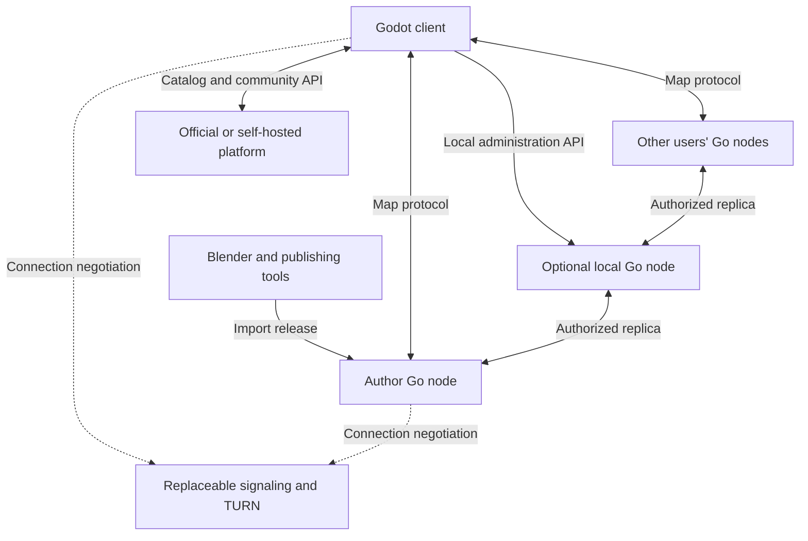
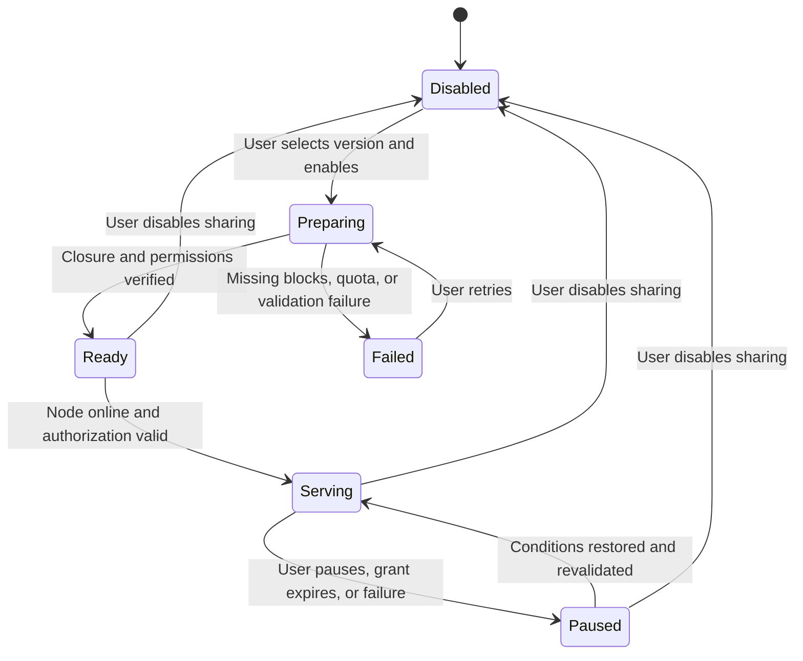

# Realm of Us — Code Architecture

**Design baseline:** 0.5 · **Date:** 2026-09-07 · **Status:** Pre-implementation architecture; application code has not been initialized  
**Project-owned code:** GPL-3.0-or-later · **Map protocol:** 0.1-draft, not frozen  
**Chinese edition:** [代码架构设计](Realm_of_Us_Architecture.zh-CN.md)  
**Product constraints and acceptance:** [Product and System Design](Realm_of_Us_Design.en.md)

This document specifies monorepo directories, code ownership, processes, interfaces, storage, and distribution. Paths, commands, fields, and interfaces are proposed, not implemented; repository names, package names, and store identifiers have not been registered by this design. The five core directories are `protocol`, `client`, `node`, `toolchain`, and `server`. Documentation and repository governance do not constitute a sixth business module.

## Contents

- [1. Architecture decisions and languages](#1-architecture-decisions-and-languages)
- [2. Repository directories and build units](#2-repository-directories-and-build-units)
- [3. Dependency direction and process boundaries](#3-dependency-direction-and-process-boundaries)
- [4. protocol: specifications and shared implementation](#4-protocol-specifications-and-shared-implementation)
- [5. client: sightseeing and node management](#5-client-sightseeing-and-node-management)
- [6. node: standalone map service](#6-node-standalone-map-service)
- [7. toolchain: authoring, map publication, and software builds](#7-toolchain-authoring-map-publication-and-software-builds)
- [8. server: official platform and connection services](#8-server-official-platform-and-connection-services)
- [9. Cross-module workflows](#9-cross-module-workflows)
- [10. Storage, keys, and write ownership](#10-storage-keys-and-write-ownership)
- [11. Multi-platform builds and distribution](#11-multi-platform-builds-and-distribution)
- [12. Dependencies and pinning](#12-dependencies-and-pinning)
- [13. Implementation order and validation ownership](#13-implementation-order-and-validation-ownership)
- [14. Previous layout mapping and documentation](#14-previous-layout-mapping-and-documentation)

## 1. Architecture decisions and languages

Use a monorepo so protocol changes and implementations can evolve in one change. Build, test, deploy, and release the client, map node, publishing tools, and official services separately. A repository is not a program, a program is not an operating-system service, and Steam does not require a separate client repository.

| Core directory | Main responsibility | Languages and outputs |
| --- | --- | --- |
| `protocol/` | Map formats, identities and grants, network/API contracts, shared validation | Markdown, JSON Schema, OpenAPI, shared Go packages, cross-language vectors |
| `client/` | Sightseeing, downloads, caching, runtime loading, optional node launch and Web-management entry | Godot with statically annotated GDScript; necessary thin C++ native adapters |
| `node/` | Hold and serve maps, validate access, maintain complete replicas, enforce quotas and local administration | Standalone Go service `rou-node` with embedded Web administration; `rou-nodectl` deferred |
| `toolchain/` | Blender authoring tools, map packaging/publication, software build and release orchestration | Blender Python; Go `rou-publish` and build tools |
| `server/` | Official or self-hosted catalog, community, media, downloads, and signaling organization | Go Web/API, workers, independent signaling; Supabase services; HTML/CSS and necessary JavaScript |

Use Blender's Python API and typed GDScript for Godot application logic. Use Go for project-owned network services and the publishing CLI; Supabase dependencies run their upstream stacks separately. Python is not a universal application language. Cryptographic and network interoperability depends on precise bytes and shared vectors, not on choosing the same language.

These decisions supersede the previous architecture: map nodes no longer use headless Godot; the platform no longer uses Django; clients connect directly to remote nodes without requiring a local node; all three desktop operating systems are formal targets; validate Android/iOS early and defer browser 3D. The product retains user-owned references, local creation, data-only maps, and free flight, without COLMAP, OpenMVS, or commercial map dependencies.

## 2. Repository directories and build units

Paths below are relative to the proposed `realmofus/` repository root. Create directories when implementation needs them; empty scaffolding is not progress.

| Path | Contents and boundary |
| --- | --- |
| `protocol/spec/` | Wire-level content, history, authorization, transport, and compatibility specifications |
| `protocol/schemas/` | Structural definitions for releases, authoring drafts, invitations, and messages |
| `protocol/api/` | Authoritative official HTTP API, local node administration API, and signaling contracts |
| `protocol/vectors/` | Positive/negative canonicalization, hash, signature, encryption, history, and limit vectors |
| `protocol/go/` | Shared Go types and validation without engine, database, or service dependencies |
| `client/app/` | The only Godot project, including `project.godot`, scenes, scripts, and export presets |
| `client/native/` | Native wrappers, pinned dependency sources, and platform build configuration |
| `client/distribution/` | Desktop, mobile, Steam, branding, and channel configuration |
| `client/tests/` | GDScript protocol, asset import, client behavior, and platform validation |
| `node/cmd/rou-node/`, `node/web/` | Map service entry and embedded administration pages; no separate MVP `rou-nodectl` |
| `node/internal/` | Authorization, transport, storage, replication, pins, quotas, administration, and composition |
| `node/distribution/`, `node/tests/` | Three-platform packaging/service configuration and node tests |
| `toolchain/blender/` | Blender add-on, export rules, and author-side validation |
| `toolchain/publisher/` | Go publishing CLI, reports, and optional official registration |
| `toolchain/build/` | Dependency preparation, protocol synchronization, native builds, packaging, and source archives |
| `toolchain/fixtures/`, `toolchain/tests/` | Small fixtures with explicit content rights and cross-component acceptance |
| `server/cmd/` | Entry points for `rou-server`, `rou-worker`, and `rou-signaling` |
| `server/internal/` | Modular business logic, persistence adapters, jobs, and signaling |
| `server/web/`, `server/migrations/` | Platform pages/Auth adapters; business tables, RLS, buckets, pgmq/Cron migrations |
| `server/deploy/`, `server/tests/` | Supabase/Go platform, media, signaling, coturn deployment and acceptance |

Supporting paths include `docs/zh-CN/`, `docs/en/`, `docs/adr/`, and hosted CI configuration. Root files include `README.md`, `README.zh-CN.md`, `LICENSE`, `LICENSES/`, `THIRD_PARTY_NOTICES.md`, `CONTRIBUTING.md`, `SECURITY.md`, `dependencies.lock`, `go.mod`, and `go.sum`. CI invokes locally runnable tools; build logic must not exist only in hosted workflow configuration.

Initially use one root `go.mod`, not a Go module per directory; `go.work` is unnecessary. Build entry points independently from their import graphs; sharing the module does not include platform code in node binaries. `node/internal/`, `server/internal/`, and `toolchain/publisher/internal/` isolate implementations. Promote shared protocol rules into `protocol/go/`, not an unbounded utility directory. Set the actual module path when the repository address is established. [Go Modules Reference](https://go.dev/ref/mod)

Version documentation, map protocol, official API, local administration API, and software releases separately. An initial release tag and component manifest may associate artifacts, but protocol changes still need compatibility declarations. Sharing a repository does not permit clients and nodes to assume matching commits.

## 3. Dependency direction and process boundaries

| Consumer | Permitted dependency or interaction | Coupling to prevent |
| --- | --- | --- |
| `protocol/` | Standard library, necessary canonicalization and cryptographic primitives | Godot, Blender, node databases, or official accounts |
| `client/` | Protocol contracts, Godot adapters, remote node/platform APIs | Linking Go node business logic; requiring a local node for visits |
| `node/` | Go protocol packages, network/storage adapters | Godot, Blender, or platform business databases |
| `toolchain/` | Protocol packages, controlled Blender invocation, node/platform APIs | Direct writes to a running node database or platform tables |
| `server/` | Protocol packages, platform storage, replaceable connection services | User projects, map-block directories, or publishing private keys |

All Go nodes run the same node implementation; data, permissions, and configuration determine their roles. Map content flows between clients and user nodes, through TURN when necessary. The official catalog does not receive 3D maps. Signaling and TURN are separate services, grouped in the diagram as connection infrastructure.

A desktop client can launch a bundled Go child process or manage an existing local node through the administration protocol. Mobile clients connect directly to remote nodes without embedding or launching a Go daemon. A self-hosted node runs independently of the desktop client.

## 4. protocol: specifications and shared implementation

| Path | Required definitions |
| --- | --- |
| `protocol/spec/content.md` | Object types, coordinates, asset profiles, roots, dependency closure, and hashes |
| `protocol/spec/history.md` | Place identity, signed heads, linear history, idempotence, conflicts, and updates |
| `protocol/spec/security.md` | Signature domains, grants, private envelopes, endpoint binding, key epochs, and revocation |
| `protocol/spec/transport.md` | WebRTC channels, handshakes, requests, fragmentation, backpressure, retries, and errors |
| `protocol/spec/compatibility.md` | Negotiation, required/optional capabilities, older versions, and migration |
| `protocol/api/catalog.openapi.yaml` | Official platform `/api/v1` contract |
| `protocol/api/node-admin.openapi.yaml` | Local node `/admin/v1` contract |
| `protocol/api/signaling.md` | Signaling messages, transient rooms, service credentials, limits, and timeouts |
| `protocol/go/` | Shared `content`, `history`, `grants`, `wire`, and `crypto` packages |

The specification is authoritative; Go and GDScript are independently validated implementations. JSON Schema cannot establish duplicate-key rejection, signatures, history, reachability, or numeric/resource limits. The cryptographic package in `protocol/go/` wraps byte handling and existing primitives; it owns neither key storage nor network connections and does not invent algorithms.

Preserve these semantics: `root_hash = SHA256(stored_root_manifest_bytes)`; `head_hash = SHA256(JCS(signed_head))`; parents reference `head_hash`; different heads at the same sequence conflict even if their roots match; `seq` is a bounded decimal string compared numerically; block hashes cover stored bytes, including private ciphertext envelopes. Roots do not include their own hashes. [RFC 8785](https://www.rfc-editor.org/rfc/rfc8785)

Go uses `crypto/sha256`, `crypto/ed25519`, and `golang.org/x/crypto/chacha20poly1305.NewX`; native Godot provisionally uses libsodium. Do not mix ordinary Ed25519 with prehashed/context variants. XChaCha20-Poly1305 keys, nonces, and tags are 32, 24, and 16 bytes; `NewX` is not ordinary ChaCha20-Poly1305 `New`. Cross-language vectors verify canonicalization, domain prefixes, AAD, envelopes, signatures, and rejection—not merely each implementation's own round trips. [Go Ed25519](https://pkg.go.dev/crypto/ed25519), [Go XChaCha20-Poly1305](https://pkg.go.dev/golang.org/x/crypto/chacha20poly1305)

`toolchain/build/` synchronizes required protocol versions, constants, and vectors into `client/app/generated/protocol/`, records provenance and checksums, and detects drift. Never edit generated content manually. GDScript implementations remain in the client. Blender emits a draft governed by a versioned schema; the Go CLI performs full release validation, avoiding a third Python network-protocol implementation initially.

## 5. client: sightseeing and node management

### 5.1 Godot project modules

| Path within `client/app/` | Responsibility |
| --- | --- |
| `bootstrap/` | Configuration, capabilities, composition, startup, and shutdown |
| `domain/` | Verified places, releases, assets, and access state without UI/network objects |
| `application/` | Open places, download complete copies, cancel, clear caches, and initiate sharing |
| `protocol/` | GDScript encoding/decoding, semantic validation, and crypto-adapter calls |
| `network/` | WebRTC, signaling, bounded messages, download scheduling, cancellation, and resumption |
| `storage/` | Client-owned object cache, index, pins, and crash recovery |
| `runtime/` | GLB preflight, complete-asset import, spatial tiles, LOD, and resource release |
| `viewer/` | Free flight, input, entrance jumps, cameras, and place transitions |
| `ui/` | Map library, invitations, catalog, loading, settings, and sharing state |
| `community/` | Replaceable catalogs, origin-bound Supabase Auth platform sessions, votes, and reports |
| `node_manager/` | Local discovery, child processes, API negotiation, cache handoff, Web-management entry; no full administration UI |
| `platform/` | Desktop/touch input, permissions, credential storage, suspension, and recovery |
| `addons/`, `generated/` | Manifest-prepared native plugins and generated protocol material |

Explicitly annotate public methods, properties, and collections where practical, and enable relevant untyped/unsafe-access warnings. UI code invokes application use cases rather than writing SQL or network frames. Annotations improve maintenance without making GDScript's type system equivalent to Go's. [Godot static typing](https://docs.godotengine.org/en/stable/tutorials/scripting/gdscript/static_typing.html)

### 5.2 Loading and content boundaries

The client opens local releases or remote Go nodes. Load a verified head, root, entrance preview, nearby tiles, and finer LODs; sightseeing begins once the entrance is usable. A GLB must be fully reassembled, decrypted, verified, and structurally preflighted before `GLTFDocument` import. Arbitrary network fragments cannot be rendered directly. [Godot runtime loading](https://docs.godotengine.org/en/stable/tutorials/io/runtime_file_loading_and_saving.html)

Maps contain restricted static GLB and permitted data only. Reject map-supplied scripts, `.pck`, `.tscn`, `.tres`, native libraries, custom shaders, external URIs, and unvalidated extensions. Bound geometry, image pixels, nesting, length, and processing time; preflight does not prove a parser vulnerability-free. GLB import may not be preemptible, so use small assets, queues, and measurements to control main-thread stalls.

Internal interfaces separate sources, caching, cryptography, catalogs, scheduling, map runtime, and local node management. Godot's high-level multiplayer RPC is not the cross-language map protocol. Both `control` and `assets` have application limits and backpressure.

### 5.3 Desktop and mobile adaptation

Windows, macOS, and Linux are all formal targets. Start physical Android/iOS probes for networking, cryptography, runtime import, and lifecycle in M0. Determine release order from results rather than assuming simultaneous launch on five platforms. Browser 3D is deferred.

`client/native/` owns thin cryptographic wrappers and dependency build configuration. Build WebRTC and SQLite plugins per platform/architecture before staging them into the Godot project. Set mobile budgets separately and test touch flight, memory pressure, heat, network changes, suspension/recovery, and verified-block resumption. Desktop frame targets do not establish phone support. [webrtc-native](https://github.com/godotengine/webrtc-native), [godot-sqlite](https://github.com/2shady4u/godot-sqlite)

## 6. node: standalone map service

### 6.1 Modules and operating modes

| Path within `node/internal/` | Responsibility |
| --- | --- |
| `app/`, `config/` | Lifecycle, configuration validation, composition, and health |
| `transport/` | Pion WebRTC, signaling, endpoint binding, fragments, and backpressure |
| `authorization/` | Visitor access, serving permission, expiry/revocation, and root reachability |
| `content/` | Release imports, dependency traversal, asset/object integrity |
| `storage/` | Content-addressed files, SQLite index, transactions, migrations, and recovery |
| `replication/` | Complete a selected version from authorized sources; retry, cancel, and report progress |
| `pins/`, `gc/` | Complete retention, references, and collection protection |
| `quotas/` | Disk, connections, upload/download bandwidth, and fair scheduling |
| `admin/` | Local-only administration API, pairing/sessions, Web pages, asynchronous operations |
| `presence/` | Optional catalog presence, TTL, backoff, and private defaults |
| `service/` | Child-process and operating-system service lifecycle adapters |

The same `rou-node` runs under a desktop client or independently, without loading Godot or rendering maps. Networking provisionally uses Pion's pure-Go WebRTC implementation; actual interoperability with native Godot still requires validation. [Pion WebRTC](https://github.com/pion/webrtc)

The initial remote data plane uses WebRTC DataChannels. HTTPS serving for publicly reachable nodes is a later optional adapter with equivalent identity, authorization, and integrity checks. HTTPS alone does not traverse residential NAT. Do not describe that future adapter as an existing fallback.

### 6.2 Client management and standalone operation

| Usage | Node lifecycle | Caching and serving |
| --- | --- | --- |
| Viewing only | No node starts | Client independently downloads, renders, and retains maps |
| Desktop sharing enabled | Client starts a bundled node or connects to an existing local one | Client hands off selected objects; user configures sharing in node Web UI; serve after full validation |
| Sharing after client exit | User explicitly enables independent background/system-service mode | Node survives client exit through managed operation, not an unmanaged orphan |
| NAS/server hosting | Administrator starts node independently and accesses local Web UI through SSH tunnel | Same administration UI, protocol, import flow, and authorization |
| Mobile viewing | No local node service initially | Offline cache; continuous map serving deferred |

By default, a node launched by the client stops with it; a control lease/watchdog handles controller loss or crashes in attached mode. Exiting a client connected to an existing standalone service must not stop that service. The handshake reports ownership and operating mode; an occupied port is insufficient evidence.

Bootstrap administration credentials through a restricted local file or inherited process channel, avoiding command lines and logs. Executable paths come only from the trusted installed component manifest; maps and invitations cannot select programs. An incompatible administration version disables node management while leaving sightseeing available.

### 6.3 Complete replica sharing

The MVP implements complete mirrors first. Partial-cache assistance, optimized multi-source scheduling, and keyless blind mirrors are later work. Saving offline and serving to others are separate actions; a retained version need not be shared.

These are local operation states, not global availability guarantees. Record sharing intent, pin completeness, grant validity, and connectivity separately. Disconnection does not delete a complete replica; pausing does not automatically unpin it. Deletion is a separate operation: stop serving, then release retention and collect eligible data.

A complete mirror binds a fixed `root_hash` and contains every reachable manifest and asset dependency, not linked destinations or author sources. The node needs permission to serve that version. Initial private mirrors are trusted devices that may hold content keys; each visitor still needs their own valid access permission. Public viewing does not imply redistribution rights; the client presents applicable content rights and required grants.

### 6.4 Local administration interface

Initially use authenticated loopback HTTP as the common interface across desktop systems. Unix sockets/Windows named pipes may follow. Loopback binding is not authentication: require a random administration token, reject unapproved browser origins and Host values, and bound request bodies, concurrency, and privileges. Administration, map-access, and official-account credentials are not interchangeable; same-origin browser sessions follow section 6.5.

| Method and `/admin/v1` path | Semantics |
| --- | --- |
| `GET /status` | API/node versions, mode, control lease, quotas, and operation summary |
| `POST /imports` | Create a bounded import operation using uploaded data or an explicitly allowed staging location |
| `GET /operations/{id}`, `POST /operations/{id}/cancel` | Progress, result, stable error codes, and cancellation |
| `PUT /pins/{root_hash}`, `DELETE /pins/{root_hash}` | Retain or unpin; reject direct unpinning of a served version |
| `PUT /shares/{scene_id}/{root_hash}`, `DELETE /shares/{scene_id}/{root_hash}` | Enable/update or stop serving; require completeness and serving permission |
| `PATCH /settings` | Allowlisted configuration such as quotas/bandwidth, never arbitrary commands |
| `POST /shutdown` | Only an attached controller with ownership or an explicitly authorized administrator |

Asynchronous operations return IDs with defined idempotency, retries, cancellation, limits, and conflicts. Imports accept data and never execute package scripts. Prevent paths, symlinks, and archives from escaping permitted roots. Never expose administration methods through the remote visitor data plane.

### 6.5 Unified local Web administration (proposed)

The MVP proposes an embedded `rou-node` Web UI as its only complete node-administration interface. Sources live in `node/web/`; built resources are embedded in the Go executable and served from its local administration listener, using same-origin `/admin/v1`. Pages/resources work offline without the official website, Supabase login, external CDNs, or a separate Node.js installation. This is conventional administration; browser 3D viewing remains deferred.

Godot retains only node launch/connection, opening the management page, a status summary, and selected-replica handoff. Disk/bandwidth settings, pins, imports, sharing, grants, and service settings live in the Web UI. Cache handoff still uses authenticated APIs: Godot temporarily retains selected objects; the node receives, completes, and validates them. The page cannot directly read client databases. Handoff does not enable sharing; failed/cancelled imports preserve existing client pins.

Do not implement a separate MVP `rou-nodectl`. `rou-node` retains necessary startup, configuration, and local-pairing entry points. Scripts automate the versioned API without writing databases. Add a thin CLI later if batch operations justify it, reusing authorization/storage/job logic. Headless NAS operators can start the service and access its loopback UI through an SSH tunnel; do not expose LAN/public administration ports by default.

Programmatic controllers retain local administration tokens. Browsers obtain a short-lived, one-use pairing code through local Godot or an explicit terminal pairing operation, then exchange it at the same origin for a separate revocable HttpOnly/SameSite session. Bound lifetime and attempts; unauthenticated HTTP cannot issue pairing codes. Ordinary logs omit codes; long-lived tokens never appear in URLs, clipboard contents, or browser localStorage. This creates no second account/password system.

Web writes verify session, CSRF, and exact Origin/Host, denying cross-origin CORS by default. GET never changes sharing/settings. Bind sessions to node instance and privileges; specify pairing, logout, rotation, and multi-instance/port isolation in the API and negative tests. Serve only trusted embedded resources; imported maps cannot inject administration scripts. Closing a browser ends the page, not the node's operating mode. Godot exit still follows section 6.2 for attached nodes; an open browser does not convert one into a persistent service.

## 7. toolchain: authoring, map publication, and software builds

| Path | Responsibility |
| --- | --- |
| `toolchain/blender/` | `blender_manifest.toml`, Python entry points, UI, and operators |
| `toolchain/blender/authoring/` | Object IDs, units, tiles, entrances, provenance, and optional modeling aids |
| `toolchain/blender/export/` | One coordinate conversion, static materials, LOD, GLB, and drafts |
| `toolchain/blender/validation/` | Missing dependencies, dimensions, texture/geometry budgets, and quality reports |
| `toolchain/publisher/cmd/rou-publish/` | Publishing CLI entry point |
| `toolchain/publisher/internal/` | Draft validation, packaging, encryption/signing, reports, node import, optional registration |
| `toolchain/build/` | Software dependency pinning, protocol synchronization, native builds, releases, and corresponding-source archives |
| `toolchain/fixtures/` | Home, small-landmark, and street-fragment examples with separate content rights |

Distinguish map packaging from software packaging: `toolchain/publisher/` produces user map releases; `toolchain/build/` produces application installers and source archives. Client platform configuration belongs in `client/distribution/`, node service configuration in `node/distribution/`, and official deployment configuration in `server/deploy/`. Shared orchestration consumes rather than duplicates those configurations.

Authors export a Blender draft, validate/encrypt/sign with the CLI, create an immutable release, import through the node API, and share invitations or explicitly register. The Blender add-on holds no publishing private key, and serving a replica needs no publishing private key. Optional batch authoring runs only a trusted local Blender executable and explicitly selected author scripts, never remote map code.

| Proposed command | Result and boundary |
| --- | --- |
| `rou-publish validate` | Validate drafts/budgets and emit human/machine-readable reports |
| `rou-publish build` | Create a release, associated signed head, and provenance/build report |
| `rou-publish inspect` | Inspect an existing package without changing the current version |
| `rou-publish import` | Submit a built release to the node through its local API |
| `rou-publish register` | Explicitly submit metadata, references, and selected screenshots, never map blocks |
| `rou-node` local launch/pairing entry | Process startup, configuration location, browser pairing; embedded Web UI handles MVP administration, full `rou-nodectl` deferred |

Published content is immutable. Registration failure cannot damage local releases; import failure cannot replace a complete served version. Record input hashes, tool versions, parameters, and seeds; do not claim unverified Blender re-exports are byte-reproducible.

## 8. server: official platform and connection services

### 8.1 Supabase reuse and Go business layer

The platform provisionally adopts Supabase as its base backend, retaining Go for project-specific business APIs, pages, image workers, and connection services. Supabase is a set of separately deployed dependencies whose configuration/adapters belong to `server/`; do not copy its sources into a sixth business module. Reuse community infrastructure first; map publication, private grants, and node administration remain independent of Supabase.

| Capability | Planned adoption | Project-owned rules |
| --- | --- | --- |
| Auth | Default registration, login, password recovery, sessions, optional OAuth/MFA | Application roles, account restrictions, publisher-key binding; login grants no map authority |
| PostgreSQL | Platform tables, transactions, constraints, migrations; pgx for Go | Visibility, signed history, conflicts, vote state, moderation |
| Storage | Default screenshot quarantine and processed media; optional software release attachments | Upload quotas, version binding, bounded decoding/publication; no 3D maps or author references |
| Data API / RLS | Reuse permitted data access and row policies; business tables unexposed by default | `/api/v1` remains the project contract; Go handles protected writes such as signed registration |
| Queues / pgmq | Default screenshot and other background jobs | Bounded retries, idempotence, failure archival, crash recovery |
| Cron / pg_cron | Schedule expiry cleanup, count reconciliation, job checks | Workers execute heavy tasks; project defines scope and retention |
| Realtime | Reuse platform events such as media progress and moderation notifications when needed | Private channel authorization, authoritative refresh after reconnect; signaling separately validated |
| Studio | Trusted operations access to database, storage, and services | Product moderation pages/audit remain in the platform; no ordinary user access to Studio |
| Edge Functions | Optional lightweight webhooks/integration where deployment needs them | No duplicate Go signature/business implementation; not a required runtime entry point |

This plan uses current documented capabilities; pin and validate exact components, extensions, and self-hosted combinations. [Supabase architecture](https://supabase.com/docs/guides/getting-started/architecture), [Queues](https://supabase.com/docs/guides/queues), [Cron](https://supabase.com/docs/guides/cron)

`rou-server` remains a modular Go Web/API service with server-rendered pages and necessary Auth/Realtime JavaScript adapters; `rou-worker` runs separately. Do not build another password database, recovery protocol, generic queue engine, or scheduling engine. Business code wraps their use and enforces project rules.

### 8.2 Business models and project API

| Module within `server/internal/` | Responsibility |
| --- | --- |
| `accounts/` | Supabase Auth adapter, application profiles/roles, session validation, publisher binding |
| `registry/` | Places, release references, visibility, tags, queries, and export |
| `media/` | Screenshot quarantine, validation, re-encoding, thumbnails, and storage interface |
| `reactions/` | Vote state, transactional counts, and reconciliation |
| `moderation/` | Reports, delisting, hidden images, account restrictions, and audit |
| `releases/` | Client/tool downloads, platforms, source, dependencies, and checksums |
| `jobs/` | pgmq consumption, job idempotence, retries/archival, failure records |
| `connection_access/` | Short-lived official signaling/TURN credentials and quotas |
| `signaling/` | Rooms, SDP/ICE forwarding, limits, expiration, and cleanup |
| `infrastructure/` | Supabase Auth/Storage/Realtime, database, and observability adapters |

| Entity | Required constraints |
| --- | --- |
| `Account`, `PublisherBinding` | `Account` holds application profile/status linked by trusted Auth `(issuer, sub)`, without another password store; one-use challenges bind platform origin, account, public key, nonce, and expiry |
| `Place` | Separate platform ID and `scene_id`; unique local place identity |
| `SceneRelease`, `ReleaseConflict` | Complete signed heads, root/head hashes, and history references; retain conflicts; no complete map manifests |
| `ProviderPresence` | Node claim, version, connection hints, expiry; self-report is not proof of completeness or continuous uptime |
| `Screenshot` | Place and `root_hash` binding, random storage key, processing state, dimensions |
| `Reaction` | One state per account/place; `+1/-1/0` is a state, not an increment |
| `Report`, `ModerationAction` | Target, reason, state, operator, and time |
| `ClientRelease` | Source commit, component/platform versions, downloads, hashes, and corresponding source |

The project API remains authoritative in `protocol/api/catalog.openapi.yaml`, under `/api/v1`. Adapters consume Supabase Auth/Storage/Realtime interfaces separately; do not rename or duplicate all upstream interfaces into project OpenAPI. Bound pagination; errors contain stable `code` and request ID without stacks or secrets.

| Method and path | Permissions and semantics |
| --- | --- |
| `GET /places`, `GET /places/{id}` | Anonymous public reads; unlisted excluded from lists; withdrawn not publicly displayed |
| `POST /publisher-challenges`, `POST /publisher-bindings` | Logged-in request/completion of one-use key-binding challenges |
| `POST /places`, `PATCH /places/{id}` | Author registration/metadata edits; descriptions cannot bypass signed fields |
| `POST /places/{id}/releases` | Author permission and signature both required; same-head idempotence and explicit conflicts |
| `POST /places/{id}/screenshots` | Author-selected uploads with limits, quarantine, and version binding |
| `PUT /places/{id}/reaction` | Logged-in transactional `+1/-1/0` assignment; retries do not accumulate votes |
| `POST /reports` | Logged in, rate limited, explicit target |
| `POST /provider-presence` | Prove node control; finite lifetime; validate serving permission where required |
| `POST /connection-credentials` | Resource-policy credentials, not map read authority |
| `GET /client-releases` | Anonymous distribution/corresponding-source records |

Only an account controlling and binding the relevant publishing key receives author privileges. Initial registration may accept a valid fixed snapshot; automatic advancement requires missing-history validation. Registration does not fetch arbitrary user URLs or download maps for health checks, preventing it from becoming 3D hosting or arbitrary network access.

Screenshots accept bounded PNG/JPEG only. Write to a private quarantine bucket first; workers inspect format/pixels, decode under resource limits, re-encode, strip EXIF, generate thumbnails, and publish newly generated objects to the processed bucket. Raw uploads are not served directly. Jobs are idempotent, with bounded timeout/failure cleanup. Votes use unique constraints and serialized transactions; counts can be rebuilt from state.

### 8.3 Platform login, authorization, and database access

The website reuses Supabase Auth. The Go boundary retains protected server-side sessions; browsers use HttpOnly, Secure, appropriately SameSite session cookies, with CSRF protection for writes. Godot and the publishing CLI provisionally reuse Auth access/refresh token lifecycles for platform login. Probe system-browser login, PKCE, origin pinning, and platform callbacks; JavaScript SDK availability is not evidence of GDScript integration. Store refresh credentials in system credential storage, keep separate sessions per configured platform, and never send platform tokens to map nodes. Auth sessions replace 0.4's default manually created custom device tokens. Scoped machine credentials for unattended registration require separate design, never administrator keys. [Auth architecture](https://supabase.com/docs/guides/auth/architecture), [PKCE](https://supabase.com/docs/guides/auth/sessions/pkce-flow)

Go verifies the trusted instance's JWT signature, allowlisted algorithm, issuer, audience, expiry, and subject. Use the configured instance's JWKS for asymmetric keys and handle rotation. A valid JWT does not establish an unrevoked session: writes also check application account state, sensitive administration verifies current sessions, and ordinary tokens have an explicit remaining-validity window. Account recovery restores community access, not publishing private keys. [JWT keys](https://supabase.com/docs/guides/auth/signing-keys), [Session-validation boundaries](https://supabase.com/docs/guides/auth/server-side/advanced-guide)

Keep business tables in a schema unexposed to Data API. `anon`/`authenticated` cannot directly change release heads, key bindings, moderation records, or aggregates by default. Any public read projection or self-profile interface explicitly defines table/view/function grants, RLS, fields, and pagination without bypassing withdrawn/unlisted semantics. User-editable metadata cannot establish administrator roles. [Data API security](https://supabase.com/docs/guides/api/securing-your-api)

Direct pgx connections do not automatically acquire the visitor's JWT-derived RLS context. Use least-privilege database roles and explicit ownership/business authorization. If a path relies on user-context RLS, establish that context transactionally after identity validation and prevent connection-pool leakage between requests. Separate migration, ordinary business, image-worker, and Auth-administration roles. Secret/service-role keys can bypass relevant RLS: never put them in Godot, browsers, releases, or local nodes, and never use them instead of business authorization. [RLS](https://supabase.com/docs/guides/database/postgres/row-level-security), [Storage access control](https://supabase.com/docs/guides/storage/security/access-control)

Private invitations never pass through public redirects or unknown catalogs; place links cannot specify arbitrary commands. Catalog visibility, map grants, and content-reuse rights remain separate. Email verification/recovery uses configured Auth/SMTP; instances without mail explicitly disable mail-dependent self-service flows.

### 8.4 Media, jobs, and real-time events

Use separate private quarantine and processed-media buckets. The project API validates author permission, quota, and pinned version before upload. Initially stream uploads through the server; any later direct upload uses bounded-duration authorization to a specific new object location, without permission to overwrite validated objects. Workers read fixed inputs, enforce byte/pixel and decoding limits, strip EXIF, re-encode, and publish under new object keys. Private output uses authorized reads or short-lived signed URLs; public teaser screenshots are explicitly public submissions. Database-row and Storage-object deletion are separate, retryable operations. [Storage buckets](https://supabase.com/docs/guides/storage/buckets/fundamentals)

Commit job state and enqueueing in one PostgreSQL transaction where possible, using SQL interfaces of the pinned pgmq version. Recover external Storage operations through explicit states and reconciliation. Acknowledge only after persisting results; visibility timeout permits redelivery, so duplicate processing cannot republish screenshots or increment counts again. Delivery guarantees within a visibility window are not exactly-once business side effects. Cron triggers bounded cleanup/compensation. Queue payloads contain task IDs/object references, never image bytes or secrets; browser consumers have no initial queue access. [pgmq interfaces](https://supabase.com/docs/guides/queues/pgmq)

Realtime events prompt UI refresh; business tables remain authoritative. User progress and moderation channels are private and authorized per user/resource. Re-query after reconnection and measure permission/token-expiry propagation without promising immediate revocation for already joined channels. Events carry only task IDs and necessary state, never private invitations or content keys. [Realtime authorization](https://supabase.com/docs/guides/realtime/authorization)

### 8.5 Authentication and storage across modules

| Module/entry | Identity and authority | Storage | Supabase dependency |
| --- | --- | --- | --- |
| `protocol/` | Defines signatures/grants and pure validation | Specifications/vectors, no runtime database or keystore | None |
| `client/` local/friend visits | Publisher signatures, node endpoint identity, map credentials, local credential protection | Independent blocks, SQLite index, pins; system credential storage | None; only community features log into platform |
| `node/` data plane | Node identity, visitor read grants, mirror serving grants, pinned-release reachability | Local blocks, SQLite, import jobs, quotas | None |
| Local node administration | Local pairing, distinct administration tokens/browser sessions, control authority | Node configuration/local sessions; no community account system | None |
| Blender / publishing CLI | Local author authorization; CLI holds publishing key and signs releases | `.blend`, drafts, immutable releases; separately protected publishing keys | No local-flow dependency; optional registration uses Auth |
| `toolchain/build/` | Developer/CI permissions, software signing and channel credentials | Dependency caches, artifacts, source archives, CI secret storage | None; optional release attachments may use platform Storage |
| `server/` community/jobs | Auth users plus project authorization; scoped worker identities | Supabase PostgreSQL, Storage, Queues; separate platform backups | Default base backend |
| Signaling / TURN | Replaceable instance's short-lived service credentials and quotas | Transient connection state, bounded logs; no persistent maps | Minimal self-hosted connection services need none |

Share protocol validation and mature cryptographic/storage libraries. A shared need for authentication/storage does not merge local administration, map grants, community login, and software signing into one account or cloud database. Permission to upload map data does not grant platform administrator authority.

### 8.6 Signaling, deployment, and replaceability

M0/M2 retain independent Go WebSocket signaling and coturn, allowing friend-access probes without deploying the platform. Supabase Realtime Broadcast is a later candidate for official signaling reuse. Before adoption, validate Godot/Go protocol adapters, service credentials without community accounts, private-room isolation, short-lived state retention, quotas, expiry disconnection, and actual DTLS binding. Until then retain the existing signaling contract; Auth anonymous-user records are not absence of an account dependency. TURN remains coturn; Realtime does not relay maps. [Broadcast](https://supabase.com/docs/guides/realtime/broadcast)

Independent signaling validates trusted issuer, target instance, permissions, and expiry on service tokens, with offline signature verification and no platform business-table access. Self-hosted instances configure their own trust sources. Service credentials authorize connection resources, never map reads or publication.

| Deployment unit | Implementation and boundary |
| --- | --- |
| HTTPS entry | Caddy and required Supabase gateway own defined routes; bounded requests/uploads |
| `rou-server` | Go pages/business API; configured Supabase origins and database roles |
| `rou-worker` | pgmq consumption and necessary buckets; resource-limited, no Auth administration |
| Supabase | Pinned Auth, PostgreSQL, Storage, gateway, required extensions; Realtime enabled by use case |
| Studio | Operations-only access; neither product moderation nor node administration |
| `rou-signaling` / coturn | Independently installable; separate signaling/relay credentials, no anonymous relay |

The platform supports managed Supabase or validated self-hosting. First validate Linux with Docker Engine/Compose for the self-hosted baseline. Three-OS Go builds do not imply native full-platform Windows/macOS support. Self-hosted map nodes require neither Supabase nor commercial desktop container tools. Document exact Auth/SMTP, rotation, Storage backend, pgmq/pg_cron, gateway, Realtime, and dependency-license combinations, without assuming managed/self-hosted feature parity. [Self-hosting](https://supabase.com/docs/guides/self-hosting), [Docker deployment](https://supabase.com/docs/guides/self-hosting/docker)

`server/deploy/supabase/` contains non-secret deployment configuration. `server/migrations/` is authoritative for project tables, RLS, bucket policies, queues, and Cron configuration; upstream services maintain their internal Auth/Storage schemas. `toolchain/build/` invokes pinned local tools to validate migrations and releases. Supabase CLI development environments are not production deployments.

Back up databases, actual Storage objects, Auth/service configuration, and recovery keys; independently validate restoration, object reconciliation, and queue replay. Database backups exclude actual Storage files, so restoring tables alone cannot establish screenshot recovery. Platform backups contain no user-node maps. Keep project APIs and map protocols independent of Supabase SDKs/project IDs. A different platform origin requires fresh login/binding; migrating Auth identities and refresh credentials requires explicit validation rather than a promise of seamless session migration. [Database backup scope](https://supabase.com/docs/guides/database/overview)

## 9. Cross-module workflows

| Workflow | Order and failure handling |
| --- | --- |
| Local publication | `toolchain` exports/signs → `node` validates/imports → `client` opens; failed imports preserve the previous complete version |
| Remote visit | `client` obtains trusted reference → signaling → node endpoint authentication → authorization → verified download → local rendering |
| Desktop mirroring | Client hands off selected cache → Web UI selects version/quotas → node completes and validates dependencies → user enables sharing |
| Official registration | Local release → publisher binding → metadata/signed head → selected screenshot processing; no map upload |

Remote authentication binds both challenges, identities, the fixed version, and DTLS fingerprints actually used by the negotiated connection, not arbitrary signaling text. M0 verifies that Pion and the selected Godot plugin expose/check the required information, including malicious signaling substitution. Do not enable private access or omit binding merely to meet a schedule before this passes.

Initial transport budgets remain those of the product design: target 256 KiB stored blocks; a WebRTC message no larger than 16 KiB or the negotiated limit; four unfinished blocks per source, up to four sources; an initial 256 KiB send-queue target per connection. Headers/encryption count toward relevant limits; observe both application and underlying buffers. These are unmeasured project budgets, not automatic library guarantees.

The MVP needs no global DHT. Invitations and replaceable catalogs supply bounded provider hints. Complete mirrors can serve the same version after the author goes offline. If no source is reachable and local blocks are missing, report failure without promising eventual retrieval.

## 10. Storage, keys, and write ownership

| Data root | Sole writer and rules |
| --- | --- |
| Author `references/`, `scripts/`, `source/` | Author/Blender; private sources never enter the software repository or official platform |
| `draft/` | Blender exporter; Go CLI reads the draft contract |
| `releases/<root_hash>/` | Immutable after CLI publication; associated signed heads stored separately |
| Client cache and index | Godot viewer; cached objects, settings, bookmarks, and offline pins |
| Node `blocks/`, `index.sqlite`, `staging/` | One Go node owns the write lock and manages serving, pins, GC, and jobs |
| Credential area | Role-separated publishing/node keys, content keys, and platform session credentials |
| Official data root | Supabase database, Storage, jobs, audit, backups; no map mounts |

Client and local node storage are separate by default and never share a writable database. Objects used for import/forwarding retain their original stored bytes. Decrypted GLB is a derived cache; re-encoded or re-encrypted results cannot impersonate the same hashed object. Sharing records bind both place and root; identical root bytes do not merge permissions across places. Initially accept duplicate objects: the client temporarily retains selected cached objects for sharing, submits data through the local API, and lets the node validate, complete, and commit. Release temporary transfer retention only after node acknowledgement; failure/cancellation never deletes existing offline pins. Physical reuse of immutable blocks is future work requiring platform filesystem and GC ownership rules, not two processes jointly managing one pool.

Temporary writes, hashes, atomic renames, and index transactions establish recovery boundaries. File renames and database commits are not one cross-resource transaction; startup recovery must identify orphan objects, incomplete imports, and pending records. GC protects complete pins, active reads, and imports. Disk pressure must not evict explicitly retained copies to pretend an import succeeded.

Every new encryption uses a fresh random nonce, with AAD binding role/position under the frozen specification. Existing ciphertext can be reused within a key epoch; reusing old ciphertext after rotation cannot imply revoked access. Mirror content keys are not publishing private keys. Expiry or stopped service cannot recall delivered plaintext, and offline replicas receive revocation with delay.

Runtime maps belong in writable user directories, not `res://` or Steam installation directories. Design client/node configuration, index migrations, and key backups separately. Diagnostics are local and redacted by default, without centralized home identifiers or access secrets. [Godot data paths](https://docs.godotengine.org/en/stable/tutorials/io/data_paths.html)

## 11. Multi-platform builds and distribution

### 11.1 Build graph and support matrix

`toolchain/build/` follows dependencies: prepare pinned dependencies/protocol material; independently build Go entry points with embedded node Web resources, Blender add-on, and native extensions; stage/export Godot; assemble installers and corresponding source; validate; upload through channel jobs. Protocol changes trigger all consumers, while UI-only changes trigger affected client checks and required release gates.

| Target | Initial responsibility |
| --- | --- |
| Windows | Client, Go node, and publishing CLI; installation/removal, service control, paths, signing workflow |
| macOS | Client, Go node, and publishing CLI; Apple Silicon/Intel strategy, launchd, signing/notarization |
| Linux | Client, Go node, and publishing CLI; minimum system dependencies, permissions, systemd, packages |
| Android | M0 device probes, then sightseeing/touch/offline refinement; build native extensions too |
| iOS | M0 device probes; macOS/Xcode, signing, device builds; no embedded always-on node |
| Browser 3D viewing | Outside the client build/acceptance matrix; ordinary platform pages and node Web administration have separate acceptance |

Prefer no-cgo dependencies for Go nodes and CLIs. Produce and validate a binary per OS/CPU, not one universal executable. SQLite drivers and service adapters must satisfy the matrix too. Godot native extensions still require platform toolchains; Go's convenience does not remove native client build work. [cgo cross-compilation](https://pkg.go.dev/cmd/cgo)

Godot uses export presets and command-line builds; iOS export requires macOS and Xcode. Record versions, templates, plugin commits, compilers, platform options, and checksums in `dependencies.lock` and release manifests. Separate target SDKs, signing services, and store tools from open-source core dependencies; do not claim the entire iOS build chain is open source. [Godot export](https://docs.godotengine.org/en/stable/tutorials/export/exporting_projects.html), [Godot iOS export](https://docs.godotengine.org/en/stable/tutorials/export/exporting_for_ios.html)

### 11.2 Client and node packages

| Artifact | Contents |
| --- | --- |
| Desktop client | Godot runtime, application resources, native extensions; optionally a Go node from the compatible component matrix |
| Standalone node | Go map service with embedded Web administration, configuration, API automation guidance, optional service installation material |
| Author tools | Blender add-on, publishing CLI, authoring/build instructions; unnecessary for ordinary visitors |
| Mobile client | Godot app, platform native extensions, sightseeing resources; no desktop node service |
| Official services | Go Web/API, worker, signaling, pinned Supabase deployment configuration; database/Storage managed separately |
| Corresponding source | Matching commit, project code, necessary dependencies/patches, build material, and licenses |

One client codebase serves direct downloads, Steam, and mobile platforms, without permanent channel forks. Steam updates the app and bundled components; node networking supplies user maps into independent caches. Steam builds do not overwrite their application files at runtime. Standalone nodes update through their installation mechanism; clients must not silently replace existing services. Check component/API compatibility and provide migration recovery; rolling back an executable does not necessarily reverse database migrations.

Public repositories contain build scripts and non-secret configuration. Signing certificates, store credentials, and release keys belong only in controlled release environments. Uploads consume validated artifacts rather than rebuilding from a floating branch. Every package records components, source commits, protocol/API compatibility, dependencies, and checksums.

### 11.3 GPL and Steam

All project-owned software uses `GPL-3.0-or-later`, including protocol implementations, client, node, tools, and official services. GPL permits commercial use; excluding commercial maps is a data policy, not a noncommercial restriction. Ordinary GPL does not become AGPL through network operation. Dependencies retain their licenses; maps/photos/fixtures have independent rights, and the documentation's distinct license is specified when initializing the repository.

Distribute matching corresponding source and necessary build/installation material with binaries, preserving dependency notices and licenses rather than pointing only to a changing default branch. Choose a provision method compliant with the applicable GPL terms. [GPL v3 text](https://spdx.org/licenses/GPL-3.0-or-later.html)

Default builds do not integrate the Steamworks runtime SDK; SteamPipe tools are for distribution. Steam organizes application builds, depots, and testing branches without requiring separate Git repositories. Keep Steam configuration in `client/distribution/steam/`, without SDKs, credentials, or invented registered App IDs. [Steam uploading](https://partner.steamgames.com/doc/sdk/uploading)

Directories, separate processes, dynamic loading, and repository splits do not automatically resolve GPL/Steamworks compatibility. Any future SDK feature requires a specific authorization decision covering actual code and dependencies; no linking exception exists today. Assess iOS App Store and other channels against actual packages and distribution terms too; successful compilation does not establish store approval. [Valve open-source distribution guidance](https://partner.steamgames.com/doc/sdk/uploading/distributing_opensource)

## 12. Dependencies and pinning

These are proposed direct dependencies, with map-path versions pinned after M0 integration and Supabase combinations validated/pinned before M3—not an exhaustive transitive inventory. Include compilers, templates, image codecs, local patches, and target architectures in the build manifest.

| Component | Purpose and license reference |
| --- | --- |
| Blender | Authoring; [GPL](https://github.com/blender/blender/blob/main/COPYING) |
| Godot | Client engine; [MIT](https://godotengine.org/license/) |
| Go / x/crypto | Services, CLI, primitives; [Go License](https://go.dev/LICENSE), [x/crypto](https://pkg.go.dev/golang.org/x/crypto) |
| Pion WebRTC | Go node networking; [MIT](https://github.com/pion/webrtc) |
| webrtc-native / libdatachannel | Godot networking; [MIT plugin](https://github.com/godotengine/webrtc-native), [MPL-2.0 underlying library](https://github.com/paullouisageneau/libdatachannel) |
| libsodium | Godot crypto adapter; [ISC](https://github.com/jedisct1/libsodium/blob/master/LICENSE) |
| godot-sqlite / SQLite | Client index; [MIT plugin](https://github.com/2shady4u/godot-sqlite), [SQLite public-domain explanation](https://www.sqlite.org/copyright.html) |
| modernc.org/sqlite | Candidate no-cgo Go node index driver; [BSD-3-Clause and platform documentation](https://pkg.go.dev/modernc.org/sqlite) |
| PostgreSQL / pgx | Platform database and Go driver; [database license](https://www.postgresql.org/about/licence/), [pgx MIT](https://github.com/jackc/pgx) |
| Supabase components / pgmq / pg_cron | Platform backend; pin source/version/license per component, without applying umbrella licensing to dependencies; [components](https://supabase.com/docs/guides/getting-started/architecture), [pgmq](https://github.com/pgmq/pgmq), [pg_cron](https://github.com/citusdata/pg_cron) |
| coder/websocket | Candidate Go signaling WebSocket library; [MIT](https://github.com/coder/websocket) |
| Caddy / coturn | HTTPS entry and relay; [Apache-2.0](https://github.com/caddyserver/caddy/blob/master/LICENSE), [coturn license](https://github.com/coturn/coturn/blob/master/LICENSE) |

Django, Gunicorn, PyNaCl, and Python websockets are no longer required for core services. Prefer bounded Go standard-library PNG/JPEG processing, validating actual resource isolation for the worker deployment. Check MPL combination conditions and transitive licenses; a top-level MIT plugin does not relicense its underlying libraries. [Mozilla MPL FAQ](https://www.mozilla.org/en-US/MPL/2.0/FAQ/)

## 13. Implementation order and validation ownership

| Stage | Code deliverables | Exit condition |
| --- | --- | --- |
| M0 Technical probes | Minimal `protocol`, Go node, Godot prototype, original small scene, build probes | Nodes build/run on three desktop OSes; report five-platform private-map client probes, endpoint binding, and import measurements |
| M1 Local loop | Blender add-on, publishing CLI, offline client viewing/flight/LOD | Publish and visit a local project without official accounts |
| M2 Distributed sightseeing | Network authorization, resumption, node management, complete mirrors, quotas | Mirror serves after author exit; administration isolation, negative authorization, and recovery checks pass |
| M3 Official entry | Supabase Auth/PostgreSQL/Storage/Queues/Cron, Go business API/worker, platform notifications | No map uploads; Auth integration, RLS/business grants, job retries, database/object recovery pass A08/A13 |
| M4 Distribution | Three desktop packages, corresponding source, optional Steam flow; mobile release guided by evidence | Runs on a new machine without editors; compatibility, updates, and channel material complete |
| M5 Later capabilities | Partial-cache assistance, tour rooms, following, browser 3D, and separate extensions | Not described as implemented and does not block established boundaries |

M0 mobile probes are not simultaneous store-launch commitments. Demonstrate a minimal private map's signatures, decryption, import, flight, and interrupted-transfer recovery on each target before freezing compatibility combinations and mobile budgets. Screenshots and empty directories are not substitutes for evidence.

| Validation location | Acceptance focus |
| --- | --- |
| `protocol/vectors/` | Shared Go/GDScript A03/A04/A07, especially cross-implementation signatures and ciphertext |
| `client/tests/`, `node/tests/` | A11/A12; rendering/input, grants, Web pairing/CSRF/origin isolation, cache handoff, recovery, quotas, process exit |
| `server/tests/` | A08/A13; Auth, RLS/grants, binding replay, conflicts, concurrent votes, Storage isolation, pgmq idempotence |
| `toolchain/tests/integration/` | A01/A02; actual Blender → CLI → node → client loop |
| `toolchain/tests/network/` | A05/A06; direct, forced TURN, network handover, mirror takeover, corrupt blocks |
| `toolchain/tests/security/` | A04; signaling substitution, out-of-scope reads, local administration attacks, malicious GLB/ZIP, credential origins |
| `toolchain/tests/performance/` | A09; fixed scenes/routes/networks/devices and per-platform entrance/frame/memory reports |
| `toolchain/tests/distribution/` | A10; editor-free startup, updates, corresponding source, replaceable services |
| `server/deploy/`, `node/distribution/` | Backup recovery, credential rotation, service lifecycle; the official platform does not back up maps |

Test actual boundaries and risks. Path filters must not skip protocol consumers or required distribution gates. Retain product-design desktop budgets; measure mobile before freezing its budgets. Numbers remain unmeasured and no fixed schedule is promised. This document revision checks consistency only, not software acceptance.

## 14. Previous layout mapping and documentation

| Previous path or organization | New owner |
| --- | --- |
| Viewer code in `godot_app/` | `client/app/` |
| Godot node mode | Reimplemented as the Go service in `node/`, not a mechanical translation of rendering code |
| `blender_addon/`, `publisher_cli/` | `toolchain/blender/`, `toolchain/publisher/` |
| `native_crypto/` | `client/native/` |
| `platform/`, `signaling/` | `server/`; platform and signaling remain separate processes |
| Top-level `distribution/`, `deploy/`, `tools/`, `tests/` | Component-owned configuration; shared orchestration and cross-component acceptance in `toolchain/` |
| `web_bridge/` | Deferred; future browser adapters inside `client/` |
| Shared Python protocol package | `protocol/go/` and client GDScript implementations, sharing specifications and vectors |

This is a design mapping, not an actual code migration. Upon repository initialization, place the four documents in `docs/zh-CN/design.md`, `docs/zh-CN/architecture.md`, `docs/en/design.md`, and `docs/en/architecture.md`, updating links. Wire specifications and authoritative APIs stay in `protocol/`.

Add ADR-012 for Supabase reuse and identity/storage boundaries, ADR-013 for proposed embedded node Web administration with deferred CLI, and A13; update A12 for Web pairing/cache handoff. IDs match the product design. Update both languages for protocol, permission, field, and acceptance changes. This revision updates planning only, without initializing programs or distributing software.
