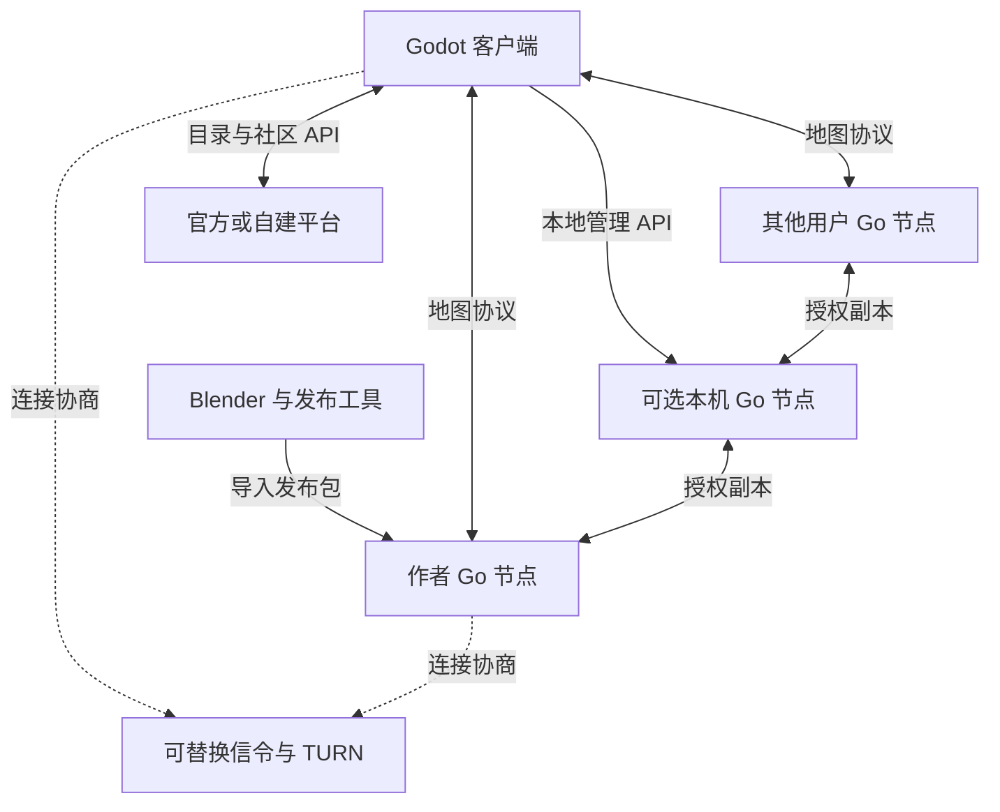
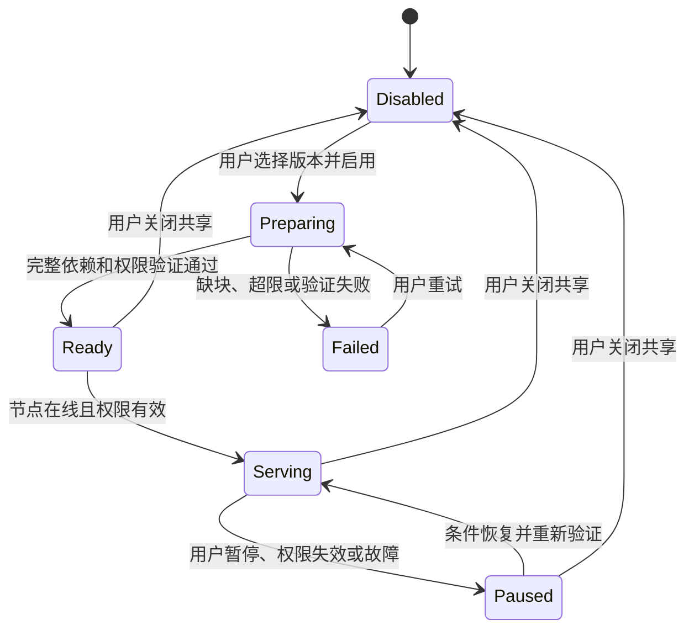

# Realm of Us（共境）— 代码架构设计

**设计基线：** 0.5 · **日期：** 2026-09-07 · **状态：** 实施前架构，尚未初始化业务代码  
**自有代码许可证：** GPL-3.0-or-later · **地图协议：** 0.1-draft，尚未冻结  
**对应英文版：** [Code Architecture](Realm_of_Us_Architecture.en.md)  
**产品约束与验收依据：** [产品与系统设计](Realm_of_Us_Design.zh-CN.md)

本文规定单仓库的目录、代码责任、进程、接口、存储与发行边界。所有路径、命令、字段和接口均为拟议设计，不表示已实现，也不表示已注册仓库、包名或商店标识。核心目录固定为 `protocol`、`client`、`node`、`toolchain`、`server`；辅助文档和仓库治理文件不构成第六个业务模块。

## 阅读导航

- [1. 架构决定与实现语言](#1-架构决定与实现语言)
- [2. 仓库目录与构建单元](#2-仓库目录与构建单元)
- [3. 依赖方向与进程边界](#3-依赖方向与进程边界)
- [4. protocol：规范与公共实现](#4-protocol规范与公共实现)
- [5. client：观光与节点管理入口](#5-client观光与节点管理入口)
- [6. node：独立地图服务](#6-node独立地图服务)
- [7. toolchain：创作、地图发布与软件构建](#7-toolchain创作地图发布与软件构建)
- [8. server：官方平台与连接服务](#8-server官方平台与连接服务)
- [9. 关键跨模块流程](#9-关键跨模块流程)
- [10. 存储、密钥与写入责任](#10-存储密钥与写入责任)
- [11. 多平台构建与渠道发行](#11-多平台构建与渠道发行)
- [12. 依赖选择与锁定](#12-依赖选择与锁定)
- [13. 实施顺序与验证责任](#13-实施顺序与验证责任)
- [14. 旧结构迁移与文档维护](#14-旧结构迁移与文档维护)

## 1. 架构决定与实现语言

采用 monorepo，允许协议和多端实现通过同一个变更提交协同演进；客户端、地图节点、发布工具和官方服务分别构建、测试、部署与发布。仓库不等于程序，程序不等于操作系统服务，Steam 也不要求独立客户端仓库。

| 核心目录 | 主要责任 | 语言与产物 |
| --- | --- | --- |
| `protocol/` | 地图格式、身份与授权、网络和 API 契约、公共验证规则 | Markdown、JSON Schema、OpenAPI、Go 公共包、跨语言向量 |
| `client/` | 观光、下载、缓存、运行时加载、可选节点启动与 Web 管理入口 | Godot + 带静态类型标注的 GDScript；必要的 C++ 原生薄适配 |
| `node/` | 持有和提供地图、授权校验、完整副本、配额与本地管理 | Go 独立服务 `rou-node`，内置 Web 管理；`rou-nodectl` 后置 |
| `toolchain/` | Blender 作者工具、地图打包发布、项目构建与发行编排 | Blender Python；Go `rou-publish` 与构建工具 |
| `server/` | 官方或自建目录、社区、媒体、发行入口、信令组织 | Go Web/API、worker、独立信令；Supabase 基础服务；HTML/CSS/必要 JavaScript |

Blender 使用其 Python API；Godot 业务使用带类型标注的 GDScript。项目自有网络服务与发布 CLI 使用 Go；Supabase 依赖按上游技术栈独立部署，不把 Python 作为全项目通用业务语言。密码和网络协议互操作取决于字节规则及共同测试向量，不能由“使用同一种语言”替代。

以下决定覆盖旧版架构：地图节点不再使用 Godot headless 模式；官方平台不再采用 Django；客户端无需本地节点即可直接连接远程节点；桌面三平台均为正式目标；Android/iOS 提前验证，浏览器三维端后置。产品仍以用户自有资料、本地创作、数据型地图与自由飞行为核心，不引入 COLMAP、OpenMVS 或商业地图依赖。

## 2. 仓库目录与构建单元

以下路径相对拟议仓库根目录 `realmofus/`。只按实施阶段创建需要的目录，不以空骨架数量衡量进度。

| 路径 | 内容与边界 |
| --- | --- |
| `protocol/spec/` | 字节级地图、版本历史、授权、传输及兼容规范 |
| `protocol/schemas/` | 发布包、作者草稿、邀请及消息的结构定义 |
| `protocol/api/` | 官方 HTTP API、本地节点管理 API、信令契约的唯一源文件 |
| `protocol/vectors/` | 正向/负向规范化、哈希、签名、加密、历史、限额向量 |
| `protocol/go/` | 无引擎、数据库或服务依赖的 Go 公共类型和验证实现 |
| `client/app/` | 唯一 Godot 工程；包含 `project.godot`、场景、脚本及导出预设 |
| `client/native/` | 原生扩展封装、固定依赖来源和平台构建配置 |
| `client/distribution/` | 桌面、移动、Steam、品牌与发行渠道配置 |
| `client/tests/` | GDScript 协议、资产导入、客户端行为和平台验证 |
| `node/cmd/rou-node/`、`node/web/` | 地图服务入口与内嵌管理页；MVP 不创建独立 `rou-nodectl` |
| `node/internal/` | 授权、传输、存储、复制、Pin、配额、管理和运行时装配 |
| `node/distribution/`、`node/tests/` | 三平台打包/服务配置及节点测试 |
| `toolchain/blender/` | Blender 插件、导出规则及作者侧检查 |
| `toolchain/publisher/` | Go 发布 CLI、构建报告与可选官方登记 |
| `toolchain/build/` | 依赖准备、协议同步、原生构建、组件打包与源码归档编排 |
| `toolchain/fixtures/`、`toolchain/tests/` | 有明确内容许可的小型样例及跨组件验收 |
| `server/cmd/` | `rou-server`、`rou-worker`、`rou-signaling` 三个入口 |
| `server/internal/` | 模块化业务、持久化适配、任务与信令实现 |
| `server/web/`、`server/migrations/` | 平台网页与 Auth 适配；业务表、RLS、bucket、pgmq/Cron 迁移 |
| `server/deploy/`、`server/tests/` | Supabase/Go 平台、媒体、信令、coturn 的部署与验收 |

辅助路径包括 `docs/zh-CN/`、`docs/en/`、`docs/adr/` 和托管 CI 配置；根文件包括 `README.md`、`README.zh-CN.md`、`LICENSE`、`LICENSES/`、`THIRD_PARTY_NOTICES.md`、`CONTRIBUTING.md`、`SECURITY.md`、`dependencies.lock`、`go.mod`、`go.sum`。CI 仅调用可本地执行的工具，不把构建逻辑只藏在托管平台配置中。

初期 Go 代码使用根目录的一个 `go.mod`，不为每个目录创建独立 Go module，也暂不需要 `go.work`。各入口按依赖图独立构建，官方服务代码不因此进入节点二进制。`node/internal/`、`server/internal/`、`toolchain/publisher/internal/` 隔离各自实现；跨模块公共规则只向 `protocol/go/` 提升，不建立无边界的公共工具目录。实际 module 路径在仓库地址确定后填写。[Go Modules Reference](https://go.dev/ref/mod)

文档、地图协议、官方 API、本地管理 API、软件发行版本分别管理。初期可用一个发布标签和组件清单关联各产物；协议变更仍需兼容声明。同仓库不允许客户端和节点默认只兼容同一提交。

## 3. 依赖方向与进程边界

| 使用方 | 允许的依赖或交互 | 禁止形成的耦合 |
| --- | --- | --- |
| `protocol/` | 标准库、必要的规范化及密码原语 | 依赖 Godot、Blender、节点数据库或官方账号 |
| `client/` | 协议契约、Godot 适配；远程节点/官方服务的网络 API | 链接 Go 节点业务；把本地节点作为观光前提 |
| `node/` | Go 协议包、网络和存储适配 | 依赖 Godot、Blender 或官方业务数据库 |
| `toolchain/` | 协议包；受控 Blender 调用；节点和官方 API | 直接写运行节点数据库或服务端表 |
| `server/` | 协议包、平台存储、可替换连接服务 | 读取用户工程、地图块目录或发布私钥 |

图中所有 Go 节点运行同一套节点代码，角色由数据、授权和配置决定。地图流量在客户端与用户节点之间传输，必要时经过 TURN；官方目录不接收三维地图。信令和 TURN 是不同服务，图中合并表示连接基础设施。

桌面客户端可以启动打包附带的 Go 子进程，也可以连接已有本地节点；二者通过管理协议交互。移动客户端直接连接远程节点，不要求嵌入或启动 Go 守护程序。用户自建节点可独立运行，与桌面客户端是否开启无关。

## 4. protocol：规范与公共实现

| 路径 | 必须定义的内容 |
| --- | --- |
| `protocol/spec/content.md` | 对象类型、坐标、资产配置、根清单、依赖闭包与哈希 |
| `protocol/spec/history.md` | 地点身份、签名头、线性历史、幂等、冲突与更新 |
| `protocol/spec/security.md` | 签名域、授权、私密信封、端点绑定、密钥周期与撤销 |
| `protocol/spec/transport.md` | WebRTC 通道、握手、请求、分片、背压、重试和错误 |
| `protocol/spec/compatibility.md` | 版本协商、必需/可选能力、旧版本行为及迁移 |
| `protocol/api/catalog.openapi.yaml` | 官方平台 `/api/v1` 契约 |
| `protocol/api/node-admin.openapi.yaml` | 本地节点 `/admin/v1` 契约 |
| `protocol/api/signaling.md` | 信令消息、短期房间、服务凭据、限额与超时 |
| `protocol/go/` | `content`、`history`、`grants`、`wire`、`crypto` 公共包 |

规范是唯一依据；Go 和 GDScript 是分别验证的实现。JSON Schema 不足以验证重复键、签名、历史、依赖可达性、数值和资源限额。`protocol/go/` 的密码包封装字节处理和现有原语，不持有密钥库、不实现网络连接、不自研算法。

必须保留的语义包括：`root_hash = SHA256(stored_root_manifest_bytes)`；`head_hash = SHA256(JCS(signed_head))`；父引用指向 `head_hash`；同序号不同头是冲突，即使根相同；`seq` 为有界十进制字符串并按数值比较；块哈希覆盖实际存储字节，私密时覆盖密文信封。根清单不包含自身哈希。[RFC 8785](https://www.rfc-editor.org/rfc/rfc8785)

Go 使用 `crypto/sha256`、`crypto/ed25519` 和 `golang.org/x/crypto/chacha20poly1305.NewX`；Godot 原生端拟使用 libsodium。普通 Ed25519 不与其预哈希/上下文变体混用；XChaCha20-Poly1305 的密钥、nonce、标签分别为 32、24、16 字节，`NewX` 不等同于普通 ChaCha20-Poly1305 的 `New`。跨语言向量验证规范化、域前缀、AAD、信封、签名与错误拒绝，不能只测试各端自己加密再解密。[Go Ed25519](https://pkg.go.dev/crypto/ed25519)、[Go XChaCha20-Poly1305](https://pkg.go.dev/golang.org/x/crypto/chacha20poly1305)

`toolchain/build/` 将所需规范版本、常量和向量同步至 `client/app/generated/protocol/`，记录来源及校验值并检查漂移；不得手改生成内容。Godot 的 GDScript 实现保留在客户端内。Blender 只产出受版本化 schema 约束的草稿，完整发布验证由 Go CLI 完成，初期不再维护第三套 Python 网络协议实现。

## 5. client：观光与节点管理入口

### 5.1 Godot 工程模块

| `client/app/` 内路径 | 职责 |
| --- | --- |
| `bootstrap/` | 配置、平台能力、依赖装配、启动和退出 |
| `domain/` | 已验证地点、版本、资产与访问状态，不持有界面/网络对象 |
| `application/` | 打开地点、完整下载、取消、清理缓存、发起共享等用例 |
| `protocol/` | GDScript 编解码、语义验证及密码适配调用 |
| `network/` | WebRTC、信令、受限消息、下载调度、取消和续传 |
| `storage/` | 客户端自己的对象缓存、索引、Pin 与崩溃恢复 |
| `runtime/` | GLB 预检查、完整资产导入、空间分区、LOD、资源释放 |
| `viewer/` | 自由飞行、输入、入口跳转、相机和地点切换 |
| `ui/` | 地图库、邀请、目录、加载状态、设置与共享状态 |
| `community/` | 可替换目录、来源绑定的 Supabase Auth 平台会话、赞踩及举报 API |
| `node_manager/` | 本地节点发现、子进程管理、API 协商、缓存移交及打开 Web 管理；不做完整管理页 |
| `platform/` | 桌面/触控输入、权限、凭据存储、应用挂起和恢复 |
| `addons/`、`generated/` | 按清单准备的原生插件及生成协议资料 |

GDScript 对公共方法、属性、集合尽量显式标注类型，启用相关未标注/不安全访问告警。界面调用应用用例，不直接写数据库或发底层网络帧。类型标注改善维护性，不把 GDScript 描述为 Go 等价的静态类型系统。[Godot 静态类型](https://docs.godotengine.org/en/stable/tutorials/scripting/gdscript/static_typing.html)

### 5.2 加载与内容边界

客户端可以从本地发布包或远程 Go 节点打开地点。下载顺序为已验证版本头、根、入口预览、周边分区、细节 LOD；入口可用后即可观光。一个 GLB 必须完整重组、解密、校验并进行结构预检查，才交给 `GLTFDocument`；不能把任意网络片段直接交给渲染器。[Godot 运行时加载](https://docs.godotengine.org/en/stable/tutorials/io/runtime_file_loading_and_saving.html)

地图只包含受限静态 GLB 和允许的数据。拒绝用户地图中的脚本、`.pck`、`.tscn`、`.tres`、原生库、自定义着色器、外部 URI 及未验证扩展。限制几何、图片像素、层级、总长度及解析时间；预检查不能证明解析器没有漏洞。GLB 导入可能不可抢占，必须通过小资产、队列和实测控制主线程停顿。

内部接口按职责划分为内容来源、缓存、密码、目录、下载调度、地图运行时和本地节点连接；不使用 Godot 高层多人 RPC 作为跨语言地图协议。协议的 `control` 与 `assets` 通道均有应用层限额和背压。

### 5.3 桌面与移动适配

Windows、macOS、Linux 都是正式支持目标。Android/iOS 在 M0 即进行实体设备的网络、密码、运行时导入和生命周期探针；发布顺序在结果出来后确定，不默认为五个平台同步上架。浏览器三维端暂不实现。

`client/native/` 保存密码薄封装和依赖构建配置；WebRTC 与 SQLite 插件按目标平台/架构构建后放入 Godot 工程。移动端预算独立设置，测试触控飞行、内存压力、发热、网络切换、挂起后的恢复和已验证块续传；不以桌面帧率目标推定手机可用。[webrtc-native](https://github.com/godotengine/webrtc-native)、[godot-sqlite](https://github.com/2shady4u/godot-sqlite)

## 6. node：独立地图服务

### 6.1 模块与运行模式

| `node/internal/` 内路径 | 职责 |
| --- | --- |
| `app/`、`config/` | 生命周期、配置验证、依赖装配、健康状态 |
| `transport/` | Pion WebRTC、信令接入、端点绑定、分片和背压 |
| `authorization/` | 访客访问、节点提供权限、到期/撤销及根可达性检查 |
| `content/` | 版本导入、依赖遍历、资产/对象完整性验证 |
| `storage/` | 内容寻址文件、SQLite 索引、事务、迁移和恢复 |
| `replication/` | 从授权来源补全指定版本；重试、取消和进度 |
| `pins/`、`gc/` | 完整保留、引用及回收保护 |
| `quotas/` | 磁盘、连接数、上传/下载带宽和公平调度 |
| `admin/` | 仅本地的管理 API、配对/会话、Web 页面及异步任务 |
| `presence/` | 可选目录在线声明；TTL、退避和私密默认 |
| `service/` | 子进程与操作系统服务的生命周期适配 |

同一 `rou-node` 既能由桌面客户端启动，也能独立部署；不加载 Godot、不渲染地图。节点网络拟使用 Pion 的纯 Go WebRTC 实现，仍须与 Godot 原生端完成实际互通验证。[Pion WebRTC](https://github.com/pion/webrtc)

初期远程数据面采用 WebRTC DataChannel。公网可达节点的 HTTPS 数据面作为后续可选适配，必须保留等价的身份、授权和完整性检查；HTTPS 本身不解决家庭 NAT 穿透。不要将后续接口写成已经具备的备用链路。

### 6.2 客户端管理与独立运行

| 使用方式 | 节点生命周期 | 缓存和共享 |
| --- | --- | --- |
| 只观光 | 不启动节点 | 客户端独立下载、渲染和保留地图 |
| 桌面开启共享 | 客户端启动附带节点，或连接本机现有节点 | 客户端移交所选副本；用户在节点 Web 页完成共享配置，完整验证后提供 |
| 退出后继续共享 | 用户显式启用独立后台/系统服务模式 | 客户端退出不影响节点；不能靠未管理的孤儿进程维持 |
| NAS/服务器提供 | 管理者独立启动节点，经 SSH 隧道访问本机 Web 页 | 使用同一管理页、协议、导入流程和权限模型 |
| 移动端观光 | 初期不启动本地节点服务 | 保留离线缓存；持续提供地图后置 |

默认情况下，客户端自己启动的节点随客户端结束；断连或崩溃通过控制租约/看护机制停止附属模式。连接到已有独立服务时，客户端退出不得停止它。二者在握手时明确报告所有权和运行模式，不能仅凭端口存在推断。

首次启动传递管理凭据使用受限本地文件或继承的进程通道，避免放入命令行或日志。启动程序路径只能来自已安装且可信的组件清单，地图和邀请不能指定可执行文件。版本不兼容时仅禁用节点管理功能，观光仍可继续。

### 6.3 完整副本共享

MVP 先实现完整副本镜像，部分缓存协助下载、多来源调度优化和无密钥盲镜像后置。客户端“保存离线”和“对外共享”是两个动作；同一个版本可以只离线保存而不提供。

这些状态是节点本地任务状态，不是全网在线保证。共享开关、Pin 完整性、权限有效性和当前连接状态分别记录；断网不删除已完成副本，暂停也不自动解除 Pin。删除副本另行执行，先停止提供再解除保留和回收。

完整镜像绑定固定 `root_hash`，包含清单和资产的全部可达依赖，不包含链接到的其他地点或作者源工程。节点需要获准提供该版本；私密镜像初期是可持有内容密钥的可信设备，每次服务仍验证访客自己的权限。公开可访问不等于拥有再分发权，客户端展示内容许可及必要授权。

### 6.4 本地管理接口

默认使用回环地址上的认证 HTTP，作为三平台统一的初期接口；Unix socket/Windows named pipe 可后续适配。只监听回环并不足以认证，必须要求随机管理令牌，拒绝未经允许的浏览器来源及 Host，限制请求体、并发和调用权限。管理令牌与地图访问、官方账号凭据互不通用；同源管理页的浏览器会话遵循第 6.5 节。

| 方法与 `/admin/v1` 路径 | 语义 |
| --- | --- |
| `GET /status` | 协议/节点版本、运行模式、控制租约、配额和任务摘要 |
| `POST /imports` | 创建限额导入任务；上传数据或使用预先允许的暂存位置 |
| `GET /operations/{id}`、`POST /operations/{id}/cancel` | 进度、结果、稳定错误码及取消 |
| `PUT /pins/{root_hash}`、`DELETE /pins/{root_hash}` | 保留或解除保留；共享中的版本不得直接解除 |
| `PUT /shares/{scene_id}/{root_hash}`、`DELETE /shares/{scene_id}/{root_hash}` | 启用/调整或停止提供；启用前检查完整性与提供权限 |
| `PATCH /settings` | 受限配置项，如配额与带宽；不接受任意命令 |
| `POST /shutdown` | 仅允许拥有控制权限的附属进程会话，或明确授权的管理者 |

异步操作返回操作 ID，明确幂等键、重试、取消、超限和冲突语义。导入只接收数据，不执行包内脚本；禁止通过路径、符号链接或压缩包越过允许的数据根。远程访客数据面绝不暴露这些管理方法。

### 6.5 统一的本地 Web 管理入口（拟采用）

MVP 拟采用 `rou-node` 内置 Web 页作为唯一完整节点管理界面。页面源码位于 `node/web/`，构建后随 Go 可执行文件嵌入，从本机管理监听器提供，同源调用 `/admin/v1`。页面与资源可离线运行，不依赖官网、Supabase 登录、外部 CDN 或另外安装 Node.js。这里是普通管理网页，浏览器三维观光仍后置。

Godot 仅保留启动/连接节点、打开管理页、节点摘要和“移交此副本”等必要入口。磁盘/带宽配置、Pin、导入任务、共享、授权状态和服务设置统一在 Web 页操作。缓存移交仍经认证 API：Godot 临时保留所选对象，节点接收、补全并验证；Web 页不能直接读取客户端数据库。移交完成不自动开启共享，导入失败或取消不删除客户端原有 Pin。

MVP 不单独实现 `rou-nodectl`。`rou-node` 自身保留必要的启动、配置和本地配对入口；脚本通过版本化管理 API 自动化，不能直接写数据库。后续确有批量运维需要时，可基于同一 API 增加薄 CLI，不复制权限、存储和任务逻辑。NAS/无桌面设备启动服务后，可通过 SSH 隧道访问其回环管理页；不默认开放局域网或公网管理端口。

程序控制端继续使用本地管理令牌；浏览器通过本机 Godot 或明确的终端配对操作取得短期一次性配对码，再向同源端点交换独立、可撤销的 HttpOnly/SameSite 会话。配对码限时、单次使用且严格限尝试，不从未认证 HTTP 端点发放。普通日志不记录配对码，长期令牌不放入 URL、剪贴板或浏览器 localStorage。该机制不建立第二套账号/密码系统。

Web 写操作同时校验会话、CSRF 和精确 Origin/Host，默认拒绝跨源 CORS；GET 不修改共享或配置。会话按节点实例和权限绑定；配对、注销、令牌轮换及多实例端口隔离需写入管理 API 契约和负面测试。页面只接受可信内嵌资源，导入的地图不能向管理页注入脚本。退出浏览器只结束页面，不改变节点运行模式；Godot 退出仍按第 6.2 节处理附属节点，浏览器打开不使其变成常驻服务。

## 7. toolchain：创作、地图发布与软件构建

| 路径 | 职责 |
| --- | --- |
| `toolchain/blender/` | `blender_manifest.toml`、Python 插件入口、界面和操作器 |
| `toolchain/blender/authoring/` | 对象 ID、单位、分区、入口、来源与可选建模辅助 |
| `toolchain/blender/export/` | 一次坐标转换、静态材质、LOD、GLB 与草稿 |
| `toolchain/blender/validation/` | 缺失依赖、尺寸、纹理/几何预算和质量报告 |
| `toolchain/publisher/cmd/rou-publish/` | 发布 CLI 入口 |
| `toolchain/publisher/internal/` | 草稿验证、打包、加密签名、报告、节点导入和可选登记适配 |
| `toolchain/build/` | 软件依赖锁定、协议同步、原生构建、组件发行与对应源码归档 |
| `toolchain/fixtures/` | 住宅、小景点和街区片段样例及独立内容许可 |

必须区分两种“打包”：`toolchain/publisher/` 生成用户地图发布包；`toolchain/build/` 生成项目软件安装包和源码包。客户端平台配置归 `client/distribution/`，节点服务配置归 `node/distribution/`，官方部署配置归 `server/deploy/`；共享构建编排不复制这些配置。

作者流程为 Blender 导出草稿、CLI 验证/加密/签名、生成不可变发布包、调用节点管理 API 导入、分享邀请或显式登记。Blender 插件不持有发布私钥；节点提供副本也不需要发布私钥。可选批处理只运行本机受信 Blender 和作者明确选择的脚本，不执行远程地图代码。

| 拟议命令 | 结果与边界 |
| --- | --- |
| `rou-publish validate` | 验证草稿和预算，输出可读及机器报告 |
| `rou-publish build` | 创建发布包、关联签名头和来源/构建报告 |
| `rou-publish inspect` | 检查已有包；不更改当前版本 |
| `rou-publish import` | 将已构建发布包通过本地 API 交给节点 |
| `rou-publish register` | 显式提交介绍、版本引用和选择的截图；不传地图块 |
| `rou-node` 本地启动/配对入口 | 提供进程启动、配置定位和浏览器配对；MVP 管理由内置 Web 页完成，完整 `rou-nodectl` 后置 |

已发布内容不可覆盖。登记失败不破坏本地发布包；导入失败不替换正在提供的完整版本。构建报告记录输入哈希、工具版本、参数和随机种子，不把未经验证的 Blender 重导出宣称为逐字节可复现。

## 8. server：官方平台与连接服务

### 8.1 Supabase 优先复用与 Go 业务层

平台拟采用 Supabase 作为基础后端，Go 保留项目特有的业务 API、网页、图片 worker 和连接服务。Supabase 是一组独立部署的依赖，配置与适配归 `server/`；无需把其源码复制成第六个业务模块。社区基础能力优先复用；地图发布、私密授权和节点管理不依赖 Supabase。

| 能力 | 规划采用方式 | 项目仍负责的规则 |
| --- | --- | --- |
| Auth | 默认复用注册、登录、密码恢复、会话及可选 OAuth/MFA | 应用角色、账号限制、发布公钥绑定；登录不授予地图权限 |
| PostgreSQL | 平台业务表、事务、约束与迁移；Go 使用 pgx | 地点可见性、签名历史、冲突、评价状态和审核 |
| Storage | 默认保存截图原稿隔离区及处理后媒体；可承载软件发行附件 | 上传配额、版本绑定、受限解码与发布；不存三维地图或作者资料 |
| Data API / RLS | 复用允许暴露的数据访问及数据库行权限；初期业务表默认不直接暴露 | `/api/v1` 是项目契约；签名登记等受保护写操作由 Go API 执行 |
| Queues / pgmq | 默认用于截图处理与其他后台任务 | 有界重试、任务幂等、失败归档及崩溃恢复 |
| Cron / pg_cron | 定时触发过期清理、统计校准与任务检查 | 重任务交给 worker，任务清理范围与保留期由项目定义 |
| Realtime | 按需复用媒体处理进度、审核通知等平台事件 | 私有频道权限、重连后重新查询真实状态；信令适配另验证 |
| Studio | 仅供可信运维管理数据库、存储和服务 | 产品审核页面与审核审计仍由平台提供，不向普通用户开放 Studio |
| Edge Functions | 仅在部署确有需要时承接轻量 webhook/服务胶水 | 不重复实现 Go 的签名验证与核心业务，不作为必需运行入口 |

以上按当前工具能力规划，具体组件、扩展和自托管组合须锁定验证。[Supabase 架构](https://supabase.com/docs/guides/getting-started/architecture)、[Queues](https://supabase.com/docs/guides/queues)、[Cron](https://supabase.com/docs/guides/cron)

`rou-server` 仍是模块化 Go Web/API 服务，网页采用服务端模板与必要的 Auth/Realtime JavaScript 适配；`rou-worker` 独立运行。不再自建密码数据库、邮件找回协议、通用队列引擎或定时调度引擎；业务代码只封装其使用和项目规则。

### 8.2 业务模型与项目 API

| `server/internal/` 内模块 | 责任 |
| --- | --- |
| `accounts/` | Supabase Auth 适配、应用资料/角色、会话验证和发布公钥绑定 |
| `registry/` | 地点、版本引用、可见性、标签、查询及导出 |
| `media/` | 截图隔离、验证、重编码、缩略图和存储接口 |
| `reactions/` | 赞踩状态、事务计数及重算 |
| `moderation/` | 举报、下架、图片隐藏、账号限制与审计 |
| `releases/` | 客户端/工具下载、平台、源码、依赖和哈希清单 |
| `jobs/` | pgmq 消费、任务幂等、重试/归档和失败记录 |
| `connection_access/` | 官方信令/TURN 的短期服务凭据与配额 |
| `signaling/` | 房间、SDP/ICE 转发、限额、到期和清理 |
| `infrastructure/` | Supabase Auth/Storage/Realtime、数据库和观测适配 |

| 实体 | 必须保持的约束 |
| --- | --- |
| `Account`、`PublisherBinding` | `Account` 保存应用资料和状态，以受信 Auth 实例的 `(issuer, sub)` 关联用户，不另存密码；绑定挑战涵盖本站来源、账号、公钥、随机数和到期时间，一次性使用 |
| `Place` | 本站 ID 与 `scene_id` 分离；本站地点身份唯一 |
| `SceneRelease`、`ReleaseConflict` | 保存完整签名头、根/头哈希与历史引用；保留冲突，不存完整地图清单 |
| `ProviderPresence` | 节点声明、版本、连接提示和到期时间；自报不等于完整性或全天在线证明 |
| `Screenshot` | 绑定地点和 `root_hash`；随机存储键、处理状态与尺寸 |
| `Reaction` | 每账号/地点唯一；`+1/-1/0` 为状态，不是增量 |
| `Report`、`ModerationAction` | 目标、原因、处理状态、执行人和时间 |
| `ClientRelease` | 源码提交、组件/平台版本、下载地址、哈希及对应源码 |

项目 API 的唯一规范仍为 `protocol/api/catalog.openapi.yaml`，统一前缀 `/api/v1`。Supabase Auth/Storage/Realtime 的依赖接口另由适配层消费，不将其所有接口重命名或复制到项目 OpenAPI。列表分页有上限，错误包含稳定 `code` 和请求 ID，不泄漏堆栈或秘密。

| 方法与路径 | 权限和语义 |
| --- | --- |
| `GET /places`、`GET /places/{id}` | 公开匿名读取；未列出不进入列表；撤下不公开显示 |
| `POST /publisher-challenges`、`POST /publisher-bindings` | 登录后取得并完成一次性密钥绑定挑战 |
| `POST /places`、`PATCH /places/{id}` | 作者登记/修改元数据；不能用介绍修改绕过签名字段 |
| `POST /places/{id}/releases` | 作者权限与签名均通过；同头幂等、冲突显式保留 |
| `POST /places/{id}/screenshots` | 作者选择上传；限额、隔离处理和版本绑定 |
| `PUT /places/{id}/reaction` | 登录；事务设置 `+1/-1/0`，重复请求不累加 |
| `POST /reports` | 登录、限流、明确目标 |
| `POST /provider-presence` | 节点证明控制权；声明有限期；必要时验证提供授权 |
| `POST /connection-credentials` | 按服务资源政策签发凭据，不授予地图读取权 |
| `GET /client-releases` | 匿名取得发行与对应源码记录 |

只有控制相应发布密钥并完成绑定的账号能领取作者权限。首次登记可接受合法固定快照；自动推进默认版本必须验证缺失历史。平台不为了登记而抓取任意用户 URL，不执行健康检查式地图下载，避免把登记接口变成三维托管或任意网络访问接口。

截图只接受有限额 PNG/JPEG：先写入私有隔离 bucket，worker 检查格式/像素并在受限资源下解码、重编码、去 EXIF、生成缩略图，完成后将新生成的对象发布到处理后 bucket，原始上传不直接对外服务。任务必须幂等；超时/失败清理有界。赞踩更新使用唯一约束及事务串行化，统计可从状态重算。

### 8.3 平台登录、权限与数据库访问

网站复用 Supabase Auth，Go 接入层持有受保护的服务端会话，浏览器使用 HttpOnly、Secure 和适当 SameSite 的会话 cookie，写操作有 CSRF 保护。Godot 与发布 CLI 的平台登录拟复用 Auth 的 access/refresh token 生命周期；系统浏览器登录、PKCE、来源固定和平台回调需做集成探针，不能把 JavaScript SDK 可用当成 GDScript 已适配。刷新凭据放在系统凭据区；每个配置的平台独立管理会话，不向地图节点发送平台 token。0.4 中手工创建自定义设备令牌的默认方案由 Auth 会话替代；无人值守登记所需的受限机器凭据另行设计，不发放管理员 key。[Auth 架构](https://supabase.com/docs/guides/auth/architecture)、[PKCE](https://supabase.com/docs/guides/auth/sessions/pkce-flow)

Go 校验受信实例的 JWT 签名、固定算法、issuer、audience、有效期与主体，非对称签名通过该实例配置的 JWKS 验证并处理轮换。有效 JWT 不证明会话未被撤销；写操作还检查应用账号状态，对敏感管理动作验证当前会话，明确普通 token 的残余有效期。账号恢复只恢复社区账号，不恢复发布私钥。[JWT 密钥](https://supabase.com/docs/guides/auth/signing-keys)、[会话验证边界](https://supabase.com/docs/guides/auth/server-side/advanced-guide)

业务表放在不暴露给 Data API 的 schema；`anon`/`authenticated` 默认无权直接修改版本头、密钥绑定、审核记录或统计。若启用公开读取投影或本人资料接口，明确表/视图/函数的 grants、RLS、字段和分页范围，确保不会绕过撤下和未列出语义。用户可编辑资料不得决定管理员身份。[Data API 安全](https://supabase.com/docs/guides/api/securing-your-api)

Go 通过 pgx 直连时不会自动获得访问者 JWT 对应的 RLS 上下文；它使用最小权限数据库角色，并显式执行所有权与业务授权。若某条路径依赖用户态 RLS，必须在验证身份后按事务设置上下文，避免连接池跨请求泄漏。迁移角色、普通业务角色、图片 worker 与 Auth 管理适配分离。secret/service-role key 可绕过相应 RLS，不能放到 Godot、浏览器、发布包或本地节点，也不能用它代替业务授权。[RLS](https://supabase.com/docs/guides/database/postgres/row-level-security)、[Storage 访问控制](https://supabase.com/docs/guides/storage/security/access-control)

私密邀请不能经过公共跳转页或未知目录，地点链接不能指定任意命令。目录可见性、地图访问授权与内容再利用许可分别管理。平台邮件验证/找回使用部署者配置的 Auth/SMTP；未配置邮件的实例明确关闭依赖邮件的自助流程。

### 8.4 媒体、任务和实时事件

截图采用独立的私有隔离 bucket 与处理后 bucket。上传先由项目 API 检查作者权限、配额和绑定版本；初期由服务端流式接收，后续直传只能使用限期且限定新对象位置的授权，不能让用户覆盖已验收的对象。worker 读取固定输入，检查字节/像素上限并受限解码，去 EXIF、重编码，再以新对象键发布。私有输出使用经授权的读取或短期签名 URL；公共预告截图是用户明确公开的信息。删除数据库记录与 Storage 对象分别处理，清理必须可重试。[Storage buckets](https://supabase.com/docs/guides/storage/buckets/fundamentals)

任务状态与入队尽量通过同一 PostgreSQL 事务提交，使用所锁定 pgmq 版本的 SQL 接口；无法同事务完成的外部 Storage 操作以状态机与对账恢复。worker 只在结果持久化后确认消息，超时可重投；重复处理不得重复发布截图或重复累计统计。可见性窗口内的投递保证不能当作业务副作用恰好执行一次。Cron 调度有界清理和补偿；队列只保存任务 ID/对象引用，禁止放图片字节或秘密。初期队列不向浏览器消费者暴露。[pgmq 接口](https://supabase.com/docs/guides/queues/pgmq)

Realtime 通知只推动界面刷新，业务表是状态依据。涉及用户处理进度和审核结果的频道默认私有，按用户/资源授权；断线重连重新读取状态，测量权限变更和 token 到期后的传播，不承诺即时撤销已加入频道的权限。事件仅带任务 ID 和必要状态，不能带私密地图邀请或内容密钥。[Realtime 授权](https://supabase.com/docs/guides/realtime/authorization)

### 8.5 各模块的鉴权与存储责任

| 模块/入口 | 身份与权限 | 存储 | 是否依赖 Supabase |
| --- | --- | --- | --- |
| `protocol/` | 定义签名、授权和校验规则，提供纯验证实现 | 规范与测试向量，无运行数据库或密钥库 | 否 |
| `client/` 本地/朋友观光 | 发布签名、节点端点身份、地图访问凭证；本机凭据保护 | 独立块缓存、SQLite 索引、Pin；密钥在系统凭据区 | 否；社区功能才登录平台 |
| `node/` 数据面 | 节点身份、访客读取权、镜像提供权及固定版本可达性 | 本机块文件、SQLite、导入任务与配额 | 否 |
| 节点本地管理 | 本机配对、独立管理令牌/浏览器会话及控制权限 | 节点配置和本机会话；不建社区账号系统 | 否 |
| Blender / 发布 CLI | 作者在本机授权，CLI 持有发布密钥并签发版本 | `.blend`、草稿、不可变发布目录；发布私钥独立保护 | 本地流程不需要；可选登记才使用 Auth |
| `toolchain/build/` | 开发/CI 权限、软件发行签名及渠道凭据 | 依赖缓存、构建产物、源码包及 CI 凭据库 | 否；可选发行附件可提交平台 Storage |
| `server/` 社区与后台 | Auth 用户身份 + 项目业务权限；worker 使用受限服务身份 | Supabase PostgreSQL、Storage、Queues；独立平台备份 | 是，默认基础后端 |
| 信令 / TURN | 可替换实例签发的短期服务凭据与资源配额 | 临时连接状态和有限日志；不持久化地图 | 最小自建连接服务不需要 |

共享的是协议验证代码和成熟密码/存储库；不能因为都需要“鉴权/存储”，就把本地管理、地图权限、社区登录和软件签名合并成一个账号或云端数据库。节点被允许上传地图，也不等于拥有平台管理员权限。

### 8.6 信令、部署与可替换性

M0/M2 保留独立 Go WebSocket 信令与 coturn，以便无需部署整个平台即可验证朋友访问。Supabase Realtime Broadcast 可作为官方信令的后续复用候选；启用前必须验证 Godot/Go 协议适配、无社区账号的服务凭据、私有房间隔离、短期状态保留、限额、过期断连及实际 DTLS 绑定。通过前不替换现有信令契约，不把 Auth 匿名用户记录当成无需账号依赖。TURN 继续使用 coturn，Realtime 不承担地图中继。[Broadcast](https://supabase.com/docs/guides/realtime/broadcast)

独立信令校验服务令牌的受信签发者、目标实例、权限及有效期，可离线验签，不读取平台业务表；自建实例配置自己的信任来源。服务凭据只允许消耗连接资源，不授予地图读取或发布权。

| 部署单元 | 方案与边界 |
| --- | --- |
| HTTPS 入口 | Caddy 与 Supabase 所需网关按路径分工；限制请求与上传 |
| `rou-server` | Go 网页/业务 API；配置固定 Supabase 来源与数据库角色 |
| `rou-worker` | 消费 pgmq、访问必要 bucket；受限资源，无 Auth 管理权限 |
| Supabase | 锁定 Auth、PostgreSQL、Storage、网关及所需扩展；Realtime 按用途启用 |
| Studio | 仅运维可达；不充当产品审核后台或节点后台 |
| `rou-signaling` / coturn | 可独立安装；信令与中继凭据分开，不开放匿名中继 |

官方平台支持托管 Supabase 或经验证的自托管配置；自托管基线首先验证 Linux + Docker Engine/Compose。Go 程序可在三桌面系统构建不代表整套平台原生支持 Windows/macOS。核心节点自建不要求 Supabase 或商业容器桌面工具。各部署组合列出 Auth/SMTP、密钥轮换、Storage 后端、pgmq/pg_cron、网关、Realtime 和依赖许可的具体版本；不默认托管与自托管所有功能等价。[自托管](https://supabase.com/docs/guides/self-hosting)、[Docker 部署](https://supabase.com/docs/guides/self-hosting/docker)

`server/deploy/supabase/` 保存非秘密部署配置，`server/migrations/` 是项目业务表、RLS、bucket policies、队列和 Cron 配置的唯一迁移来源；Auth/Storage 等上游内部 schema 由对应服务维护。`toolchain/build/` 调用固定本地工具验证迁移与发行；Supabase 开发 CLI 环境不作为生产部署。

备份必须覆盖数据库、实际 Storage 对象、Auth/服务配置和恢复所需密钥，分别验证恢复、对象对账与队列重放。数据库备份不包含 Storage 实际文件，不能仅恢复表就宣称截图可用。官方平台备份不包含用户节点地图。保持项目 API 与地图协议独立于 Supabase SDK/项目 ID；更换平台来源时重新登录并重新绑定，迁移 Auth 身份与刷新凭据需要专项验证，不承诺无感会话迁移。[数据库备份范围](https://supabase.com/docs/guides/database/overview)

## 9. 关键跨模块流程

| 流程 | 顺序及失败处理 |
| --- | --- |
| 本地创作发布 | `toolchain` 导出/签名 → `node` 验证导入 → `client` 打开；旧完整版本在新导入失败时保留 |
| 远程观光 | `client` 获得可信引用 → 信令协商 → 节点端点认证 → 授权 → 获取并校验数据 → 本地渲染 |
| 桌面成为镜像 | 客户端移交所选缓存 → Web 管理页选择版本/配额 → 节点补全缺块并验证 → 用户启用共享 |
| 官方登记 | 本地已生成版本 → 平台绑定发布者 → 提交介绍/签名头 → 处理选择的截图；不上传地图 |

远程认证必须绑定双方挑战、身份、固定版本和连接实际协商使用的 DTLS 指纹；不能只签名信令里的任意文本。M0 验证 Pion 与目标 Godot 插件能获取/核验所需数据，并测试恶意信令替换。未通过前不开放私密访问，也不省略该绑定来满足进度。

传输继承总体设计的首轮预算：块存储字节目标上限 256 KiB；单条 WebRTC 消息不超过 16 KiB 与协商上限中的较小值；每来源 4 个未完成块、最多 4 个来源；每连接发送队列初始目标 256 KiB。消息头和加密开销计入相应预算；同时监控应用与底层缓冲。数字仍须实测，不能视为库自动保证。

MVP 不需要全网 DHT。邀请和可替换目录给出有界提供者提示；完整镜像可以在原作者离线后继续提供同一版本。所有来源不可达且本地缺块时必须明确失败，不承诺最终总能找到副本。

## 10. 存储、密钥与写入责任

| 数据根 | 唯一写入责任与规则 |
| --- | --- |
| 作者 `references/`、`scripts/`、`source/` | 作者/Blender；私人原稿不进入软件仓库或官方平台 |
| 草稿 `draft/` | Blender 导出器；Go CLI 只按草稿契约读取 |
| 发布 `releases/<root_hash>/` | 发布 CLI 完成后不可变；关联签名头独立保存 |
| 客户端缓存及索引 | Godot 观光进程；缓存、设置、收藏与离线 Pin |
| 节点 `blocks/`、`index.sqlite`、`staging/` | 单个 Go 节点拥有写锁；提供、Pin、GC 和任务索引由其管理 |
| 凭据区 | 按角色隔离发布/节点密钥、内容密钥和平台会话凭据 |
| 官方数据根 | Supabase 数据库、Storage、任务、审计及备份；不挂载地图目录 |

客户端和本地节点默认分开存储，不同时打开一个可写数据库。缓存中用于导入/转发的对象必须保留原始存储字节；解密后的 GLB 是派生缓存，重新编码或加密后的结果不能冒充同一哈希对象。共享记录按地点和根共同确定，不能因根字节相同就合并不同地点的授权。初版允许重复对象：客户端为分享任务暂时保留所选缓存，经本地 API 提交数据，节点自行验证、补全并提交。节点确认导入后才释放传输所需临时保留；失败或取消不删除原有离线 Pin。未来可评估不可变块的物理复用，必须先明确平台文件语义和 GC 责任，不能直接让两个进程共同管理同一个块池。

临时写入、哈希检查、原子改名和索引事务建立崩溃恢复边界。文件改名与数据库提交不是跨资源原子事务，启动恢复需识别孤立对象、未完成导入和待提交记录；GC 保护完整 Pin、活动读取和导入任务。磁盘不足不驱逐用户明确保留的副本来假装导入成功。

每次新加密使用新的随机 nonce，AAD 按冻结规范绑定角色和位置；同一密钥周期可复用既有密文，换钥不能继续复用旧密文来声称已撤销旧访问。私密镜像持有的内容密钥不等于发布私钥。停止服务或授权到期不能收回已交付的明文；离线镜像的撤销传播有延迟。

运行地图保存在可写用户目录，不写入 `res://` 或 Steam 安装目录。节点与客户端配置、索引迁移及密钥备份分别设计。诊断默认本地保存并脱敏，不集中上传住宅标识或访问秘密。[Godot 数据路径](https://docs.godotengine.org/en/stable/tutorials/io/data_paths.html)

## 11. 多平台构建与渠道发行

### 11.1 构建图与支持矩阵

`toolchain/build/` 按依赖关系执行：准备固定依赖与协议资料；独立构建 Go 入口及内嵌节点 Web 资源、Blender 插件和各平台原生扩展；准备 Godot 工程后导出；组装安装包与对应源码；验证后由渠道任务上传。协议变更触发所有消费方验证，纯界面变更只触发受影响客户端及必要发行检查。

| 目标 | 初期责任 |
| --- | --- |
| Windows | 客户端、Go 节点及发布 CLI；安装/卸载、服务控制、路径和签名流程 |
| macOS | 客户端、Go 节点及发布 CLI；Apple Silicon/Intel 构建策略、launchd、签名/公证 |
| Linux | 客户端、Go 节点及发布 CLI；最低系统依赖、权限、systemd 与发行包 |
| Android | M0 实机验证，逐步完善观光、触控与离线缓存；原生扩展一起构建 |
| iOS | M0 实机验证；macOS/Xcode、签名和设备构建；不内置常驻节点 |
| 浏览器三维观光 | 暂不进入客户端构建和验收矩阵；普通平台网页和节点 Web 管理页分别验收 |

Go 节点和 CLI 优先选择无需 cgo 的依赖，每个 OS/CPU 生成对应程序，并分别验证；不是一个二进制通用所有系统。SQLite 驱动及服务适配也必须满足目标矩阵。Godot 原生扩展仍需各平台工具链，Go 的便利不消除客户端的原生构建工作。[cgo 交叉编译](https://pkg.go.dev/cmd/cgo)

Godot 使用导出预设与命令行构建；iOS 导出需要 macOS 和 Xcode。版本、模板、插件提交、编译器、平台参数和校验值进入 `dependencies.lock` 及发行清单。平台 SDK、签名服务和商店工具属于目标平台/渠道要求，应与开源核心依赖清单分列；不声称整个 iOS 构建链都是开源。[Godot 导出](https://docs.godotengine.org/en/stable/tutorials/export/exporting_projects.html)、[Godot iOS 导出](https://docs.godotengine.org/en/stable/tutorials/export/exporting_for_ios.html)

### 11.2 客户端包与节点包

| 产物 | 内容 |
| --- | --- |
| 桌面客户端包 | Godot 运行程序、应用资源、所需原生扩展；可附带同版本矩阵内的 Go 节点 |
| 独立节点包 | Go 地图节点及内嵌 Web 管理资源、配置示例、API 自动化说明及可选服务安装材料 |
| 作者工具包 | Blender 插件、发布 CLI、导出/构建说明；普通访客不需要 |
| 移动客户端包 | Godot 应用、平台原生扩展与观光资源；不包含桌面节点服务 |
| 官方服务产物 | Go Web/API、worker、信令及固定 Supabase 部署配置；数据库/Storage 另管理 |
| 对应源码包 | 匹配提交、项目代码、必要依赖/补丁、构建材料及许可文本 |

同一套客户端源码服务直接下载、Steam 和移动平台，不建立长期渠道代码分叉。Steam 更新应用程序及随包组件，用户地图由节点网络提供并独立缓存。Steam 版不在运行时覆盖自己的应用文件；独立节点升级由其安装方式管理，已有服务不能被客户端无提示替换。升级过程检查组件/API 兼容，数据迁移前有恢复方案，不把回滚程序等同于可逆数据库迁移。

公开仓库保存打包脚本和非秘密配置；签名证书、商店上传凭据和发行密钥只在受控发布环境使用。上传阶段消费已经验证的确定产物，不重新从浮动分支构建另一份。每个软件包包含组件、源码提交、协议/API 兼容信息、依赖及校验值清单。

### 11.3 GPL 与 Steam

所有自有软件代码使用 `GPL-3.0-or-later`，包括协议实现、客户端、节点、工具和官方服务。GPL 允许商业使用；不接入商业地图是数据政策，不是禁止商用条款。普通 GPL 不因网络运行自动变成 AGPL。第三方保留自己的许可证，地图/照片/样例内容权利独立；文档的独立许可在仓库初始化时明确。

分发二进制时提供匹配的对应源码及必要构建/安装材料，保留依赖声明和许可，不只指向会变化的默认分支。具体提供方式遵循适用 GPL 条款。[GPL v3 正文](https://spdx.org/licenses/GPL-3.0-or-later.html)

默认不集成 Steamworks 运行时 SDK；SteamPipe 上传工具只用于发行阶段。Steam 通过应用、内容包和测试分支管理构建，不要求拆分 Git 仓库。Steam 配置归 `client/distribution/steam/`，不包含 SDK、凭据或虚构的已注册 App ID。[Steam 上传文档](https://partner.steamgames.com/doc/sdk/uploading)

目录分离、独立进程、动态加载或拆仓库都不会自动解决 GPL 与 Steamworks SDK 的兼容问题。未来如需 SDK 功能，必须针对实际代码和依赖形成单独授权决定；目前没有连接例外。iOS App Store 等渠道也需按实际包和分发条款核对，不能因成功编译就宣称获准上架。[Valve 开源发行说明](https://partner.steamgames.com/doc/sdk/uploading/distributing_opensource)

## 12. 依赖选择与锁定

下表为拟采用的直接依赖，地图链路具体版本在 M0 联调后锁定，Supabase 平台组合在 M3 前验证锁定；不是全部传递依赖清单。构建清单还应覆盖编译器、模板、图片解码库、本地补丁和平台架构。

| 组件 | 作用与许可核查入口 |
| --- | --- |
| Blender | 作者工具；[GPL](https://github.com/blender/blender/blob/main/COPYING) |
| Godot | 客户端引擎；[MIT](https://godotengine.org/license/) |
| Go / x/crypto | 服务、CLI、密码原语；[Go License](https://go.dev/LICENSE)、[x/crypto](https://pkg.go.dev/golang.org/x/crypto) |
| Pion WebRTC | Go 节点网络；[MIT](https://github.com/pion/webrtc) |
| webrtc-native / libdatachannel | Godot 网络；[MIT 插件](https://github.com/godotengine/webrtc-native)、[MPL-2.0 底层库](https://github.com/paullouisageneau/libdatachannel) |
| libsodium | Godot 密码适配；[ISC](https://github.com/jedisct1/libsodium/blob/master/LICENSE) |
| godot-sqlite / SQLite | 客户端索引；[MIT 插件](https://github.com/2shady4u/godot-sqlite)、[SQLite 公有领域说明](https://www.sqlite.org/copyright.html) |
| modernc.org/sqlite | Go 节点无 cgo 索引驱动候选；[BSD-3-Clause 与平台说明](https://pkg.go.dev/modernc.org/sqlite) |
| PostgreSQL / pgx | 平台数据库与 Go 驱动；[数据库许可](https://www.postgresql.org/about/licence/)、[pgx MIT](https://github.com/jackc/pgx) |
| Supabase 组件 / pgmq / pg_cron | 平台基础后端；逐组件锁定来源、版本及许可，不以总项目许可覆盖依赖；[组件说明](https://supabase.com/docs/guides/getting-started/architecture)、[pgmq](https://github.com/pgmq/pgmq)、[pg_cron](https://github.com/citusdata/pg_cron) |
| coder/websocket | Go 信令 WebSocket 候选；[MIT](https://github.com/coder/websocket) |
| Caddy / coturn | HTTPS 入口与中继；[Apache-2.0](https://github.com/caddyserver/caddy/blob/master/LICENSE)、[coturn 许可](https://github.com/coturn/coturn/blob/master/LICENSE) |

不再依赖 Django、Gunicorn、PyNaCl 或 Python websockets 实现核心服务。图片处理优先使用 Go 标准库中受限 PNG/JPEG 路径，具体资源隔离按 worker 部署方式验证。MPL 组件的组合条件及传递许可需要检查，顶层 MIT 插件不覆盖其底层库。[Mozilla MPL FAQ](https://www.mozilla.org/en-US/MPL/2.0/FAQ/)

## 13. 实施顺序与验证责任

| 阶段 | 代码交付 | 退出条件 |
| --- | --- | --- |
| M0 技术验证 | 最小 `protocol`、Go 节点、Godot 原型、自制小场景和构建探针 | 三桌面 OS 节点可构建运行；五平台客户端的私密地图互通探针、端点绑定与导入测量形成报告 |
| M1 本地闭环 | Blender 插件、发布 CLI、客户端离线加载/飞行/LOD | 无官方账号可从本地工程发布并参观 |
| M2 分布式观光 | 网络授权、续传、节点管理、完整镜像与配额 | 作者离线后由镜像提供；管理面隔离、负面授权与存储恢复验证通过 |
| M3 官方入口 | Supabase Auth/PostgreSQL/Storage/Queues/Cron、Go 业务 API/worker、平台通知 | 注册不传地图；Auth 集成、RLS/业务权限、任务重试和数据库/对象备份通过 A08/A13 |
| M4 正式发行 | 桌面三平台包、对应源码、可选 Steam 流程；移动发行按实测推进 | 新机器无需编辑器可运行；组件兼容、更新和渠道材料完备 |
| M5 后续能力 | 部分缓存协助、观光房间、跟随、浏览器三维等独立设计 | 不写成已实现能力，不阻塞前述边界 |

M0 的移动探针不是同时上架承诺。先验证最小私密地图在每个目标端的签名、解密、导入、飞行与断线续传，再冻结具体兼容组合和移动预算。不能用示意模型截图或空目录替代这些证据。

| 验证位置 | 验收重点 |
| --- | --- |
| `protocol/vectors/` | Go/GDScript 共同通过 A03/A04/A07；特别覆盖跨实现签名和密文 |
| `client/tests/`、`node/tests/` | A11/A12；渲染/输入、权限、Web 配对/CSRF/来源隔离、缓存移交、存储恢复、限额及进程退出 |
| `server/tests/` | A08/A13；Auth、RLS/权限、绑定防重放、版本冲突、赞踩并发、Storage 隔离与 pgmq 幂等 |
| `toolchain/tests/integration/` | A01/A02；Blender → CLI → 节点 → 客户端真实闭环 |
| `toolchain/tests/network/` | A05/A06；直连、强制 TURN、网络切换、镜像接替和损坏块 |
| `toolchain/tests/security/` | A04；信令替换、越界块、本地管理越权、恶意 GLB/ZIP 与凭据来源 |
| `toolchain/tests/performance/` | A09；固定地图、轨迹、网络和设备，分平台报告首屏/帧时间/内存 |
| `toolchain/tests/distribution/` | A10；无编辑器启动、软件更新、对应源码及可替换服务 |
| `server/deploy/`、`node/distribution/` | 备份恢复、凭据轮换、服务生命周期；官方不代备份地图 |

只增加验证真实边界和风险的测试。路径过滤不能跳过协议消费方或必需发行门槛。桌面初始性能预算沿用总体设计，移动预算先测量后冻结；所有数字未实测，不承诺固定工期。此文档更新只验证文档一致性，不表示软件已通过上述验收。

## 14. 旧结构迁移与文档维护

| 旧版路径或组织 | 本版归属 |
| --- | --- |
| `godot_app/` 中观光代码 | `client/app/` |
| Godot 节点模式 | 由 `node/` 的 Go 服务重新实现，不机械翻译渲染相关代码 |
| `blender_addon/`、`publisher_cli/` | `toolchain/blender/`、`toolchain/publisher/` |
| `native_crypto/` | `client/native/` |
| `platform/`、`signaling/` | `server/`；平台与信令仍为不同进程 |
| 顶层 `distribution/`、`deploy/`、`tools/`、`tests/` | 配置随所属组件，公共编排和跨组件验收归 `toolchain/` |
| `web_bridge/` | 后置；将来作为 `client/` 内的浏览器适配 |
| Python 协议公共包 | `protocol/go/` 与客户端 GDScript 分别实现，同一规范和向量 |

这是设计映射，当前没有实际代码搬迁。仓库初始化后可将四份文档放入 `docs/zh-CN/design.md`、`docs/zh-CN/architecture.md`、`docs/en/design.md`、`docs/en/architecture.md` 并调整链接。字节规范与 API 源文件始终留在 `protocol/`。

新增 ADR-012（Supabase 平台复用与身份/存储边界）、ADR-013（拟采用节点内嵌 Web 管理，CLI 后置）及 A13；更新 A12 验证 Web 配对和缓存移交。编号与产品设计保持一致；协议、权限、字段及验收变更必须同次更新中英文。本版只更新规划，未初始化程序或发布软件。
