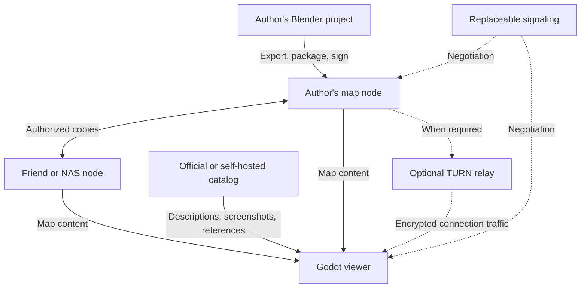

# Realm of Us — Product and System Design

**Design baseline:** 0.5 · **Date:** 2026-09-07 · **Status:** Pre-implementation design; not implemented or benchmarked  
**Project-owned code:** GPL-3.0-or-later · **Map protocol:** 0.1-draft, not frozen  
**Chinese edition:** [产品与系统设计](Realm_of_Us_Design.zh-CN.md)  
**Companion document:** [Code Architecture](Realm_of_Us_Architecture.en.md)

This document defines product goals, system constraints, data lifecycles, and acceptance criteria. The companion defines modules, interfaces, deployment, and distribution. Together they supersede the earlier Chinese technical proposal v0.2 and platform/repository architecture v0.1. Document, protocol, and software versions are independent.

“Must” identifies a design requirement; “proposed” identifies an implementation choice awaiting validation; “target” identifies an unmeasured budget. Fields and directories are proposals, not evidence of an interoperable implementation. Both languages use matching section numbers, fields, decisions, and acceptance IDs. Semantic discrepancies require a documentation correction rather than an implementation-specific interpretation.

## Contents

- [1. Vision and initial scope](#1-vision-and-initial-scope)
- [2. Terms and identity model](#2-terms-and-identity-model)
- [3. Architecture and data ownership](#3-architecture-and-data-ownership)
- [4. Authoring, building, and publishing lifecycle](#4-authoring-building-and-publishing-lifecycle)
- [5. Content format and version consistency](#5-content-format-and-version-consistency)
- [6. Connections, authorization, and private maps](#6-connections-authorization-and-private-maps)
- [7. Local rendering and progressive loading](#7-local-rendering-and-progressive-loading)
- [8. Replicas, collaboration, and failure semantics](#8-replicas-collaboration-and-failure-semantics)
- [9. Official entry point and user-facing commitments](#9-official-entry-point-and-user-facing-commitments)
- [10. Open-source baseline and extensions](#10-open-source-baseline-and-extensions)
- [11. Budgets, costs, and measurement](#11-budgets-costs-and-measurement)
- [12. Implementation order and acceptance](#12-implementation-order-and-acceptance)
- [13. Decisions and open issues](#13-decisions-and-open-issues)

## 1. Vision and initial scope

Realm of Us, named **共境** in Chinese, lets people reconstruct familiar real places locally, share copies held on user devices, and explore them through free flight on their own devices. Independent places and links between their entrances gradually form a shared virtual home.

### 1.1 Agreed constraints

| ID | Constraint | Consequence |
| --- | --- | --- |
| R01 | Start with users' own photographs, dimensions, plans, and creative work | No commercial map datasets; no COLMAP, OpenMVS, or mandatory scanning service in the initial release |
| R02 | Local authoring and rendering | Blender for creation; Godot for visits; online AI is an optional external authoring aid |
| R03 | Begin with sightseeing | Free flight, place transitions, and invitations; characters, physical interaction, and synchronized cameras are not initial requirements |
| R04 | Users control map data | Authors keep sources; user nodes hold and serve 3D releases; friends or NAS devices may explicitly retain and serve authorized copies |
| R05 | A lightweight official entry point is allowed | Register places, show screenshots, provide votes and downloads; do not host 3D maps |
| R06 | Official services are replaceable | Local maps, friend invitations, and self-hosted nodes need no official account; catalog, signaling, and relay endpoints are configurable |
| R07 | Essential dependencies are open source | Required authoring, viewing, and self-hosting software is open source; project-owned code is GPL-3.0-or-later |
| R08 | Support private homes | Exact addresses, interior references, and private invitations are not public by default; encryption and authorization are part of the distributed MVP |
| R09 | Deliver an installable viewer | Visitors need no Blender, Godot editor, or AI account; Steam is an optional distribution channel |
| R10 | Three desktop systems; mobile before browser 3D | Windows, macOS, and Linux are formal targets; physical Android/iOS probes start in M0; browser 3D is deferred |

### 1.2 Two delivery levels

**Distributed sightseeing MVP (M1–M2):** local creation, immutable releases, local streaming, free flight, cross-network invitations, private access, complete pins, and authorized mirrors. Friends may visit the same version concurrently, each controlling their own camera.

**Initial official entry point (M3–M4):** add a website, optional accounts, place registration, screenshots, votes, reporting, and standalone client distribution. The website is a conventional entry point and does not require browser-based 3D rendering.

Later work includes 2–8-person tour rooms, camera following, shared points of interest, and a Godot Web client. Real-time co-editing, avatars, character interaction, seamless global terrain, global DHT discovery, platform federation, blockchains, and Gaussian splatting are outside these initial acceptance criteria. “Open world” initially means an openly extensible network of places, not complete Earth geometry.

## 2. Terms and identity model

| Term | Meaning | Distinction |
| --- | --- | --- |
| Place | A reconstructed space that can be visited | Multiple independent places can depict the same physical location; no property title is implied |
| `scene_id` | Stable identity combining the initial publisher-key fingerprint and a random place identifier | Independent of database IDs, domains, and coordinates; encoding is frozen with the protocol |
| Release | An immutable content snapshot of a place | Changes create a new release; published content is not overwritten |
| `head` | A publisher-signed release reference and history relationship | Establishes who signed what, not accuracy or permission to access |
| `root_hash` | SHA-256 of the stored root-manifest object | Identifies a content snapshot, not the place or signed head |
| Tile | A spatial unit for culling, LOD, and loading | Not a network block |
| Asset | A complete GLB or another permitted data object | Imported only after complete retrieval and validation |
| Block | A byte object for integrity checks, caching, and resumption | May span multiple WebRTC messages |
| Provider | A device serving authorized content for a specified release | Possession of a copy does not confer publishing authority |
| Catalog | An index of place descriptions and connection hints | Listing does not guarantee availability, completeness, or trustworthiness |

Community accounts, publishing keys, node identities, and access credentials are separate. Account recovery cannot restore signing authority; official login does not grant private map access; knowledge of a hash does not grant read permission. Each MVP place has one publishing key. Losing or replacing it requires a new place; secure identity migration is future work.

## 3. Architecture and data ownership

Mirrors use the same connection mechanism. The project may operate discovery and connection services, while map content travels between user nodes. TURN may relay all map traffic, but does not persist maps.

| Data | Default holder | Received by the official platform? |
| --- | --- | --- |
| Reference photos, plans, dimensions, scripts, `.blend` | Author and separately authorized collaborators | No |
| GLB, textures, manifests, blocks | Author, caching visitors, authorized mirrors | Neither hosted nor fetched for registration |
| Publishing keys, private content keys, friend credentials | Relevant user devices | Not in catalog or community databases |
| Accounts, descriptions, heads, votes, reports | Official or self-hosted platform | Yes, when users choose those services |
| Selected public screenshots and thumbnails | Platform | Yes; storage and processing are required |
| SDP/ICE and connection state | Signaling service and endpoints | Transient handling, with bounded logs and retention |

The architecture therefore uses **distributed 3D map storage with potentially centralized catalog and community services**. It promises neither zero server-held user data nor network anonymity. Peers and connection services may observe IP addresses, timing, and traffic volume; private content encryption does not conceal every form of metadata.

The code uses a five-directory monorepo: `protocol` defines contracts and shared validation; `client` contains Godot sightseeing; `node` is an independent Go map service; `toolchain` contains Blender Python tools and Go publishing/build tools; `server` contains the Go platform and independent signaling. Programs build and release separately.

Clients connect directly to remote nodes without a local node. Desktop sharing provisionally uses the Go node’s embedded local Web UI; Godot retains launch/connection, opening the page, and selected-replica handoff. Through authenticated local APIs, the node receives, completes, and verifies a replica before serving as requested. The MVP has neither a full Godot administration UI nor a separate `rou-nodectl`. Mobile initially views/caches only. Client/node databases remain separate; ordinary caching and handoff never automatically enable sharing.

### 3.1 Identity and storage across modules

| Scope | Authentication/authorization | Persistence |
| --- | --- | --- |
| Platform community | Supabase Auth identifies users; Go business authorization and explicit RLS/grants protect data | Supabase PostgreSQL, screenshot Storage, queues |
| Client visits | Publisher signatures, node identities, map grants; platform login only for community features | Independent local cache, SQLite, system credentials |
| Map nodes | Read/serve grants, pinned dependency scope, separate local administration sessions | Local blocks, SQLite, configuration |
| Authoring tools | Author holds publisher key; CLI signs; only optional registration logs into platform | Local source, drafts, immutable releases |
| Software builds | Developer/CI permissions, software signing, channel credentials | Build caches, release artifacts, CI secret storage |
| Shared protocol code | Defines/verifies signatures and grants without account management | Specifications/vectors, no runtime database |

Supabase accounts cannot replace publisher keys, invitations, local administration tokens, or software-signing keys. Platform databases/Storage do not own offline client/node data. Conventional administration pages can ship initially while browser 3D remains deferred. See architecture sections 6.5 and 8 for interfaces and login adapters.

## 4. Authoring, building, and publishing lifecycle

1. **Prepare references:** choose the shareable area and collect user-owned photographs, plans, and known dimensions. “Scanning” does not imply an automatic photogrammetry pipeline in the initial release.
2. **Model locally:** use Blender manually or review and execute externally AI-assisted `bpy` scripts. The project never automatically uploads references; authors decide what to submit to any cloud AI service.
3. **Check quality:** inspect multiple views, hidden surfaces, dimensions, room connectivity, and inferred details. A convincing single render is insufficient, and survey-grade accuracy is not promised.
4. **Optimize and export:** the add-on produces static GLB assets, tiles, LODs, reusable-component references, entrances, and provenance in a draft directory without publishing keys.
5. **Build a release:** the CLI validates dependencies, creates objects and indexes, encrypts where needed, and signs the release. It emits an immutable directory and build report.
6. **Import into a node:** the node checks paths, signatures, dependencies, and hashes before atomically updating the version it can serve. The CLI never writes a running node's database directly.
7. **Share or register:** deliver an invitation or submit a public description, signed release reference, and selected screenshots. Registration is independent of map upload.

### 4.1 Code and assets have different roles

Parametric code suits regular buildings, layouts, and repeated components, improving editability, reuse, and readable revisions. Complex geometry and textures remain binary assets. Writing mesh coordinates as code does not inherently reduce size or GPU work.

Visitors download optimized, prebuilt data without executing author scripts or rebuilding scenes. Asynchronous collaborators may share authorized scripts, textual layouts, and `.blend` files; the publisher reviews locally before signing a new version. Git manages code and text; binary work uses object or tile ownership and explicit conflict resolution, not promised automatic merging.

Build reports record input hashes, Blender/add-on versions, parameters, seeds, and dependencies. Published bytes define the shared version. Rebuilding across tool versions is evaluated for geometry, appearance, and budgets; byte-for-byte reproducibility is not claimed without evidence.

### 4.2 Asset profile

Use meters, a right-handed coordinate system, and Y-up; Godot cameras face −Z. Convert coordinates once during Blender export. Each place uses a local origin; optional geographic metadata is separate, avoiding large geographic values in small-space rendering.

The initial profile accepts self-contained glTF 2.0 / GLB static meshes, restricted materials, and embedded PNG/JPEG images. External URIs, custom extensions, and unvalidated material features are disabled. Draco, meshopt, and KTX2 are not baseline capabilities. Repeated components may reference separate GLB assets and instances. Duplicate textures inside tile GLBs are an accepted initial cost to measure and optimize later. Blender supplies the exporter; tiling, budgets, and runtime restrictions are project rules. [Blender glTF documentation](https://docs.blender.org/manual/en/4.5/addons/import_export/scene_gltf2.html)

## 5. Content format and version consistency

### 5.1 Immutable object relationships

The root manifest references child indexes; indexes reference asset descriptors; descriptors list content blocks. The entrance preview is a small independent asset. Large places must not require a complete ZIP before display. ZIP is for offline transfer only, with extraction-size, file-count, and path limits.

| Object | Minimum semantics | Validation |
| --- | --- | --- |
| `head` | `schema_version`, `scene_id`, `seq`, `parents`, `root_hash`, `publisher_key`, `signature` | Signature, publisher/place relationship, history |
| `manifest` | Units, axes, bounds, entrance, index references, rights, provenance | Must match the stored object referenced by the head |
| Tile index | Bounds, LOD, geometric error, asset dependencies | Bound depth and counts; reject cycles; LOD0 is finest |
| Asset descriptor | Format, plaintext length, plaintext SHA-256, ordered block references | Verify reassembly order, length, and complete asset hash |
| Block | Bytes actually transmitted | `block_hash = SHA256(stored_bytes)`; includes the encryption envelope when private |
| Invitation and grant | Place, pinned version, permissions, provider hints, expiration, access proof | Separate from map content and official login credentials |

`root_hash = SHA256(stored_root_manifest_bytes)`. A public root is canonical JSON. A private root is an encrypted object containing its nonce and authentication tag, with sensitive manifest fields inside it. A root does not contain its own hash, avoiding a circular definition.

`head_hash = SHA256(JCS(signed_head))`. `parents` contains parent `head_hash` values, not root-manifest hashes. Ed25519 signs a distinct protocol-domain prefix followed by JCS bytes of the head without `signature`. Exact domain bytes, binary encodings, encryption-envelope layouts, and error codes require test vectors at protocol freeze; this is not a complete wire specification. [RFC 8785](https://www.rfc-editor.org/rfc/rfc8785)

The proposed `seq` is a decimal string without leading zeroes, from 0 through 2^63−1, avoiding JSON-number handling differences across Go, GDScript, and potential browser implementations. Compare numerically, never lexicographically. Reject duplicate JSON keys, non-finite numbers, out-of-range lengths, and unknown required capabilities; JSON Schema does not replace these semantic checks.

### 5.2 History and updates

The MVP uses one publisher and linear history: the initial head has `seq=0` and no parent; each subsequent head increments `seq` by one and has exactly one parent. A client may open a pinned, signed snapshot directly. Automatically advancing the current version requires validating missing history from the trusted head to the new head.

Resubmitting the same head is idempotent. Different valid heads at the same sequence, or incompatible successor branches, enter an explicit conflict state rather than last-write-wins. Recovery selects a trusted branch before continuing publication. The highest observed sequence prevents silent rollback but cannot prove global freshness. Explicitly opening an older snapshot is allowed without changing the default current head.

Updates reuse byte-identical blocks. A small modeling change may substantially alter exported GLB bytes; chunking does not guarantee minimal deltas. Private releases can reuse unchanged, existing ciphertext objects within the same key epoch. Re-encryption and key rotation change hashes and increase transfer volume. Reusing old ciphertext across epochs cannot be presented as revocation of old access.

## 6. Connections, authorization, and private maps

### 6.1 Establishing access

A client obtains the place identity, trusted publisher fingerprint, and release reference from a bookmark, invitation, or catalog. Replaceable WSS signaling exchanges SDP/ICE, followed by WebRTC direct connectivity or coturn when needed. Native Godot requires an external WebRTC extension; Go nodes provisionally use Pion. Validate the actual plugin, engine, Pion, and target systems together. [Godot WebRTC](https://docs.godotengine.org/en/stable/tutorials/networking/webrtc.html)

A key returned by a catalog identifies that listing's claimed publisher. Trust between friends comes from fingerprints or pinned references exchanged over a trusted channel; a display name alone cannot establish identity on first contact.

Proposed endpoint authentication signs both challenges, identities, the place, pinned version, and actual negotiated DTLS fingerprints. Binding must use fingerprints applied by the connection, not arbitrary text supplied by signaling. **M0 must demonstrate this binding on the selected plugin and pass a signaling-substitution attack test.** If unavailable, define and review an alternative secure-session design first; do not remove binding and ship private access.

### 6.2 Permissions and keys

Publisher-signed grants bind at least `scene_id`, `root_hash`, permissions, recipient identity or a random bearer-credential identifier, and issue/expiry times. Invitations authorize a specific snapshot by default; later versions require another grant. Reading a map, serving a copy, managing a temporary room, and signing releases are separate permissions.

The MVP may use short-lived bearer invitations: forwarding one forwards its authority. Grants bound to a friend's public key are a compatible enhancement. Content keys travel through authenticated connections or trusted invitation channels, never public directories, HTTP query strings, or diagnostic logs. Invitation files, clipboard contents, and links can leak; clients must not automatically send their secrets to a catalog.

Private root manifests, child indexes, thumbnails, and asset blocks use XChaCha20-Poly1305 authenticated encryption. Go uses `golang.org/x/crypto/chacha20poly1305.NewX` and native Godot provisionally uses libsodium, with cross-language vectors proving byte interoperability. Every new encryption uses a fresh random nonce. Associated data binds format, place, key epoch, object role, and block position; it cannot include a ciphertext hash that does not yet exist. Full layouts and negative vectors must be frozen before M2. [libsodium AEAD](https://doc.libsodium.org/secret-key_cryptography/aead), [Go XChaCha20-Poly1305](https://pkg.go.dev/golang.org/x/crypto/chacha20poly1305)

MVP mirrors are explicitly authorized, trusted devices that may hold decryption keys to inspect manifests and request scope. Keyless blind mirrors are not promised. Every node must check that a requested block belongs to the reachable dependency set of an authorized release; its object store is not an arbitrary hash-read service.

Expiry or received revocation can stop future serving. An offline mirror unaware of revocation may continue accepting a grant until it expires. Without central coordination, immediate global revocation is not promised. Delivered plaintext or decryption keys cannot be forcibly recalled; rotation protects newly encrypted content.

### 6.3 Transport boundaries

| Layer | Initial parameter | Behavior |
| --- | --- | --- |
| Content block | Target maximum of 256 KiB stored bytes | Private nonces, tags, and headers count toward the budget; final blocks may be smaller |
| WebRTC fragment | Total message length ≤16 KiB or the negotiated limit, whichever is lower | Subtract application headers for payload; reassemble by request ID and offset |
| Concurrency | Four unfinished blocks per source, up to four map sources | Bound memory, rates, cancellation, and retries |
| Send queue | Initial target of 256 KiB per connection | Observe application and underlying buffers; stop enqueueing at the limit |

Reliable, ordered `control` handles negotiation, requests, cancellation, and errors. Reliable `assets` carries content fragments. A later `presence` channel may discard stale state. Channels still share connection resources, so asset traffic requires scheduling and limits; separation alone does not guarantee responsiveness.

Persistence uses temporary files, verification, and atomic rename. Only verified blocks survive as reusable progress. Discard corrupt blocks and try other providers. Negotiate compatibility before transferring maps; report unknown required capabilities instead of silently interpreting them as an older format.

## 7. Local rendering and progressive loading

The Godot client loads a verified head, root manifest, entrance preview, nearby tiles, and finer LODs in that order. A GLB must be fully reassembled, decrypted, and checked for length and hash before runtime import. Godot supplies `GLTFDocument`/`GLTFState` loading, not this project's streaming scheduler or input restrictions. [Godot runtime file loading](https://docs.godotengine.org/en/stable/tutorials/io/runtime_file_loading_and_saving.html)

Spatial scheduling considers the view frustum, distance, screen-space error, and movement direction, with LOD hysteresis. Keep coarse geometry until detail is ready. Fast flight may produce progressive refinement. Switch places only when the destination entrance is usable; show missing areas explicitly rather than synthesizing detail.

Separate download, hashing, and decryption from main-thread import. Batch scene instantiation and texture uploads. A GLB parse may not be preemptible: control stalls through smaller assets, lower texture budgets, and measurements, not assumed thread or frame-scheduler interruption. Reuse components by hash and use MultiMesh where appropriate; release resources only when no other references remain.

Network maps contain restricted data only. Reject author-supplied `.pck`, `.tscn`, `.tres`, `.gd`, native libraries, and custom shaders. Before parsing, validate GLB lengths, buffer/accessor bounds, image pixel counts, node/mesh counts, external URIs, and extension allowlists. Preflight does not prove parsers vulnerability-free: maintain dependency patches and evaluate process-isolated parsing before expanding public scale.

The initial UI includes local maps, invitations, optional catalogs, free flight, speed controls, entrance reset, loading/offline status, and cache settings. Advanced diagnostics expose hashes, connection paths, and frame times separately. A signature is not a safety certification and never replaces input validation.

## 8. Replicas, collaboration, and failure semantics

| State or failure | Required behavior |
| --- | --- |
| Temporary cache | Evictable under quota; only downloaded portions are available, not guaranteed complete offline access |
| Complete pin | Traverse and validate every manifest and asset dependency; report completion only for the full closure |
| Authorized mirror | MVP sharing requires a complete dependency closure and serving permission; can replace the author while online; no automatic sharing |
| All sources offline, local blocks missing | Retain available content and identify missing parts; eventual retrieval is not guaranteed |
| Signaling failure | Established direct connections can generally continue; new or rebuilt connections need another reachable signaling path |
| TURN failure | Connections using that relay may fail; retry reachable paths and report failure if none works |
| Official catalog outage or delisting | Known references, local copies, and self-hosted services remain usable if connection services and providers are reachable |
| Local data root already owned | Reject a second writer; use another root or the local control interface |

A complete pin covers one release's dependency closure, not linked destinations or the author's source project. Private offline use also requires securely retained content keys. Import, validate, and register references before garbage collection; never delete pinned copies, sources, or objects being imported.

The node Web UI separately reports download completeness, sharing intent, authorization, and node state; Godot retains necessary summaries and a link to administration. Offline retention does not enable sharing: import, complete, and validate before serving. Pausing/disabling does not delete the replica; deletion first stops serving and releases retention. Partial-cache assistance is deferred; visited areas alone are not a complete mirror.

An attached node stops with its client by default, including controller-crash handling. Users may explicitly choose an independent service for continued serving. A client connected to an existing service must not stop it on exit. Sleep, disconnection, or expired grants can interrupt service; continuous availability is not promised.

Collaborators submit source changes for publisher review without sharing the publishing key or requiring real-time editing. Where content rights permit, users can fork a new `scene_id` and record provenance. Independent depictions of the same physical location coexist without global land ownership.

Node Web administration works offline and listens on loopback only; NAS access may use SSH tunnels. One-use pairing establishes local browser sessions without Supabase accounts. Full Godot administration and a separate CLI are deferred; automation uses the same API. Closing the page does not stop the node; attached/independent lifecycle rules still apply.

## 9. Official entry point and user-facing commitments

The official platform provides accounts, registration, descriptions and tags, release references, author-uploaded screenshots, votes, reports, moderation, and client download links. Registration verifies control of a publishing key, not property ownership, photography permission, reconstruction accuracy, or continued availability.

Three independent dimensions govern a place: **catalog visibility** (public, unlisted, withdrawn), **map access** (public or invitation-authorized), and **content reuse rights**. Unlisted does not mean access-controlled; publicly viewable does not automatically mean modifiable or redistributable. Private homes are unregistered by default. If an author creates a public teaser listing, its description and screenshots are explicitly public submissions.

The platform stores references and selected public metadata, not complete manifests; it does not fetch arbitrary user URLs or create replicas. Screenshots can differ from actual content, so they are version-bound and reportable. “Recently online” is a time-limited node claim, not verified continuous availability.

Official accounts are needed only for community writes. Public catalog browsing, local visits, and friend invitations can be anonymous to the official account system. Users can export their registration records and register elsewhere. The MVP does not automatically synchronize accounts, votes, or moderation across platforms.

The platform can remove its screenshots, hide listings, and restrict accounts, but cannot delete distributed maps. Official signaling and TURN may impose quotas; self-hosted services define their own resource policy. The map protocol must not require official callbacks for all access authorization.

Reuse Supabase Auth, PostgreSQL, Storage, Queues/pgmq, and Cron/pg_cron for platform infrastructure. Realtime serves platform events where needed; Studio is operations-only. Go retains publisher binding, signed history, votes/moderation, and image processing. Bind platform sessions to configured service origins and never send them to map nodes. Validate managed/self-hosted combinations separately. Community features can fail during platform outages, while local visits and friend access with reachable providers/connection services need no platform login. [Supabase architecture](https://supabase.com/docs/guides/getting-started/architecture)

## 10. Open-source baseline and extensions

| Capability | Proposed baseline | Pinning requirement |
| --- | --- | --- |
| Local authoring | Blender 4.5 series, Python add-on | Validate exact patch, export profile, and draft contract |
| Desktop/mobile viewing | Godot 4.7.2, typed GDScript; Compatibility as an initial probe | Pin templates/native extensions; measure desktop and mobile render paths separately |
| Map node and publishing CLI | Independent Go programs; Pion WebRTC for nodes | Build/run separately on Windows, macOS, and Linux; prefer no-cgo dependencies |
| Networking and cryptography | Godot webrtc-native/libsodium; Go standard crypto and x/crypto; coturn | Actual DTLS binding and cross-language signature/ciphertext vectors |
| Local indexes | Client godot-sqlite; proposed modernc.org/sqlite for Go nodes | Two data roots; validate drivers, OSes, and CPU architectures together |
| Official platform/signaling | Supabase Auth/PostgreSQL/Storage/Queues/Cron; Go business API/worker, independent WebSocket signaling | Validate/pin platform combinations before M3; Realtime reused where needed, signaling separately validated, coturn independent |

Retain the Godot 4.7.2 stable archive and Blender 4.5 series as existing candidates, subject to M0 integration. Tool-level support does not establish project-level validation. Pion supplies pure-Go WebRTC without a Godot node dependency; verify the Go SQLite driver's targets and transitive dependencies too. [Godot release archive](https://godotengine.org/download/archive/4.7.2-stable/), [Pion WebRTC](https://github.com/pion/webrtc), [modernc.org/sqlite](https://pkg.go.dev/modernc.org/sqlite)

M0 Android/iOS probes verify signatures, decryption, import, flight, and interrupted-transfer recovery for the same small private map. Mobile is not an always-on provider initially. Validate touch input, texture/memory budgets, heat, network handover, and suspension/recovery separately; results determine release order. iOS export requires macOS/Xcode and signing. Platform SDKs/store tools are separate from open-source core dependencies, and compilation does not establish store eligibility. [Godot iOS export](https://docs.godotengine.org/en/stable/tutorials/export/exporting_for_ios.html)

Browser 3D is outside the current build/acceptance matrix. Future support requires dedicated cryptography, storage, permissions, and lifecycle adapters. The conventional catalog website can launch earlier and is separate from browser sightseeing.

libp2p/IPFS is not required initially. A future adapter may replace a source or transport but cannot bypass signatures, authorization, or budgets. Content addressing still requires actual online replicas and cannot imply permanent availability.

Project-owned code is GPL-3.0-or-later. Dependencies retain their licenses; maps and reference materials declare independent rights. GitHub, Steam, and optional cloud AI are external channels or aids, not required open-source runtime components. Steamworks SDK, corresponding-source, and channel requirements are centralized in section 11 of the companion architecture document.

## 11. Budgets, costs, and measurement

All numbers below are initial tuning targets, not measurements. Storage sizes use KiB/MiB/GiB; network rates use decimal Mbps.

| Item | Initial target | Measurement boundary |
| --- | --- | --- |
| Reference machine | Four CPU cores, 16 GiB RAM, GPU with roughly 4 GiB VRAM | Record actual model, driver, OS, and versions in M0 |
| Continuous rendering | 1080p, fixed ten-minute route, P95 frame time ≤33 ms | Also record P99, maximum stall, and LOD transition peaks |
| Visible geometry | ≤1 million triangles and ≤300 draws | Tuning caps, not standalone frame-rate predictions |
| Resources | Decoded map textures about ≤512 MiB; process RSS ≤2 GiB | Include overlapping resources during transitions; disk size is not memory size |
| Entrance dependency closure | ≤5 MiB of transferred objects | Includes entrance GLB, indexes, and shared dependencies, not just a cover image |
| Individual GLB | Normally 1–4 MiB; initial cap 8 MiB | Reduce if stalls exceed budget; a size cap is not a performance test |
| Root-manifest object | ≤256 KiB | Includes encryption overhead when private; larger indexes are hierarchical |
| First controllable view | P95 ≤8 seconds under N1 | App already running, map cold; from opening a place through connection and import to free flight |
| Connection success | Target ≥95% within the specified network matrix | At least 30 attempts per class; report counts and causes, without extrapolating to all networks |

N1 is a controlled condition with effective sender upload of 20 Mbps, RTT 80 ms, and 1% packet loss. Also test home NAT, mobile hotspots, forced TURN, and reconnection. Report application cold start, map cold cache, warm cache, and additional visitors separately. Measure mobile application startup, cold maps, and recovery separately without assuming desktop budgets; browser tests are deferred.

For one bottleneck sender, the ideal transfer-time lower bound is `t ≥ 8 × S / U`, with `S` in decimal MB and `U` in Mbps. Sending one 100 MB copy at 10 Mbps takes about 80 seconds before protocol and contention overhead. Visitors share uplink capacity; P2P does not eliminate first-distribution bottlenecks.

Operating costs include website compute, database and screenshot storage/backups, screenshot egress, signaling, and relayed bytes. If all map traffic uses TURN, its operator still supplies that bandwidth; billing depends on the provider's ingress/egress rules. Participants pay local authoring, disk, upload, and electricity costs; optional AI costs are the author's choice.

Record connection time, direct/relay path, entrance time, import duration, frame times, memory, bytes, and cache hits locally by default. Do not automatically upload home identifiers, keys, or exact locations. Benchmark reports retain scene hashes, routes, and full environments.

## 12. Implementation order and acceptance

| Stage | Deliverable | Exit criterion |
| --- | --- | --- |
| M0 Feasibility | Go node, Godot prototype, original small scene, tool/plugin and private-map probes | Nodes build/run on three desktop OSes; three desktop and physical Android/iOS clients verify the same private map, DTLS binding, import, and recovery; produce a compatibility report |
| M1 Local loop | Blender add-on, CLI, core protocol, offline Godot viewing and LOD | Publish and fly through a local project without networking; emit quality and budget reports |
| M2 Distributed MVP | Private invitations, cross-network transfer, resumption, pins, mirrors, desktop node management | Two devices open the same version; mirrors survive author exit; administration isolation, grants, and storage recovery pass |
| M3 Official entry point | Supabase backend, Go business API/worker, catalog, screenshots, votes, reports | No 3D uploads; platform Auth, RLS/grants, Storage, retries, backups pass A08/A13 |
| M4 Official distribution | Three desktop packages, corresponding source, installation/updates; mobile release guided by measurements | Runs without editors; compatible components/APIs and provenance/dependency records; Steam/mobile channels assessed separately |
| M5 Later experience | Partial-cache assistance, tour rooms, following, POIs, Web client | Independent acceptance per feature; does not block previous stages |

Parts of M3 may overlap M2 after protocol interfaces stabilize, but public opening requires a secure distributed access loop. The old “10–14 weeks” estimate is no longer a commitment for the whole project. Re-estimate the platform, cryptographic details, and multi-platform packaging after M0 against team capacity.

| Acceptance ID | Scenario and pass condition |
| --- | --- |
| A01 Local autonomy | Existing references/scripts support authoring, export, publication, and viewing offline; no AI or official login required |
| A02 Modeling quality | Authorized room, courtyard/small landmark, and street-fragment fixtures; verify dimensions, multiple views, and recorded inference |
| A03 Integrity | Reject single-byte corruption, reordered blocks, and wrong lengths; validate roots, signatures, and unknown required capabilities |
| A04 Secure access | Reject expired credentials, wrong identities, old challenges, signaling endpoint substitution, and out-of-scope block reads; logs contain no secrets |
| A05 Network and resume | Reproducible N1 and real-network matrix; verified blocks are not downloaded again after interruption; forced TURN is covered |
| A06 Pins and mirrors | Traverse the pin closure; open the same snapshot from a mirror after author exit; report correctly when every source is offline |
| A07 History | Idempotent duplicate registration; no silent branch overwrite; explicit old-version visits; reuse byte-identical objects |
| A08 Platform boundary | Registration rejects 3D packages; no publisher impersonation; idempotent votes and version-bound screenshots |
| A09 Performance | Report entrance time, frame times, and memory using section 11's environment, byte definitions, and routes; estimates are not measurements |
| A10 Open delivery | A new machine can build from documentation; corresponding source is complete; official catalog/signaling/relay configurations are replaceable |
| A11 Platforms | Client/node/CLI build and validation matrix for Windows, macOS, and Linux; physical Android/iOS crypto, loading, touch, and suspension/recovery reports; separate mobile release acceptance |
| A12 Desktop sharing | Node-free viewing; offline embedded Web UI; pairing/CSRF/origin/instance isolation; complete verified cache handoff before explicit serving; pause retains data; loopback-only listener; attached/independent exit semantics |
| A13 Platform reuse | Measure Auth login/refresh/rotation/invalidity; reject wrong-origin tokens, unauthorized API-bypass writes, cross-user media/channel access; idempotent pgmq redelivery; separate database/Storage recovery; platform outage preserves local and already reachable friend paths |

The first end-to-end demo uses an original home or small landmark: model and publish locally, register a description and screenshots, let a friend enter by catalog or invitation and fly independently, continue from an authorized mirror after the author exits, and submit one vote.

## 13. Decisions and open issues

| ID | Decision or unresolved issue | Closure |
| --- | --- | --- |
| ADR-001 | Agreed: publish mesh data; execute author scripts only on the authoring side | Maintain runtime asset allowlists |
| ADR-002 | Agreed: separate official catalog from user content and accounts from publishing authority | A04, A08, A10 |
| ADR-003 | Agreed: independent places, one publisher, immutable releases | Protocol and history vectors |
| ADR-004 | Proposed: WebRTC with replaceable signaling/TURN | M0/M2 network, endpoint-binding, and license validation |
| ADR-005 | Not frozen: signature domains, encryption envelopes, grant encoding, limits, errors | Wire specification, cross-language vectors, and protocol review before M2 |
| ADR-006 | Unverified: engine/plugin/OS combinations and budgets | M0 measured compatibility matrix; revise implementation where necessary |
| ADR-007 | Agreed: GPL core; no Steamworks SDK in default builds | M4 distribution review against actual dependencies; no linking exception has been granted |
| ADR-008 | Deferred: synchronized cameras, Web client, federation, keyless mirrors | Separate designs, not claimed initial capabilities |
| ADR-009 | Agreed: five-directory monorepo, centralized contracts/APIs, independently built/released programs | Dependency gates for `protocol`, `client`, `node`, `toolchain`, `server`, and A10 |
| ADR-010 | Agreed: independent Go node with optional desktop management and complete replica sharing | Authenticated local API, single-writer storage, A06/A12 |
| ADR-011 | Agreed: three formal desktop targets; mobile before browser 3D | M0 physical-device probes and A11; no simultaneous mobile store-launch promise |
| ADR-012 | Agreed reuse priority: Supabase Auth/PostgreSQL/Storage/Queues/Cron for platform; exact combinations await validation | Architecture section 8 and A13; independent map, local administration, software-distribution identities |
| ADR-013 | Proposed: embedded node Web UI for full administration; minimal Godot entry points, deferred `rou-nodectl` | Architecture section 6.5 and A12; offline administration, pairing, cache handoff, headless deployment |

Top risks are runtime import stalls, unavailable endpoint binding, disclosure of home references, upload/relay cost, and insufficient online replicas. Address them through small-asset benchmarks, substitution tests, private defaults, byte budgets, and explicit pin/mirror states. Citations support particular tool or license facts; protocol details, parameters, and product choices are project proposals, not external implementation promises.

This baseline builds on 0.4 module/platform/protocol boundaries, expanding Supabase reuse, per-module authentication/storage ownership, and proposed node Web administration. Both languages are updated; the protocol remains unfrozen and software unimplemented.
