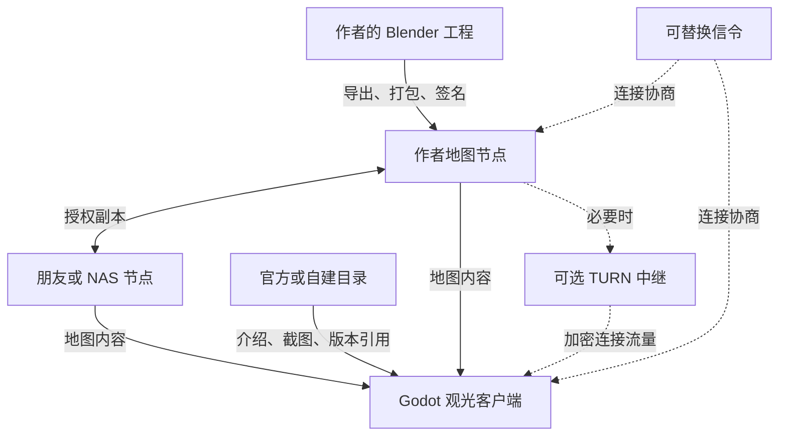

# Realm of Us（共境）— 产品与系统设计

**设计基线：** 0.5 · **日期：** 2026-09-07 · **状态：** 实施前设计，未实现、未实测  
**自有代码许可证：** GPL-3.0-or-later · **地图协议：** 0.1-draft，尚未冻结  
**对应英文版：** [Product and System Design](Realm_of_Us_Design.en.md)  
**配套文档：** [代码架构设计](Realm_of_Us_Architecture.zh-CN.md)

本文定义产品目标、系统约束、数据生命周期和验收标准；配套架构文档定义模块、接口、部署与发行。两份文档共同替代原《分布式真实世界观光技术方案 v0.2》和《官方平台与代码仓库架构设计 v0.1》。文档版本、协议版本、软件版本分别管理。

“必须”表示本设计要求；“拟采用”表示待原型验证的实现选择；“目标”表示待实测的预算。协议字段和目录均为拟议设计，不能据此声称已有可互操作实现。中英文按相同章节编号维护；字段、决策编号和验收编号应一致，任何语义分歧均应修正文档，不由实现自行解释。

## 阅读导航

- [1. 愿景与首版范围](#1-愿景与首版范围)
- [2. 术语与身份模型](#2-术语与身份模型)
- [3. 架构与数据归属](#3-架构与数据归属)
- [4. 创作、构建与发布生命周期](#4-创作构建与发布生命周期)
- [5. 内容格式与版本一致性](#5-内容格式与版本一致性)
- [6. 连接、授权与私密地图](#6-连接授权与私密地图)
- [7. 本地渲染与渐进加载](#7-本地渲染与渐进加载)
- [8. 副本、协作与故障语义](#8-副本协作与故障语义)
- [9. 官方入口与用户承诺](#9-官方入口与用户承诺)
- [10. 开源基线与扩展路线](#10-开源基线与扩展路线)
- [11. 预算、成本与测量](#11-预算成本与测量)
- [12. 实施顺序与验收](#12-实施顺序与验收)
- [13. 决策记录与待关闭问题](#13-决策记录与待关闭问题)

## 1. 愿景与首版范围

Realm of Us 让人们在本地重建自己熟悉的真实地点，通过用户持有的副本分享给朋友，并在自己的设备上自由飞行观光。世界由独立地点及其入口链接组成，逐步形成共同建设的虚拟家园。

### 1.1 已确定的约束

| 编号 | 约束 | 设计结果 |
| --- | --- | --- |
| R01 | 从用户自己的照片、尺寸、平面图和创作出发 | 不接入商业地图数据；首版不引入 COLMAP、OpenMVS 或必需扫描服务 |
| R02 | 本地制作与渲染 | Blender 创作；Godot 观光；在线 AI 是作者自行选择的外部辅助 |
| R03 | 先做观光游戏 | 自由飞行、地点切换和邀请访问；角色、物理互动与同步相机不作为首版条件 |
| R04 | 用户掌握地图数据 | 源工程由作者保管，三维发布资产由用户节点提供；可显式授权朋友或 NAS 保留并提供副本 |
| R05 | 可以有轻量官方入口 | 官方登记地点、展示截图、提供赞踩与发行入口；不托管三维地图 |
| R06 | 官方服务可替换 | 本地地图、朋友邀请和自建节点无需官方账号；目录、信令和中继地址可配置 |
| R07 | 核心依赖开源 | 必需制作、观光及自建服务使用开源软件；自有代码采用 GPL-3.0-or-later |
| R08 | 支持私密住宅 | 默认不公开精确地址、室内资料或私密邀请；加密与访问授权进入分布式 MVP |
| R09 | 提供可安装客户端 | 访客无需 Blender、Godot 编辑器或 AI 账户；Steam 为可选发行渠道 |
| R10 | 三桌面系统兼容，移动优先于浏览器 | Windows、macOS、Linux 为正式目标；Android/iOS 在 M0 实机验证，浏览器三维端后置 |

### 1.2 两个交付层次

**分布式观光 MVP（M1–M2）：** 本地制作、不可变发布、局部流式加载、自由飞行、跨网络邀请、私密访问、完整保留和授权镜像。朋友可以同时访问同一版本，每个人独立控制相机。

**官方入口首版（M3–M4）：** 在前者基础上增加网站、可选账号、地点注册、截图、赞踩、举报处理，以及独立客户端发行。官网是普通网页入口，不以浏览器三维渲染为前提。

后续阶段包括 2–8 人观光房间、相机跟随、共享兴趣点和 Godot Web 客户端。实时共同编辑、头像与角色互动、全球无缝地形、全网 DHT、平台联邦、区块链和高斯泼溅均不进入上述首版验收。这里的“开放世界”首先是开放接入的地点网络，不承诺完整地球几何。

## 2. 术语与身份模型

| 术语 | 含义 | 与其他对象的区别 |
| --- | --- | --- |
| 地点 / Place | 用户重建的一处可参观空间 | 一个现实位置可有多个独立地点；不表示现实产权 |
| `scene_id` | 初始发布公钥指纹与随机地点标识组成的稳定身份 | 不依赖官方数据库、域名或经纬度；编码由协议冻结 |
| 发布版本 / Release | 某个地点的一次不可变内容快照 | 改动产生新版本，已发布内容不覆盖 |
| `head` / 版本头 | 发布者签名的版本引用与历史关系 | 证明谁签发了什么；不证明真实还原质量或访问资格 |
| `root_hash` | 根清单存储对象的 SHA-256 | 标识内容快照；不等同于地点身份或版本头哈希 |
| 空间分区 / Tile | 为剔除、LOD 和加载划分的空间单元 | 不是网络传输块 |
| 资产 / Asset | 一个完整 GLB 或其他允许的数据对象 | 完整获取并验证后才能导入 |
| 内容块 / Block | 用于校验、缓存和续传的字节对象 | 可跨多条 WebRTC 消息传输 |
| 提供节点 / Provider | 按授权向访客提供指定版本内容的设备 | 持有副本不等于拥有发布权 |
| 目录 / Catalog | 地点介绍与连接提示的索引 | 目录上架不保证地图在线、完整或可信 |

社区账号、发布密钥、节点身份、访问凭证分别管理。账号找回不能恢复地图签名权；官方账号登录不自动授权私密地图；持有哈希不自动取得读取权限。MVP 每个地点只有一个发布密钥，密钥丢失或需要换钥时建立新地点；安全迁移协议留待后续设计。

## 3. 架构与数据归属

图中镜像也使用同一连接机制。控制与发现服务可由项目方提供，地图内容沿用户节点之间的链路传输；TURN 可能转发全部地图流量，但不持久保存地图。

| 数据 | 默认持有者 | 官方是否接收 |
| --- | --- | --- |
| 参考照片、平面图、尺寸、建模脚本、`.blend` | 作者；另行授权的合作者 | 否 |
| GLB、纹理、清单和内容块 | 作者、缓存访客、授权镜像 | 不托管、不为登记而抓取 |
| 发布私钥、私密内容密钥、朋友访问凭证 | 相应用户设备 | 不进入目录或社区数据库 |
| 账号、地点介绍、版本头、评价、举报 | 官方或自建平台 | 是，用户主动使用时 |
| 已选择公开的截图与缩略图 | 平台 | 是，需存储和处理 |
| SDP/ICE 与连接状态 | 信令及连接端点 | 短期处理；限制日志和保留时间 |

因此，项目是**三维地图分布式存储，官方目录与社区可以集中运营**。它不承诺“服务器没有任何用户数据”，也不承诺匿名网络。P2P 对端和连接服务可能看到 IP、时间和流量规模；私密内容加密不能隐藏所有元数据。

代码采用五个核心目录的 monorepo：`protocol` 定义规范与公共验证，`client` 是 Godot 观光端，`node` 是独立 Go 地图服务，`toolchain` 包含 Blender Python 工具及 Go 发布/构建工具，`server` 包含 Go 官方平台和独立信令。各程序分别构建和发布。

观光客户端直接连接远程节点，不要求启动本机节点。桌面共享拟统一使用 Go 节点自带的本地 Web 管理页；Godot 保留启动/连接、打开管理页和移交所选副本的入口。节点通过本地认证 API 接收、补全并验证副本，再按用户选择提供；MVP 不另做完整 Godot 管理页或独立 `rou-nodectl`。移动端初期只观光和缓存。客户端与节点不共享可写数据库，普通缓存和移交操作不会自动开启共享。

### 3.1 各模块如何使用身份与存储

| 范围 | 鉴权/权限 | 持久化位置 |
| --- | --- | --- |
| 平台社区 | Supabase Auth 识别用户；Go 业务授权与明确的 RLS/grants 控制数据 | Supabase PostgreSQL、截图 Storage 与任务队列 |
| 客户端观光 | 发布签名、节点身份和地图访问授权；只有社区功能使用平台登录 | 客户端本机缓存、SQLite、系统凭据区 |
| 节点提供地图 | 验证读取权、提供权、固定版本依赖范围；独立本机管理会话 | 节点本机块文件、SQLite 和配置 |
| 作者工具 | 作者保管发布私钥；发布 CLI 签名；可选平台登记才登录 | 本地源工程、草稿和不可变发布包 |
| 软件构建 | 开发/CI 权限与软件发行签名、渠道凭据 | 构建缓存、发行产物与 CI 凭据库 |
| 协议公共代码 | 定义并验证签名与授权，不自行管理账号 | 规范与向量，无运行数据库 |

Supabase 的平台账号不能替代地图发布密钥、朋友邀请、本机管理令牌或软件发行密钥；平台数据库和 Storage 不接管客户端/节点的离线数据。普通管理网页可以在首版提供，与后置的浏览器三维观光无关。具体接口与登录适配见架构第 6.5 和第 8 节。

## 4. 创作、构建与发布生命周期

1. **整理资料：** 作者选择可分享的范围，收集自有照片、平面图和已知尺寸。初版“扫描”不隐含自动摄影测量管线。
2. **本地建模：** 在 Blender 手工建模，或审阅并执行外部 AI 辅助生成的 `bpy` 脚本。项目不自动上传参考资料；使用云端 AI 时，由作者决定向该服务提交什么。
3. **质量核对：** 检查多视角、背面、尺寸、房间连通和推测补全部分。单张好看的渲染图不足以验收真实地点重建，不承诺测绘精度。
4. **优化与导出：** 插件生成静态 GLB、分区、LOD、共享构件引用、入口和来源记录；形成不含发布密钥的草稿目录。
5. **构建发布包：** CLI 校验依赖、生成内容对象与索引，按需要加密并签名；产出不可变发布目录和构建报告。
6. **节点导入：** 节点验证路径、签名、依赖和内容哈希，成功后原子更新可提供版本；CLI 不直接写运行中的节点数据库。
7. **分享或登记：** 作者交付邀请，或向官方提交公开介绍、签名版本引用和截图；此步骤与地图上传无关。

### 4.1 代码与资产各自承担什么

参数化代码适合规则建筑、布局和重复构件，可提高可编辑性、复用和版本可读性。复杂几何与纹理仍作为二进制资产保存。把网格坐标改写成代码不必然减小体积，也不减少最终 GPU 工作量。

访客下载预生成的优化资产，不执行作者脚本，不重新建模。异步合作可以共享经授权的脚本、文本布局和 `.blend`；发布者本地审核后签发新版本。Git 用于代码和文本；二进制采用对象或分区责任分配，不承诺自动合并。

构建报告记录输入哈希、Blender/插件版本、参数、种子和依赖。发布资产字节是版本依据；跨工具版本重建只评估几何、外观与预算，未经验证不宣称逐字节可复现。

### 4.2 资产配置

坐标以米为单位，采用右手系、Y 向上；Godot 相机面向 −Z。Blender 导出阶段只转换一次。每个地点使用局部原点，经纬度为可选元数据，避免以大地理坐标直接渲染小空间。

初版接受自包含 glTF 2.0 / GLB 的静态网格、受限材质和内嵌 PNG/JPEG。禁用外部 URI、自定义扩展和未验证的材质功能；Draco、meshopt、KTX2 不在默认配置中。重复构件可以引用独立 GLB 并实例化；分区 GLB 内重复纹理的开销先接受、后测量优化。Blender 的 glTF 导出器是基础能力，分区、预算及运行时限制是本项目增加的规则。[Blender glTF 文档](https://docs.blender.org/manual/en/4.5/addons/import_export/scene_gltf2.html)

## 5. 内容格式与版本一致性

### 5.1 不可变对象关系

根清单引用子索引，子索引引用资产描述，资产描述列出内容块。入口预览独立成小资产；大地点不能等待完整 ZIP 下载后才显示。ZIP 只用于离线搬运，导入时限制解压体积、文件数和路径。

| 对象 | 最少语义 | 校验要求 |
| --- | --- | --- |
| 版本头 `head` | `schema_version`、`scene_id`、`seq`、`parents`、`root_hash`、`publisher_key`、`signature` | 签名、公钥与地点关系、历史一致性 |
| 根清单 `manifest` | 单位、坐标、包围盒、入口、索引引用、许可、来源 | 必须与版本头指向的存储对象相符 |
| 分区索引 | 包围盒、LOD、几何误差、资产依赖 | 限制深度、数量和循环；LOD0 为最精细 |
| 资产描述 | 格式、明文长度、明文 SHA-256、按序排列的块引用 | 验证重组顺序、总长度及完整资产哈希 |
| 内容块 | 实际传输字节 | `block_hash = SHA256(stored_bytes)`；私密时覆盖加密信封 |
| 邀请与授权 | 地点、固定版本、权限、提供者提示、有效期及访问证明 | 不是地图内容，也不是官方登录凭证 |

`root_hash = SHA256(stored_root_manifest_bytes)`。公开根清单为规范化 JSON；私密根清单为包含 nonce 和认证标签的加密对象，其内部才包含敏感清单。根清单不包含自己的哈希，避免循环定义。

`head_hash = SHA256(JCS(signed_head))`；`parents` 引用父版本的 `head_hash`，不引用根清单哈希。签名使用 Ed25519，覆盖独立的协议域前缀和去掉 `signature` 字段后的 JCS 字节。签名域的精确字节、二进制编码、加密信封布局和错误码须在协议冻结时附测试向量；本文不是完整字节级规范。[RFC 8785](https://www.rfc-editor.org/rfc/rfc8785)

`seq` 拟使用无前导零的十进制字符串，范围为 0 至 2^63−1，避免 Go、GDScript 与潜在浏览器实现的 JSON 数字处理差异。必须按整数大小比较，不能按字符串字典序。拒绝重复 JSON 键、非有限数字、超界长度及未知的必需功能；JSON Schema 不能代替这些语义检查。

### 5.2 历史与更新

MVP 每地点一个发布者、线性历史：首版 `seq=0` 且无父版本；后续 `seq` 增加 1 且恰有一个父版本。客户端可以直接访问固定签名快照；要自动推进当前版本，必须验证从已信任头到新头的缺失历史。

同一头重复提交幂等；同一序号的不同合法头，或不兼容的后继分支，进入显式冲突状态，不采用“最后写入获胜”。恢复时先选定受信分支再继续发布。已见最高序号仅阻止静默回退，不证明掌握全网最新版本。明确打开旧快照是允许的，不改变默认当前头。

更新复用字节完全相同的内容块。小模型改动也可能使导出 GLB 大量变化，分块并不保证最小差量。私密版本可复用同一密钥周期内未变化的既有密文对象；重新加密和换钥会改变哈希并增加传输量。不可跨密钥周期复用旧密文来声称已撤销旧访问。

## 6. 连接、授权与私密地图

### 6.1 建立访问链路

客户端从本地收藏、邀请或目录获得地点身份、可信发布者指纹和版本引用；通过可替换的 WSS 信令交换 SDP/ICE，尝试 WebRTC 直连，必要时走 coturn。Godot 原生端需要外部 WebRTC 扩展，Go 节点拟采用 Pion；实际插件、引擎、Pion 和目标系统须联合验证。[Godot WebRTC](https://docs.godotengine.org/en/stable/tutorials/networking/webrtc.html)

目录返回的公钥只代表该条目声称的作者。朋友关系通过受信渠道交换指纹或已固定的地点引用建立；首次接触不能仅凭显示名称推断身份。

端点认证拟对双方挑战、身份、地点、固定版本和实际协商的 DTLS 指纹签名。必须绑定连接对象实际使用的指纹，不能签名后仅比较信令转发来的任意文本。**M0 必须验证目标插件能实现这种绑定并通过信令替换攻击测试**；若不能，先补充经过评审的安全会话方案，不能移除绑定后上线私密访问。

### 6.2 权限与密钥

发布者签发的访问授权至少绑定 `scene_id`、`root_hash`、权限、接收者身份或随机 bearer 凭证标识，以及签发和到期时间。默认邀请只授权指定快照；后续版本另行授权。地图读取、允许节点提供副本、临时房间管理与签发地图版本是不同权限。

MVP 可使用短期 bearer 邀请，转交即转交权限；按朋友公钥授权是可兼容的增强。私密内容密钥通过已认证连接或受信邀请渠道交付，不放进公开目录、HTTP 查询串或诊断日志。邀请文件、剪贴板和链接都可能泄密，客户端不自动向目录发送其中的秘密。

私密根清单、子索引、缩略图和资产块采用 XChaCha20-Poly1305 认证加密；Go 使用 `golang.org/x/crypto/chacha20poly1305.NewX`，Godot 原生端拟使用 libsodium，并以跨语言向量验证字节互通；每次新加密使用新随机 nonce。附加认证数据绑定格式、地点、密钥周期、对象角色和块位置；不能包含尚未生成的密文哈希。完整布局及负面向量必须在 M2 前冻结。[libsodium AEAD](https://doc.libsodium.org/secret-key_cryptography/aead)、[Go XChaCha20-Poly1305](https://pkg.go.dev/golang.org/x/crypto/chacha20poly1305)

MVP 镜像是作者明确授权的受信设备，可持有解密密钥以检查清单及请求范围；不承诺无密钥的盲镜像服务。所有节点必须验证请求块属于获准版本的可达依赖集合，禁止把本机块库作为任意哈希读取接口。

授权到期或节点收到撤销后，可以拒绝后续服务；离线镜像未收到撤销时，旧授权可能持续有效直至到期。没有中心协调就不承诺即时全网撤销。已取得的明文或解密密钥无法强制收回；换钥只保护新加密的内容。

### 6.3 传输边界

| 层次 | 首轮参数 | 行为 |
| --- | --- | --- |
| 内容块 | 最大目标 256 KiB 的存储字节 | 私密块的 nonce、标签及头部计入预算；末块可更小 |
| WebRTC 数据片段 | 单条消息总长不超过 16 KiB 或协商上限的较小值 | 扣除应用头后计算载荷，按请求 ID 与偏移重组 |
| 并发 | 每来源 4 个未完成块，最多 4 个地图来源 | 控制内存、限速、取消和失败重试 |
| 发送队列 | 初始目标每连接 256 KiB | 同时监测应用队列和底层缓冲量，超限停止排队 |

`control` 可靠有序，承担协商、请求、取消和错误；`assets` 可靠，承担内容分片。后续 `presence` 允许丢弃过时状态。多通道仍共享连接资源，必须调度并限制资产流量，不能依靠通道分离保证实时性。

落盘采用临时文件、校验、原子改名；中断后仅复用已验证块。损坏块丢弃并尝试其他来源。协议协商必须在传地图前完成，未知必需能力应明确报错，不默默按旧格式解释。

## 7. 本地渲染与渐进加载

Godot 客户端按“已验证版本头 → 根清单 → 入口预览 → 周边分区 → 细节 LOD”加载。一个 GLB 必须完整重组、解密并通过长度和哈希检查，才能交给运行时导入器。Godot 提供 `GLTFDocument`/`GLTFState` 运行时加载能力；它不自动提供本项目的流式调度或资源安全限制。[Godot 运行时文件加载](https://docs.godotengine.org/en/stable/tutorials/io/runtime_file_loading_and_saving.html)

空间调度按视锥、距离、屏幕误差和运动方向排序，加入 LOD 切换迟滞。细节未完成时保留粗略模型；飞行过快时允许逐步变清晰。场景只在入口可用后切换，缺失区域保持明确状态，不生成伪造细节。

下载、哈希与解密和主线程导入分离；场景实例化与纹理上传分批执行。一次 GLB 解析可能不可抢占，应通过缩小资产、降低纹理和实测配置控制卡顿，不假设线程或帧调度能任意切断导入。共享构件按哈希复用，必要时使用 MultiMesh；资源只有在没有其他引用时才释放。

网络地图仅接受受限数据。禁止载入作者提供的 `.pck`、`.tscn`、`.tres`、`.gd`、原生库和自定义着色器。解析前检查 GLB 长度、buffer/accessor 边界、图片像素数、节点/网格数量、外部 URI 与扩展白名单。预检查不能证明解析器没有漏洞；维护依赖补丁，并将隔离进程解析作为公共规模扩大前的评估项。

客户端基本界面包括本地地图、朋友邀请、可选目录、自由飞行、速度调节、重置入口、加载/离线状态和缓存设置。高级诊断另行展示哈希、连接路径与帧时间。地图签名不等于安全认证，不以“已签名”代替输入检查。

## 8. 副本、协作与故障语义

| 状态或故障 | 必须表现出的行为 |
| --- | --- |
| 临时缓存 | 可按配额回收；只保证已获取部分，不宣称完整离线 |
| 完整保留 / Pin | 遍历该版本全部清单与资产依赖并校验；只有闭包完整才显示完成 |
| 授权镜像 | MVP 只对完整依赖闭包启用共享，验证提供权限；在线时可替作者提供，默认不自动共享 |
| 所有来源离线且本地缺块 | 可看已有内容，明确提示缺失；不保证最终一定取得地图 |
| 信令故障 | 已建立直连通常可继续；新建或重建连接需其他可达信令路径 |
| TURN 故障 | 使用该中继的连接可能中断；重新尝试可达路径，失败则提示 |
| 官方目录故障或下架 | 已知引用、本地副本和自建服务仍可用，前提是连接服务及内容来源可达 |
| 本地数据根目录被占用 | 拒绝第二个写入进程，使用独立数据根或本地控制接口 |

完整保留指一个版本的依赖闭包，不递归下载链接指向的其他地点，也不下载作者源工程。私密离线访问还需安全保留内容密钥。先导入、验证并登记引用，再执行垃圾回收；不得删除固定副本、源工程或正在导入的对象。

节点 Web 管理页分别显示下载完整性、共享开关、权限有效性和节点状态，Godot 保留必要摘要和打开管理页的入口。保存离线不等于启用共享；先导入、补齐和验证，再由节点提供。暂停或关闭共享不会自动删除副本；删除需要先停止服务并解除保留。部分缓存助传后置，不能将只浏览过的区域标为完整镜像。

客户端启动的附属节点默认随客户端结束，并处理控制端崩溃；用户可显式选择独立服务方式持续提供。客户端连接已有服务时不得在退出时停止该服务。电脑休眠、网络断开或授权失效均可能停止可用服务，不承诺全天在线。

协作者修改源工程后提交给发布者审核；无共享发布私钥、无实时多人编辑要求。用户可在内容许可允许时 fork 为新 `scene_id`，记录来源。同一现实位置的不同作品并存，不设置全球土地占有权。

节点 Web 管理页离线运行且仅监听回环；NAS 可经 SSH 隧道访问。浏览器本机会话通过一次性配对建立，不需要 Supabase 账号。完整 Godot 管理页和独立管理 CLI 后置；自动化使用同一管理 API。页面关闭不停止节点，节点退出仍遵守附属/独立服务的生命周期。

## 9. 官方入口与用户承诺

官方平台提供账号、地点登记、介绍与标签、版本引用、作者上传截图、赞踩、举报、管理后台和客户端发行链接。注册验证发布密钥控制权，不证明现实产权、拍摄许可、重建准确性或地图持续在线。

三个维度独立管理：**目录可见性**（公开、未列出、撤下）、**地图访问**（公开或邀请授权）和**内容再利用许可**。未列出不是私密授权；公开可访问也不自动授予修改和再分发权。私密住宅默认完全不登记；若作者另建公共预告条目，其中介绍与截图就是其主动公开的信息。

平台只保存版本引用及作者选择的公开元数据，不存完整清单，不主动抓取用户任意 URL，不替用户生成地图副本。截图可能与实景不一致，必须绑定版本并允许举报。“最近在线”仅为节点带时限的声明，不能显示为已验证全天可用。

官方账号仅用于社区写操作；访客可匿名浏览公开目录、打开本地地图和使用朋友邀请。用户能导出自己的地点登记记录并另行登记到其他平台。MVP 不自动同步各平台账号、评价或审核记录。

平台可删除自己的截图、隐藏目录或限制账号，不能删除已分发地图。官方信令和 TURN 可设置配额，自建服务自行决定资源政策；地图协议不能强制回调官方平台才能取得全部访问许可。

平台基础能力优先复用 Supabase Auth、PostgreSQL、Storage、Queues/pgmq 和 Cron/pg_cron；Realtime 按需用于平台事件，Studio 仅供运维。Go 保留密钥绑定、签名历史、评价/审核和图片处理等项目规则。所有平台会话绑定配置的服务来源，不发送给地图节点。托管与自托管组合需分别验证；平台停机时社区功能可失败，但本地地图和具备可达来源/连接服务的朋友访问无需平台登录。[Supabase 架构](https://supabase.com/docs/guides/getting-started/architecture)

## 10. 开源基线与扩展路线

| 能力 | 拟采用基线 | 锁定要求 |
| --- | --- | --- |
| 本地创作 | Blender 4.5 系列、Python 插件 | 验证具体补丁、导出配置和作者草稿契约 |
| 桌面与移动观光 | Godot 4.7.2、带类型标注的 GDScript；Compatibility 作为初始探针路径 | 固定模板/原生扩展，分别测量桌面与移动渲染路径 |
| 地图节点与发布 CLI | Go 独立程序；节点使用 Pion WebRTC | Windows、macOS、Linux 分别构建运行；优先无 cgo 依赖 |
| 网络与密码 | Godot webrtc-native / libsodium；Go 标准密码库与 x/crypto；coturn | 验证实际 DTLS 绑定、签名与密文跨语言向量 |
| 本地索引 | 客户端 godot-sqlite；Go 节点拟用 modernc.org/sqlite | 两个独立数据根；驱动、系统和 CPU 联合验证 |
| 官方平台与信令 | Supabase Auth/PostgreSQL/Storage/Queues/Cron；Go 业务 API/worker、独立 WebSocket 信令 | 平台组合在 M3 前验证锁定；Realtime 按需复用，信令适配另验证，coturn 独立 |

Godot 4.7.2 的稳定归档与 Blender 4.5 系列作为现有候选保留，具体组合须经 M0 验证；不以工具宣称支持代替项目实测。Pion 提供纯 Go WebRTC，节点无需 Godot；Go SQLite 驱动也需核验目标平台与传递依赖。[Godot 版本归档](https://godotengine.org/download/archive/4.7.2-stable/)、[Pion WebRTC](https://github.com/pion/webrtc)、[modernc.org/sqlite](https://pkg.go.dev/modernc.org/sqlite)

Android/iOS 在 M0 验证同一小型私密地图的签名、解密、导入、飞行与断线恢复。初期移动端不作为常驻地图提供者；触控、纹理/内存预算、热量、网络切换、挂起恢复单独验收，发行顺序由结果决定。iOS 导出需要 macOS/Xcode 和相应签名流程；目标平台 SDK 与商店工具不等于开源核心依赖，商店准入也不由编译成功保证。[Godot iOS 导出](https://docs.godotengine.org/en/stable/tutorials/export/exporting_for_ios.html)

浏览器三维端后置，不进入当前构建与验收矩阵；未来需要专门的密码、存储、权限和生命周期适配。官网目录作为普通网页可先上线，与浏览器内观光是两件事。

首版不引入 libp2p/IPFS；未来接入只替换内容来源或传输适配，不能绕过签名、授权和预算。任何内容寻址系统都需要实际在线副本，不能据此承诺永久可用。

自有代码统一 GPL-3.0-or-later；第三方软件保留各自许可；用户地图及参考素材独立声明权利。GitHub、Steam 与可选云端 AI 是外部渠道或辅助，不属于必需开源运行链路。Steamworks SDK、对应源码及渠道规则集中在配套架构文档第 11 节。

## 11. 预算、成本与测量

以下为首轮调优目标，均未实测。二进制体积使用 KiB/MiB/GiB；网络带宽使用十进制 Mbps。

| 项目 | 初始目标 | 测量边界 |
| --- | --- | --- |
| 参考设备 | 四核 CPU、16 GiB RAM、4 GiB 显存级 GPU | M0 记录具体型号、驱动、操作系统与版本 |
| 连续画面 | 1080p，固定轨迹 10 分钟，P95 帧时间 ≤33 ms | 同时记录 P99、最大停顿及 LOD 切换峰值 |
| 视野预算 | ≤100 万三角形、≤300 次绘制 | 是调优上限，不能单独预测帧率 |
| 资源预算 | 地图解码纹理约 ≤512 MiB；进程 RSS ≤2 GiB | 包含切换时重叠资源；磁盘体积不代表内存 |
| 首屏依赖闭包 | ≤5 MiB 的实际传输对象 | 包括入口 GLB、索引及共享依赖，不只计算封面 |
| 单个 GLB | 常规 1–4 MiB；初始上限 8 MiB | 卡顿超标即缩小；不能用上限代替性能测试 |
| 根清单对象 | ≤256 KiB | 私密时包含加密开销；更大索引分层 |
| 首个可控画面 | N1 下 P95 ≤8 秒 | 应用已启动、地图冷缓存；从打开地点到可飞行，含连接及导入 |
| 连接成功率 | 给定网络矩阵中目标 ≥95% | 每类至少 30 次；报告次数和原因，不外推至所有网络 |

N1 为有效发送上行 20 Mbps、RTT 80 ms、丢包 1% 的受控条件；另外测试家庭 NAT、移动热点、强制 TURN 和断线重连。冷启动、冷地图、热缓存以及新增访客分别报告。移动端应用启动、冷地图和恢复分别测量，不套用桌面预算；浏览器测试后置。

单个瓶颈发送端的理想传输时间下限为 `t ≥ 8 × S / U`，其中 `S` 为十进制 MB、`U` 为 Mbps。例如 100 MB 经 10 Mbps 上行发送一份约需 80 秒，实际还含协议和竞争开销。多访客共享上行；P2P 不消除首次分发瓶颈。

运营成本包括网站计算、数据库与截图存储/备份、截图出站、信令，以及实际中继字节。若全部地图流量走 TURN，运营方仍需承受对应带宽；计费按供应商实际进出站口径计算。参与者承担本地制作、磁盘、上行和供电，可选 AI 费用由作者决定。

默认本地记录连接耗时、直连/中继、首屏、导入耗时、帧时间、内存、字节数和命中率；不自动上传住宅标识、密钥或精确位置。性能报告保留场景哈希、测试轨迹和完整环境。

## 12. 实施顺序与验收

| 阶段 | 交付 | 退出条件 |
| --- | --- | --- |
| M0 可行性验证 | Go 节点、Godot 原型、自制小场景、工具/插件及私密互通探针 | 三桌面 OS 节点构建运行；三桌面与 Android/iOS 实机客户端验证同一私密地图、DTLS 绑定、导入和恢复，形成兼容报告 |
| M1 本地闭环 | Blender 插件、CLI、基础协议、Godot 离线观光与 LOD | 不联网也可从本地工程发布并自由飞行；生成质量及预算报告 |
| M2 分布式 MVP | 私密邀请、跨网络传输、续传、完整保留、授权镜像、桌面节点管理 | 两设备访问同一版本；作者离线后镜像可接续；本地管理隔离、权限和存储恢复通过 |
| M3 官方入口 | Supabase 基础后端、Go 业务 API/worker、目录、截图、赞踩与举报 | 不传三维地图；平台 Auth、RLS/权限、Storage、任务重试及备份通过 A08/A13 |
| M4 官方发行 | 三桌面平台包、对应源码、安装/更新；移动发行按实测推进 | 无编辑器可运行；组件/API 兼容且有来源与依赖记录；Steam 和移动渠道单独核对 |
| M5 后续体验 | 部分缓存助传、观光房间、跟随、POI、Web 端 | 各功能独立验收；不阻塞前四阶段 |

M3 可在协议接口稳定后与 M2 的部分工作并行，但官方公开开放要以安全分布式访问闭环为前提。原先“10–14 周”估算不再作为总项目承诺；新增平台、加密细节和多平台打包应在 M0 后按团队能力重新估算。

| 验收编号 | 核心场景与通过条件 |
| --- | --- |
| A01 本地自主性 | 断开外网后，已有资料和脚本可完成建模、导出、发布、观光；不要求 AI 或官方登录 |
| A02 建模质量 | 房间、庭院/小景点、街区片段三类授权样例；核对尺寸、多视角和推测记录 |
| A03 完整性 | 改一个块字节、块顺序或资产长度必被拒；根清单、签名和未知必需能力均验证 |
| A04 安全访问 | 拒绝过期凭证、错误身份、旧挑战、信令端点替换和越界块请求；日志不含秘密 |
| A05 网络与续传 | N1 与实际网络矩阵可复测；中断后已验证块不重复下载；强制 TURN 被覆盖 |
| A06 保留与镜像 | Pin 完整遍历依赖；作者离线仍可从镜像进入同一快照；全部来源离线正确提示 |
| A07 版本历史 | 重复登记幂等；分支不静默覆盖；可明确复访旧版本；新版本复用相同字节对象 |
| A08 官方边界 | 注册接口拒绝三维包；不能冒领发布身份；赞踩幂等；截图按版本绑定 |
| A09 性能 | 按第 11 节环境、字节口径和轨迹报告首屏、帧时间与内存；不得以估计值冒充测量 |
| A10 开放交付 | 新机器可按文档构建；对应源码完整；配置可替换官方目录、信令与中继 |
| A11 多平台 | Windows、macOS、Linux 的客户端/节点/CLI 按矩阵构建验证；Android/iOS 实机报告密码、加载、触控与挂起恢复，移动发行另验收 |
| A12 桌面共享 | 无节点可观光；内置 Web 页离线可用；配对/CSRF/来源和实例隔离通过；缓存移交后完整验证再显式共享；暂停不删副本；管理监听器仅回环；退出区分附属与独立节点 |
| A13 平台复用 | Auth 登录/刷新/轮换及失效边界实测；错误来源 token、绕过 API 的未授权写入、跨用户截图/频道访问被拒；pgmq 重投幂等；数据库与 Storage 分别恢复；平台停机不阻止本地和已有可达朋友链路 |

首个端到端演示使用一处自建住宅或小景点：本地建模和发布，官方登记介绍及截图，朋友经目录或邀请进入，独立自由飞行；作者退出后由授权镜像接续，访客提交一次评价。

## 13. 决策记录与待关闭问题

| 编号 | 当前决定或未决项 | 关闭方式 |
| --- | --- | --- |
| ADR-001 | 确定：网格数据发布，脚本仅在作者侧执行 | 保持运行时资产白名单 |
| ADR-002 | 确定：官方目录与用户内容分离，账号与发布权分离 | A04、A08、A10 |
| ADR-003 | 确定：地点独立、单发布者、不可变版本 | 协议和历史测试向量 |
| ADR-004 | 拟采用：WebRTC + 可替换信令/TURN | M0/M2 网络、身份绑定与许可证验证 |
| ADR-005 | 未冻结：签名域、加密信封、授权编码、限额与错误码 | M2 前完成字节级规范、跨语言向量及协议评审 |
| ADR-006 | 未验证：Godot/插件/系统组合和资源预算 | M0 建立实测兼容矩阵，失败则调整具体实现 |
| ADR-007 | 确定：GPL 核心；Steamworks SDK 不进入默认构建 | M4 按实际依赖复核发行；连接例外没有被授予 |
| ADR-008 | 后置：多人相机同步、Web 端、平台联邦和无密钥镜像 | 单独设计，不写成首版已具备能力 |
| ADR-009 | 确定：五目录 monorepo，规范与 API 集中，程序分别构建发布 | `protocol`、`client`、`node`、`toolchain`、`server` 的依赖门槛与 A10 |
| ADR-010 | 确定：独立 Go 节点，桌面可选管理并共享完整副本 | 本地认证 API、单写者存储、A06/A12 |
| ADR-011 | 确定：三桌面系统正式目标，移动优先于浏览器三维端 | M0 实机探针与 A11；不承诺移动同时上架 |
| ADR-012 | 确定优先复用：平台使用 Supabase Auth/PostgreSQL/Storage/Queues/Cron；具体组合待验证 | 架构第 8 节与 A13；保持地图、本机管理和软件发行身份独立 |
| ADR-013 | 拟采用：节点内嵌 Web 页统一完整管理；Godot 仅保留必要入口，`rou-nodectl` 后置 | 架构第 6.5 节与 A12；验证离线管理、配对、缓存移交和无桌面部署 |

最高优先级风险是运行时导入卡顿、身份绑定无法落地、住宅资料泄露、上行与中继成本，以及离线副本不足。分别通过小资产实测、端点替换测试、私密默认、按字节预算和明确 Pin/镜像状态处理。所有引用仅支持相应工具能力或许可事实；其余参数、协议与产品选择是本项目设计，不是外部来源的实现承诺。

本版承接 0.4 的五目录、平台和地图协议边界，扩展 Supabase 复用、各模块鉴权/存储责任，以及拟采用的节点 Web 管理入口。中英文同步更新，协议仍未冻结，软件尚未实现。
