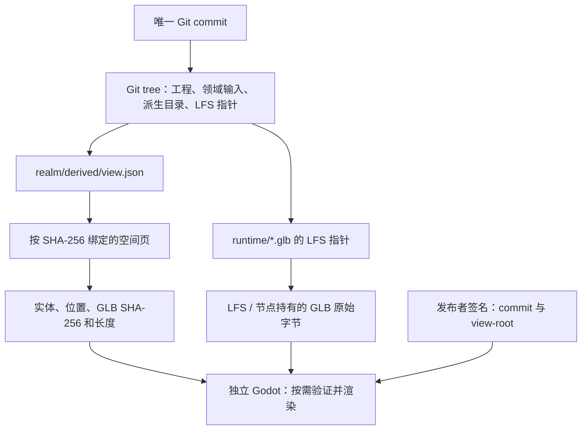

# Git 复用评估与 Realm of Us 架构调整提案

> 2026-09-14：本文保留方案形成时的论证。用户已授权 G1–G4 实现，工程目录统一为 `realm/`；当前可执行命令、格式和实测边界以 [新规范](../protocol/spec/s1-repository.zh-CN.md) 与 [验收](../experiments/S1-Git-results.zh-CN.md) 为准。下文“拟议/待实现”描述研究时点，不是当前实现状态。

## 1. 结论与决策范围

建议采用原生 Git 作为唯一的工程文件树、提交、分支和合并历史，使用标准 Git LFS 管理 Blender 源工程、重型贴图及运行时 GLB。创作者日常统一使用 rou：常见 Git 操作通过薄封装委托原生 CLI，rou 同时协调世界规则、实体身份、空间索引、创作依赖、构建验证、编辑器集成和按需分发。用户不需要在两套命令之间来回切换，也不维护两套状态。停止继续扩展自研通用文件树、暂存索引、ignore、文本合并和第二套提交图。

这是一项有实验证据支持的重构提案，不是已经完成的仓库实现。项目仍处于预研阶段，旧仓库格式与设计可以退出，不实现一次性转换器、旧提交映射或旧格式读取兼容，也不维护双后端。新工程布局、命令和发布契约须在后续重构阶段实现。现有工作源文件与模型保留；旧实现、向量和实验报告只记录历史行为，不构成新格式的兼容约束。

推荐方案保留四项产品边界：世界内容可以脱离中心平台分发；作者可保留原始工程树；重资产按需获取；独立 Godot 客户端只浏览，不需要 Git、Git LFS、Blender 或放置模式。Godot 放置编辑由编辑器插件承担，模型与实例进一步分离继续作为后续优化，不作为 Git 迁移前提。

| 决策 | 推荐调整 | 主要依据 |
| --- | --- | --- |
| 工程历史 | Git commit/refs/index 成为唯一权威 | 已验证普通文件、分支、稀疏检出、改名、离线恢复和合并行为 |
| 重资产 | 原始源文件与 runtime GLB 都先使用标准 LFS | 已验证真实 `.blend`/GLB 的指针、选择性下载、内容校验和自定义传输 |
| 空间选区 | rou 将 chunk/entity 选择转换为工程路径及依赖集合 | Git 的选择单位是路径，不理解 entity、AABB 或共享库依赖 |
| 世界结果 | 可读路径的领域输入、构建记录和派生目录进入同一个 Git tree | 避免工程版本和可浏览世界使用两套独立 HEAD |
| 查看器 | 读取固定版本的目录、证明/发布记录和 GLB 字节 | 无需给 Godot 实现完整 Git 客户端 |
| P2P | 保留 S2；在 LFS transfer 与查看器资源提供接口后接入 | 传输适配已证明可替换，发现、续传、治理仍需实现 |
| 目录 | 默认采用标准 `.git/` 加本地 `.rou/` | 最大程度保留 Git 工具兼容；隐藏 Git 实体目录是可选布局 |

优先推进的是一个有限的 Git 原型迁移：完整工程树、可复原作者工程、README 独立提交、空间依赖选取和确定版本浏览。公开 P2P、发布签名和自动空间合并继续按 S2 的边界分阶段完成。

## 2. 评估依据与当前实现差距

评估基于 2026-09-13 当前 Mac 工作区、项目源代码、Git/Git LFS 官方资料和隔离仓库实验。部分机器回执使用 UTC，因此记录日期为 2026-09-14。实验使用 Apple Git 2.50.1 和已安装的 Git LFS 3.6.1；这些版本只描述本次环境，不是将来的发行依赖建议。后续打包应重新选择并锁定仍受维护的版本。

S1.3 的[第一次 Git 实验](../experiments/S1.3-results.zh-CN.md#git-复用实验与决定)已经证明元数据分文件合并、冲突和部分 clone 可行。当时保留 Go 引擎是阶段范围选择，报告没有证明 Git 不适用或自研更快。现在新增原始工程树、可读路径、共享外部依赖与普通文本版本管理，通用版本控制需求明显增加，因而需要重新选择。

| 当前能力 | 已实现边界 | 采用 Git 后的处理 |
| --- | --- | --- |
| 自研 commit、refs、HEAD、reflog | 世界实体快照及本地历史 | 由 Git 替代；不转换旧历史或保留 ID 映射 |
| clone/fetch/pull | 本地提供者、目录与源/GLB 对象；pull 仅快进 | Git 管历史与远端；LFS/rou 管对象获取 |
| checkout/sparse-checkout | 选区源库、整世界选择、覆盖保护 | 保留空间语义，工作文件切换交给 Git |
| diff | 实体增删改 | Git 文本/路径 diff 加 rou 领域 diff |
| `staging/` | Blender 导出的贡献包 | 改为 `.rou` 内构建暂存，Git index 承担真正暂存 |
| 手工目录、README、整场景 `.blend` | 参与本地 dirty 检测，但未作为任意文件树保存 | 由 Git/LFS 正式跟踪和恢复 |
| merge、ignore、通用索引 | 未实现 | 优先复用 Git，补充领域验证 |

有三处接入前必须处理的现状。工作区实现的文件清单是本机基线；一次模型提交可能更新 README 的干净基线，却没有把 README 字节写入历史。其目录扫描只跳过 `.rou`，直接在同一 realm 目录运行 `git init` 会把 `.git` 的内部修改纳入当前 dirty 检查。根 `realm.json` 当前也是选区派生目录，不能直接改成“Git 跟踪的完整世界权威文件”而不更改读写逻辑。

这些差距说明需要迁移工作区与版本接口，而不是在现有 `.rou/HEAD` 旁边再增加一个 Git HEAD。[仓库当前边界](../old-doc/repository-2.0.md)和文件链路继续作为迁移前行为说明。

## 3. 方案比较

Git 的 blob 保存内容、tree 保存路径与对象关系、commit 固定根 tree 和父提交。复用这些机制可以直接获得完整工程树的历史，而不要求按 entity 或 chunk 拆解每一种文件。[1. Git 对象模型](https://git-scm.com/book/en/v2/Git-Internals-Git-Objects)

| 方案 | 优点 | 主要成本或限制 | 结论 |
| --- | --- | --- | --- |
| A. 继续自研完整 VCS | 所有格式、存储和 API 自由设计 | 需补齐文件树、索引、ignore、文本合并、引用同步、恢复与回收；维护面持续扩大 | 不推荐作为主线 |
| B. 原生 Git，全部二进制直接进 Git | 最少外部系统，可用 partial clone | 大型二进制进入 pack 历史；按资产独立提供与块级传输不自然，实际增量收益须测量 | 可作小型仓库/对照实验 |
| C. Git + 标准 LFS，源与 runtime 都走 LFS | 普通 Git 工作树；统一重文件指针；可替换传输 | 增加 LFS 依赖；整文件版本、缓存及推送可用性仍需管理 | 推荐首轮方案 |
| D. Git + LFS 源工程，runtime 单独 rou CAS | 浏览资产可完全由节点独立管理 | 首轮就有两种上传/可用性/GC 闭包；需要自研 runtime 发布路径 | 保留为有证据后再采用的优化 |
| E. Git 只存自定义指针，rou 管所有载荷 | 格式与 P2P 自由度高 | 若工作树要保持真实 `.blend`，需重做 clean/smudge、指针校验、缓存和分发，接近重造 LFS | 暂不推荐 |

LFS 在 Git 中保存带 SHA-256 和长度的文本指针，工作树可保留真实文件；它不要求把源工程重新导出成逐实体 Collection 库后才能保存。Git 对象 ID 和 LFS 载荷 ID 是不同命名空间：前者标识 Git 编码对象，后者标识文件原始字节。[2. LFS 存储规范](https://github.com/git-lfs/git-lfs/blob/main/docs/spec.md)

原生 Git 的 pack 可以压缩及差量表示对象；LFS 常规版本存储则以完整文件对象为单位。不能承诺 `.blend` 或 GLB 发生很小改动时只增加很少空间，也不能把传输续传当作版本间二进制差量。[3. Git Packfiles](https://git-scm.com/book/en/v2/Git-Internals-Packfiles)

首轮使用本机原生 Git/Git LFS 进程作为后端，由 Go 编排确定参数、工作目录和结构化输出。暂不直接用 go-git 替代原生 Git：官方兼容表注明部分操作有限制，其 partial clone 议题还区分“发送 filter”与“完整 promisor/按需补取支持”。这不否定嵌入式库，而是避免尚未验证的兼容性成为迁移前提。[4. go-git 兼容表](https://github.com/go-git/go-git/blob/main/COMPATIBILITY.md)、[5. partial clone 议题](https://github.com/go-git/go-git/issues/1381)

## 4. 唯一历史与工程布局

推荐一个 Git commit 同时确定创作输入、领域输入、构建记录、可浏览目录和 LFS 指针。realm/view 的哈希是内容标识；它没有独立可推进的 HEAD，也没有第二条 rou commit 父链。README-only 的两个 Git 提交可以复用相同世界结果，这不构成两套历史。

以下为新格式草案，不是当前 checkout 的输出：

```text
my-realm/
├── .git/                              # Git 历史、refs、index；LFS 本地对象
├── .rou/                              # 本地选区、导出暂存、构建与浏览缓存
├── .gitignore
├── .gitattributes
├── README.md
├── LICENSE
├── realm.json                         # 新格式：不可变世界规则/身份入口
├── docs/
├── sources/                           # 作者原始文件树，保留自定义子目录
│   ├── buildings/house_a/house.blend
│   └── shared/
│       ├── trees/oak.blend
│       └── textures/bark.png
├── realm/
│   ├── authoring/house_a.json          # binding ID→源工程入口与文件依赖
│   ├── entities/house_a.json           # 稳定 ID、放置、authoring binding ID
│   └── derived/
│       ├── builds/house_a.json         # 输入摘要、导出设置、输出引用
│       ├── chunks/0_0_0.json           # 派生空间页，文件名不要求哈希
│       └── view.json                  # 可浏览根，绑定全部派生页
└── runtime/house_a.glb                 # 可读输出路径，Git 中保存 LFS 指针
```

目录是推荐布局，必须约定的部分应尽量少。`realm/authoring` 是源工程路径、入口和依赖绑定的唯一权威；entity 只引用 binding ID，不重复保存另一份可编辑的源路径。多个绑定可以使用同一个 `.blend` 的不同入口；共享文件只在工程树中登记一次。文件路径不从 chunk 坐标推导，跨块实体仍只定义一次。空目录通常不需要独立历史语义；需要模板目录时可以保留说明文件。

`.gitignore` 负责团队共享的忽略规则，Git 本地 exclude 负责个人规则；不增加同用途的 `.rouignore`。`.rou/`、Godot 导入缓存、Blender 备份及离线渲染中间产物可默认忽略。已跟踪文件不会因后来匹配 ignore 自动退出版本管理；必要依赖若尚未被跟踪，构建验证应明确指出缺口。[6. Git ignore](https://git-scm.com/docs/gitignore)

新格式的根 `.gitignore` 应包含 `/.rou/`。该目录仅保存本地选区、会话和构建/浏览缓存，不保存唯一的源工程、世界规则或团队共享的依赖绑定。`realm.json`、`.gitattributes`、原工程树及正式 `runtime/`、`realm/derived/` 则按方案进入版本管理。

默认保留标准 `.git/` 是为了正常使用 Git CLI、IDE、托管与排错工具。若坚持所有内部对象都在 `.rou` 下，Git 支持 `.git` 文本文件指向 `.rou/git/`；本次已验证原生 CLI 能正常提交和查看状态，但没有验证所有 IDE、worktree 和 LFS 组合。因此这是可选布局，不能悄悄改变默认工具假设。[7. Git 仓库布局](https://git-scm.com/docs/gitrepository-layout)

Git index 替代原 `staging/` 的暂存职责；`.rou/build/` 可保存 Blender 导出中间结果，验证后再更新可读 runtime 路径及派生文件。LFS 缓存和工作文件的字节可能重复保存；先保证可编辑副本不会改坏不可变历史，跨缓存/工作区物理去重再根据测量决定。

## 5. 空间选区、文件选区与按需下载

三种选择分别解决不同问题，不能合成一个含糊的“partial”：

| 层次 | 决定什么 | 承担者 |
| --- | --- | --- |
| 空间选择 | 哪些 chunk/entity 属于本次创作范围 | rou |
| 工程路径选择 | 这些实体的源工程、共享依赖和说明文件在工作区如何呈现 | rou 推导，Git sparse-checkout 执行 |
| 对象获取 | 本地缺少哪些 Git 对象或 LFS 文件字节 | Git partial clone / LFS fetch / 后续节点提供器 |

Git sparse-checkout 负责工作区路径；partial clone 限制下载的 Git 对象并补取缺失对象。前者不等于少下载历史，后者也不会识别 chunk 或自动推导 Blender 依赖。[8. Git sparse-checkout](https://git-scm.com/docs/git-sparse-checkout)、[9. Git partial clone](https://git-scm.com/docs/partial-clone)

首轮建议允许完整获取轻量 Git 历史、文本和 LFS 指针，跳过 LFS 自动展开，再只拉取选区所需载荷。这样在没有 filter 支持的普通 Git 提供者上也能避免全量下载重模型。原生 `--filter=blob:none` 是可选规模优化；启用后需识别服务端是否支持，不能在 filter 被忽略时仍报告“元数据量已受控”。大量实体元数据的路径选择、树规模和延迟另设基准。

标准 Git/LFS 的默认行为要分别说明：普通 `git fetch` 取得 Git 对象和引用，不展开工作树，也不自行取得 LFS 载荷；`git clone` 的默认 checkout 在启用 LFS filter 时可下载所检出版本、所检出路径需要的载荷，不等于全部历史模型。`git lfs fetch` 才是显式载荷下载，可限制 ref 和路径，而且不改工作文件；`git lfs checkout` 再从本地载荷物化文件。`git lfs fetch --all` 用于获取指定引用可达历史中的所有 LFS 对象，不用于“选择当前版本整个世界”。[20. Git fetch](https://git-scm.com/docs/git-fetch)、[21. LFS fetch](https://github.com/git-lfs/git-lfs/blob/main/docs/man/git-lfs-fetch.adoc)、[22. LFS checkout](https://github.com/git-lfs/git-lfs/blob/main/docs/man/git-lfs-checkout.adoc)

拟议 `rou clone` 在首次 checkout 前控制 LFS：先 `git clone --no-checkout`，再设置仓库局部的 `git lfs install --local --skip-smudge`，初始化只呈现世界元数据的空间工作区。后续由 rou 根据固定 commit 和选区显式 fetch/checkout 载荷。直接使用原生 clone 时可先用 `GIT_LFS_SKIP_SMUDGE=1 git clone ...`，随后设置相同局部策略；只在 clone 命令前设置环境变量不会永久约束之后的 switch。这些局部设置不会随 clone 自动复制，需要每个工作副本初始化。受控 LFS fetch 同时应避免用户配置的 recent 扩展下载，并明确 include/exclude 的作用范围。[23. LFS install](https://github.com/git-lfs/git-lfs/blob/main/docs/man/git-lfs-install.adoc)

rou 的空间选择流程应固定目标 commit，读取该版本的 realm/authoring/实体输入，展开共享库和贴图依赖，生成 Git 路径规则，然后获取 LFS 载荷并物化真实工作文件。某个 entity 跨多个 chunk，只展开一次；只选择一个实体但它位于一个包含几十个实体的 `.blend` 中，仍可能下载整个工程文件。这个粒度限制不能由 sparse-checkout 消除。

按 chunk 找实体还依赖该版本有效的 AABB 和空间索引。首轮对未构建或派生目录过期的草稿，只开放明确 entity/工程路径选择，并提示先构建后按块选择；不能借用旧索引静默漏掉新建或移入区域的实体。已验证的发布版本正常支持空间选取。

Git cone 模式按目录选择，速度和工具兼容性较好，但可能带入同目录其他文件。当前官方文档已将 non-cone 标为 deprecated，因此初期按资产目录推导 cone 选区，LFS 下载再按实际依赖限制；带入同目录路径不要求取得其中每个重文件的载荷。已有小集合 non-cone 实验仅证明旧版 Git 的路径投影机制，不作为新默认模式，也没有测量十万文件或任意特殊路径。[8. Git sparse-checkout](https://git-scm.com/docs/git-sparse-checkout)

应保留 `set` 替换、`add` 追加以及 `--all` 的空间含义，底层调用 Git 而不重做文件替换事务。版本切换后必须按新版本重新计算依赖，不能沿用旧版本的文件清单。普通 `git checkout` 可以使用，但插件应检测 commit 改变，把仍打开的旧编辑器会话标为 stale，要求重新载入或显式重应用修改；不能直接把旧场景的 base 改成新 HEAD。磁盘目录信息可以自动刷新，Blender/Godot 内存场景不能因此被视为已切换。

以 `git switch -c feature/garden` 后接 `rou sparse-checkout set --chunk ...` 为例：前者默认从当前 HEAD 新建分支，提交内容不变，通常不更改模型文件。后者保持 HEAD 不动，将空间选区解析成目录和依赖，再更新工作区路径并获取所需 LFS 文件。收缩选区会从工作区移除干净的受跟踪文件，但不是 `git rm`，历史和已缓存载荷仍在；不会顺带回收缓存。切换到另一个提交的已有分支则不同：Git 先在现有 sparse 规则下更新路径，rou 随后需按新版本协调依赖。[24. Git switch](https://git-scm.com/docs/git-switch)

空间收缩前 rou 必须检查将移除目录内的本地修改和作者文件。Git sparse 的行为不能等同于“永不清理 ignored 文件”；作者备份不能只因被 ignore 就视为可自动删除。多步选择、下载和物化也不构成跨命令原子事务，中断时应明确保留未就绪状态。

LFS 默认 smudge 可以在 checkout 时下载载荷。因此受控下载入口需要明确配置 skip-smudge、按路径 fetch、再 checkout 物化；`git lfs checkout` 自身不负责下载缺失载荷。本次实验中它可在缺失载荷时返回成功状态并留下指针，所以不能只检查进程退出码。打开 Blender 或构建前必须确认实际文件字节与期望 OID/size 一致。[10. Git LFS 工作流](https://github.com/git-lfs/git-lfs/blob/main/docs/man/git-lfs.adoc)

## 6. 源文件、暂存内容与构建一致性

文件树保存作者原始工程，不要求把一份场景拆成若干源库才能进入历史。逐实体导出仍可用于得到运行时 GLB；保存源工程与构建运行资产是两个操作。纯 README 提交不调用 Blender，复用既有 view-root；模型或共享依赖修改则需要识别受影响的导出。

领域输入与派生输出应拆开：`realm/entities` 保存作者意图，`realm/derived` 保存 asset 引用、世界 AABB、chunk page 和构建记录。若把 source/transform 与输出 asset hash 写进同一个记录，再把整个记录当作构建输入哈希，会形成输入依赖输出的循环。realm 固定配置也不要再反向包含该构建自身的 view-root 哈希。

放置以 `realm/entities` 为统一交换记录。Blender 中主动进行的放置编辑应显式导出为这份记录的变更；未来 Godot Editor 插件也读写同一契约。载入工程时核对会话基线并同步放置，仅修改网格的导出不能顺带用旧 Scene 位置覆盖另一位作者的新放置。保存完整 `.blend` 工程有利于恢复创作环境，但不让其中的旧位置自动优先于当前实体记录。

每个构建记录应至少固定源工程字节哈希、入口对象/Collection、依赖路径及字节哈希、领域输入摘要、导出器/Blender 版本及设置、GLB 哈希与长度。LFS 文件以 pointer 中的载荷 SHA-256/size 对应实际输入；普通文件按约定原始字节计算。不能只依据文件 mtime 或可读文件名判定“未变化”。

拟议 `rou build` 默认冻结本次相关的工作树输入与依赖，在 `.rou/build/` 的临时快照上构建，再将结果写回 `runtime/` 和 `realm/derived/`。作者可以先保存、构建和检查效果，再使用 `rou add` 显式暂存输入与输出。构建不自动 add，不提交，也不改变作者已经暂存的其他内容；未保存的 Blender 内存不属于构建输入。冻结期间若输入持续变化而无法得到一致快照，应停止并报告；构建期间工作树继续变化则须显示输出对应的旧输入，不能把结果当作当前文件的构建。

完整逻辑输入由实际工作文件与明确未检出路径的 index 记录组成；合并时读取合并后的 index，不从旧 HEAD 回填选区外实体或源。选区内应有而被删除的文件不得按 sparse 缺席自动恢复。工作树构建允许尚未暂存的新创作文件并记录其摘要，提交时再检查必需输入是否进入 index。

`rou commit` 默认校验实际 Git index 的领域输入、构建记录和输出一致性，通过后调用原生 `git commit`，再重读并校验真正创建的固定 commit。不得把已暂存的源 v1 与未暂存的源 v2 所导出的 GLB 合成一次声称一致的提交。提交入口不隐式 build、不隐式 add；若发现过期输出，明确要求构建并重新暂存相关文件。README-only 提交不运行 Blender，复用已验证的世界结果。若提交期间 hook 或其他进程改变了实际内容，使提交后检查失败，应报告该 commit 已创建但未通过世界验证，不自动回退分支或覆盖作者文件。

`rou build --staged` 保留为高级入口：读取 index 中已由 `rou add` 固定的输入版本，构建输出仍先写工作树。`rou validate --staged` 可单独检查准备提交的内容。假设暂存了源 v1，随后工作树另存为 v2，这两个入口仍读取 v1；选项自身不自动暂存或提交。`.rou/build/` 只保存临时副本和报告，不是另一份权威暂存索引。主流程使用默认工作树构建，再显式 add，无需日常携带 `--staged`。这些 CLI 契约尚未实现。

若 index 中的源 v1 与输出 v1 一致，未暂存的工作树 v2 不应阻止提交 v1，只显示剩余修改；只有 index 本身混合了不一致的输入与输出才拒绝。这保留了 Git 的部分暂存语义。

原生 Git 仍可用于诊断、IDE 集成和高级操作，也可能产生尚未完成构建的草稿提交。rou 应区分“Git 提交存在”“世界目录结构有效”“源与输出一致”“运行资产已在提供者上可用”。直接使用 Git 不会让未经验证的提交获得有效世界或正式发布资格；查看器不得无提示地显示过期 GLB 并声称它对应当前源文件。

本地 hook 可以提前提示，但 Git hook 能被跳过，也不会随普通 clone 自动成为统一强制策略。正式发布应由 `rou validate/publish` 或接收端从固定 commit 验证全部相关 Git blob、LFS pointer、依赖与派生索引；不能只验证当前工作树或可变 HEAD，也不能以之前通过 rou 提交代替接收端验证。[11. Git hooks](https://git-scm.com/docs/githooks)

## 7. 多人合并与冲突边界

普通 README、脚本和配置使用 Git 文件级差异与三方合并；实体可继续显示“移动、模型更新、覆盖 chunk 改变”等领域差异。JSON 能文本合并，不代表合并后的实体身份、坐标或依赖仍合法。本次构造了两个分支分别在不同文件中新建同一 entity ID 的例子：Git 成功合并，Realm 规则却必须拒绝结果。

派生 view-root 是并行构建的公共变更点，不能承诺避免所有 merge 冲突。建议合并领域输入和源文件后，重新生成冲突的派生页和根；不要使用 `ours` 自动选一份旧索引。即使 Git 没有报冲突，也要重新核验源输入摘要及完整空间索引。[12. Git merge](https://git-scm.com/docs/git-merge)

| 情形 | 处理 |
| --- | --- |
| 同 chunk、不同 entity、不同源文件 | 通常可文件级合并，随后验证领域结果 |
| 同 entity 的不同字段 | 可尝试文本/字段合并，但仍须验证整体实体 |
| 不同文件出现重复 ID | Git 可能无冲突，rou 必须检测 |
| 同 `.blend` 的不同对象 | 文件仍可能冲突；保留两版，人工在 Blender 合成 |
| 共享贴图/库修改 | 确定受影响构建，再明确更新派生结果 |
| 两端各自产生 view-root | 合并输入后重建，不把根当作者内容直接选边 |

LFS 指针发生冲突并不等于模型被合并；指针的基础、当前和对方版本应可供插件定位模型。现有 S1 对二进制明确人工处理的边界保持。LFS 锁可以作为特定提供者的协作辅助，但不能把它当成跨独立 fork 和离线节点的全局锁。

## 8. 独立 Godot 查看与版本绑定

独立查看器不读取作者 `.blend`，不启动 Git/LFS，也不解析 Git pack 或执行 checkout。它需要固定版本的世界目录、相应验证材料及运行时 GLB 原始字节。创作端和节点可以使用 Git/LFS 提供这些内容。



推荐把 view-root 及所有派生页直接纳入该 Git tree；文件使用可读路径，发布后节点可按原始 SHA-256 提供相同字节。构建记录和页内的 asset 引用必须与该 commit 的 runtime LFS pointers 一致。只有根在 Git 中、其余外置对象既未发布也未 pin 的方案，不具备可复原保证。

view-root 不包含自己的当前 commit ID，否则 commit 引用 tree、tree 引用 view-root、view-root 再引用 commit 会形成哈希循环。构建内容先生成并提交，发布记录随后绑定 `{realm_id, repository_id, git_object_format, commit_oid, view_root_sha256}`。发布记录属于不可变发布背书，不另建立世界提交 DAG。

对不可信提供者，单独一份写着 `commit_oid` 的导出 JSON 不足以证明它属于该提交。可以提供 raw commit、到 view-root 的必要 raw tree 路径和根 blob，逐层校验 Git 对象 ID；后续空间页和 GLB 用 SHA-256 校验。本次用四个对象、633 字节的微型例子验证了这条绑定路径及篡改拒绝，但它不代表真实大型 tree 的证明大小，也不是生产级解析器。

发布者签名可同时直接覆盖 commit 和 view-root，便于查看器验证其发布意图；这属于发布背书。Git 路径证明则说明根文件属于提交，两者不能混称。发布者授权、可信密钥和来源仍须显式确定，不能因为 JSON 给出了公钥就自动相信其代表官方仓库。

路径证明只证明归属，不证明输入与输出一致。修改源文件却保留旧 view-root 的提交仍可通过这条证明；它也不能独自证明所有 runtime pointers 和空间页都对应正确。只有可信发布者或本地可信版本桥接组件校验固定 commit 的输入、构建记录、runtime pointers 与完整索引后，查看器才能把它标为有效世界。仅有路径证明的内容保持未验证状态；如果改由 Godot 独立执行全部校验，就必须提供更大的验证材料集合，不能声称仍只需要四个对象。输入摘要匹配是必要条件，不是证明任意导出器诚实执行的密码学证据。

生产验证器还应限制证明字节数、tree 条目数和路径深度；raw tree 路径包含经过的完整 tree 对象，大目录需要合理分片。浏览状态保留“目录未知”“已验证为空”“实体已知但资源缺失”，网络 404 不能代表空 chunk。

Godot 现有 GLB 校验、距离加载、实体去重、自由浏览 UI 和独立应用打包可以保留；local_repository.gd对 `.rou/HEAD`、自研 commit/state/page 的读取应替换成版本目录提供接口。编辑器插件和浏览客户端可共享纯验证/加载代码，工作区写入仅存在创作端。

## 9. 身份、Git OID、签名与 P2P

realm 身份继续由固定世界规则及创世身份约束；fork 的仓库治理身份仍与 Git remote URL、目录路径不同。clone 不授予上游写权限，拥有资产副本不授予发布权。Git 自身不会强制 realm 参数在后续提交中保持不变，这仍属于 rou 验证。

fork 的新仓库身份放在治理/发布记录中，不要求重写继承的 Git 提交，也不把“当前 fork ID”嵌入每个历史 tree。第一次打开世界时需通过用户选择或受信来源确定 realm/仓库及密钥；已签名的旧版本仍可能被重放。可用签名引用序号和已见状态检测部分回退，但离线初次访问不能证明拿到的是全网最新版本。

Git 仓库的对象算法必须显式记录。当前 Git 文档说明默认 SHA-1，SHA-256 仓库与 SHA-1 仓库尚不能直接互操作；因此不能为了和现有 64 位资产哈希一致就无条件把所有 Git 仓库切为 SHA-256。首轮可用广泛兼容的 Git SHA-1 格式，领域对象/LFS 载荷保持原始 SHA-256，代码不得共用一个只接受 64 位字符串的 ID 类型。[13. Git init 对象格式](https://git-scm.com/docs/git-init)

Git commit/tag 签名可以保留作者的历史证明，但签名并不自动证明某人拥有官方仓库写权限，也不证明 GLB 可重建。S2 的发布/引用授权继续由治理规则判断。面向公开分发的签名记录应直接覆盖 SHA-256 view-root 和 realm/repository 身份，不仅覆盖一个未注明算法的 commit 字符串。[14. Git 签名格式](https://git-scm.com/docs/gitformat-signature)

直接签署 SHA-256 view-root 加强的是所发布世界内容的绑定，不会把 SHA-1 Git 提交及祖先链整体升级成 SHA-256 安全性；两种保证必须分别记录。

P2P 分为两个不同通道：历史/文本/指针由 Git 协议、Git bundle 或后续经过适配的节点交换；重资产由 LFS 提供器或 rou-node 按载荷 SHA-256 交换。Git partial clone 的 promisor 机制不能直接被描述为任意只持有一块资产的节点网络，它还依赖远端能够补齐所承诺的 Git 对象。区域资产节点可以不持有完整创作历史。

LFS 官方支持自定义 transfer process，standalone 模式可跳过 HTTP Batch API。这样可以让标准 LFS 指针与工作树保持不变，由后续 `rou-node`/传输适配器根据 OID 发现节点、拉取、重组并交回完整文件。本次本地适配器已经在配置不可用 HTTP API 的条件下成功获取文件；错误字节也被 LFS 拒绝。这证明接入点可行，不代表 P2P 发现、NAT 穿透或网络续传已经实现。[15. LFS 自定义传输](https://github.com/git-lfs/git-lfs/blob/main/docs/custom-transfers.md)

S2 可在整文件 OID 下增加传输 block 图，用于多节点并发和续传；最终仍需验证完整文件 SHA-256。是否采用固定块或内容定义分块，应根据真实 `.blend`/GLB 版本测量决定。不能承诺分块会自动消除两种格式中重复贴图，或把跨格式编码差异视为相同块。

公共 Git 托管和 LFS HTTP 服务可以作为提供者，均不是核心平台依赖。自定义 transfer 的安装是本机工具配置，不应从下载的 realm 任意脚本自动执行。可选择官方提供者、个人 fork 或局域网/离线副本，公开读取范围仍由明确发布及开启共享决定。

## 10. 可用性、缓存、离线与回收

Git refs 已推送成功不等于全部 LFS 对象在浏览提供者上可用。正常 LFS 工作流有上传步骤，正式 release 还应检查该版本的目录闭包、必要 runtime OID 及提供者的持有范围。草稿分支可以暂时不完整，发布状态必须区分“仅目录已知”和“所需资产可取得”。

同一 LFS 对象的工作区副本、本地缓存、远端副本和查看器缓存可能占用多份空间。本次验证同字节的两个路径只产生一个 LFS 内容对象，但工作文件与缓存是不同文件。先统一 OID 和提供接口；暂不让多个组件通过硬链接共同修改文件，也不让 viewer 清理 LFS 正在使用的目录。

节点通过载荷提供接口解析 OID，不把 `.git/lfs/objects` 的布局写进公开协议或 Godot。Git 独立目录、多个 worktree 和 LFS 自定义存储位置都可能改变实际缓存路径。

Git 的可达性/GC 与 LFS 的缓存回收不是同一个闭包。release pin、离线工作集、正在构建的依赖、未推送对象和查看器引用必须纳入各自持有者的保留规则。Git 对象回收不能替代 LFS 或节点资产的保留承诺。统一 CAS 可作为后续优化，但须先明确谁负责删除以及哪些发布仍依赖该对象。[16. LFS 配置与缓存行为](https://github.com/git-lfs/git-lfs/blob/main/docs/man/git-lfs-config.adoc)

保留 Git 历史不代表所有旧版本的 LFS 载荷会一直留在本机。LFS prune 有自己的近期使用与远端确认规则；离线版本 pin 必须覆盖实际载荷保留，不能只创建一个 Git ref。[19. LFS prune](https://github.com/git-lfs/git-lfs/blob/main/docs/man/git-lfs-prune.adoc)

Git bundle 可以离线搬运 Git 对象和 refs；它不把 LFS 的真实模型字节自动装入同一个包。完整离线交付应增加所选 OID 的载荷和目录清单，并校验接收端缺口。本次只实测了已缓存版本离线恢复，没有完成新的 Realm 离线 bundle 产品。[17. Git bundle](https://git-scm.com/docs/git-bundle)

## 11. CLI、编辑器与模块调整

建议创作者日常统一使用 rou，常见版本操作保持 Git 的命令习惯，通过薄封装调用原生 Git/LFS；空间选择、构建、领域差异、验证和发布增加世界语义。`.git` 始终是唯一的 index、HEAD、refs 和历史，`.rou` 只保存本地选区、会话、临时构建与缓存。封装不意味着重新实现 Git，也不要求用户日常混用两套命令。原生 Git 和 IDE 仍可诊断或进行高级操作，因此 rou 每次必须读取真实 Git 状态，检测外部版本切换与过期编辑器会话。

| 职责 | 建议接口方向 | 当前状态 |
| --- | --- | --- |
| 文件添加/提交/分支/历史 | `rou add/commit/switch/branch/log/restore` 委托同名 Git 操作 | Git 具备；rou 新后端与提交验证尚未接入 |
| 普通文本与领域差异 | `rou diff` 委托 Git diff 并补充实体语义 | 需定义输出和领域结果验证 |
| 历史获取与快进更新 | `rou fetch`；`rou pull` 默认只快进 | 委托 Git，更新版本后重新协调空间依赖 |
| 合并 | `rou merge` 委托 Git 合并，重建派生目录后验证 | 分叉合并暂不自动创建提交，等待输入解决与结果检查 |
| 推送 | `rou push` 委托 Git push 与 LFS 上传 | 按拟推送引用及历史检查载荷，不能按当前 sparse 选区截断 |
| realm 初始化和配置 | `rou init` 或显式初始化入口 | 需要替换现有初始化逻辑 |
| 空间编辑范围 | rou 空间选择 → Git sparse + LFS hydration | 当前空间选择可复用，后端需替换 |
| 源与 GLB 构建 | `rou build` / Blender 插件 | 新契约待实现 |
| 世界结构/构建一致性 | `rou validate`，含 index/固定 commit 范围 | 新入口待实现 |
| 固定版本发布与节点 pin | `rou publish` / 节点接口 | S2 待实现 |

普通文件提交的目标使用方式是 `rou add README.md`、`rou commit`，不需要导出。模型贡献的目标流程是：选定空间范围 → 在 Blender 保存原始工程 → `rou build` 冻结相关工作树输入并构建 → `rou add` 显式暂存输入与派生输出 → `rou commit` 自动校验 index、提交并校验实际 commit。详细的双人操作、底层 Git 命令及工作树、`.rou`、`.git` 变化见[统一 rou 多人协作流程](git-rou-collaboration-workflow.zh-CN.md)。这些命令描述重构后的目标契约，不是当前可执行教程。

`rou pull` 默认取得远端历史后只做快进；发生分叉时停下，由作者显式 `rou merge`。分叉合并使用 `git merge --no-commit`，先解决作者源文件与领域输入冲突，再由 rou 重建派生 GLB、空间页及根文件，显式 add 后提交。不能让旧派生文件的冲突阻止读取已经解决的作者输入，也不能通过自动选择 `ours` 掩盖派生不一致。若合并可快进，则先验证固定目标，再执行 `git merge --ff-only`；`--no-commit` 自身不能阻止快进更新。[12. Git merge](https://git-scm.com/docs/git-merge)

`rou push` 不把当前空间选区当作上传范围。标准 Git/LFS 推送依据拟推送引用和历史安排载荷：合并进来的其他作者模型可能不在本地工作树中，但仍需由目标提供者持有或按约定可取得。推到已经持有这些对象的同一远端可以避免重复上传；推到新的 fork 提供者则需要补齐其缺失载荷。缺少历史载荷时应明确报告，不能仅因当前 HEAD 可浏览就宣称历史已完整保存；正式发布还需执行固定版本的可用性验证。

| 代码位置 | 保留 | 替换或调整 |
| --- | --- | --- |
| `protocol/`、`toolchain/realm_format/` | 空间规则、GLB 校验、量化与跨端向量 | 新工程/领域/发布 schema；Git OID 与资产哈希类型分离 |
| `repository/refs.go`、`history.go` | 可参考现有行为测试 | 自研 refs/reflog/commit DAG 改由 Git |
| `repository/worktree.go`、`switch.go` | 领域选区和未提交保护的验收意图 | 文件 inventory、checkout、暂存与恢复委托 Git；补插件会话基线 |
| `repository/selection.go`、`preview.go` | chunk 范围、实体选择、领域合并和索引验证逻辑 | 与路径/依赖解析连接，不再以旧 workspace 格式为中心 |
| `repository/storage.go`、`transfer.go` | 完整性检查思路、提供者边界 | Git/LFS 适配与明确的节点职责；移除旧仓库 CAS 路径，不提供兼容读取 |
| `toolchain/blender/rou_authoring/` | 实体 ID、坐标转换、GLB 导出、局部放置 | 保存原工程及共享依赖、index 输入验证、source/placement 往返 |
| `toolchain/cmd/rou/` | 命令装配与领域参数 | 常见 Git 命令增加薄封装，移除通用 VCS 重复实现，接入 Git/LFS 与领域校验 |
| `client/app/` | 渲染、GLB 验证、区域加载、通用浏览 UI | 用固定版本目录提供器替换旧 `.rou` 历史读取 |
| `node/`、`server/` | S2 节点、可替换信令、可选平台边界 | 节点对接 Git 元数据、LFS OID 与发布证明；不需要先引入 Supabase |

上述保留指算法、接口意图或代码片段，不意味着可以不改调用链直接搬用。尤其旧 `CommitWorktree` 把所有根文件扫描结果当成本地干净基线的行为，不应移植到新后端。

## 12. 重构阶段与验收门槛

建议将下一阶段标为 S1-Git 重构，不回写“原 S1 从一开始就使用 Git”。本次研究完成可行性门槛 G0；其余阶段是明确待办，不因文档调整自动变为完成。

| 阶段 | 交付 | 通过条件 |
| --- | --- | --- |
| G0：可行性评估 | 本报告、原生 Git/LFS 隔离实验 | 文件树、按需获取、真实载荷、绑定与失败边界有证据；本次完成 |
| G1：完整创作树 | Git 唯一历史、LFS、ignore、原始 `.blend`/文本跟踪 | 新 clone 展开真实载荷后，原工程可在 Blender 打开，多实体和共享依赖有效；自定义目录、README-only 提交、dirty/改名/删除正确 |
| G2：领域与构建 | 输入/派生分离、共享依赖、固定版本构建、空间选择适配 | 稀疏闭包完整；未检出不删除；源 v1/输出 v2 混用拒绝；共享库更新定位过期实体；旧编辑器会话不能借新 HEAD 提交 |
| G3：查看器与合并 | Git 版本目录桥接、生成页重建、Blender 导出/独立 Godot 浏览往返 | 固定版本可浏览；未知/缺失明确；二进制冲突保留；文本合并后领域验证；独立 app 无 Git/Blender 依赖 |
| G4：旧实现清理与回归 | 移除旧仓库后端，按新格式重新生成样例，更新脚本与指南 | 无转换器、旧格式读取或双后端；使用保留的作者工程完成新格式样例；新建/克隆、空间选择、构建与浏览在当前 Mac 重验 |
| S2：公开分发 | 发布签名、提供者、LFS/P2P adapter、pin/离线/续传 | 无中心平台的两节点按需协作与离线恢复；不把 G0 的本地适配器当成 P2P 完成 |

按新格式重新创建受控样例与验收仓库，使用现存作者工程、模型和贴图作为输入，不转换旧 `.rou` 提交或制造 Git 历史。可丢弃的是预研设计及旧实现约束，不是作者的实际源文件；未保存的原始多实体 `.blend` 也不能宣称已从逐实体源库恢复。

当前没有必须维持线上兼容的正式协议。各阶段实现只以新的 Git/LFS 后端为目标，不为同一个仓库双写历史；G4 清理剩余旧实现、测试入口与说明。旧实验报告可作为历史记录保留，适用的空间/GLB 向量可复用为几何验证材料，但旧格式及其冻结状态不约束新方案；新工程与发布格式独立版本化。

Godot Editor 放置插件继续使用同一领域输入与构建契约，可在这些接口稳定后独立推进；不以完成整个编辑器插件作为 G1 文件树迁移的前提。

实施中至少补充以下尚未验证的验收：路径特殊字符/大小写冲突、多个 worktree 的局部 `.rou` 状态、跨进程 index 变化、共享库依赖环、忽略但必需的文件、LFS pointer 缺失/错误、上传中断和发布可用性、派生 root 冲突重建、旧 source 放置覆盖新位置、大资产与大量实体的性能、实际 Git/LFS HTTP 或 SSH 提供者。Windows/Linux、公开 WAN 和完整 P2P 不在本次实测范围。

## 13. 实验结果与复现

原生 Git 实验包含 18 项检查，LFS 实验包含 17 项检查，均在隔离目录完成。它们验证所需的机制，不等于新的 Realm 工作流端到端验收，也不提供性能排行榜。

| 实验 | 结果 | 证据边界 |
| --- | --- | --- |
| 原生 filtered clone | 起初省略 8 个 blob；对象目录 1,967 字节 | 本地 file:// 远端明确支持 filter |
| 只选 A 及共享依赖 | A 的 2 MiB 载荷取得，B 仍缺失；对象目录约 2.10 MB | 两份合成二进制，不是 Blender 渲染或网络吞吐测试 |
| 全工作树展开 | B 随后取得，对象目录约 4.20 MB | 当前提交文件，不是所有历史资产全量获取 |
| 文本提交与改名 | README 单独提交；未选文件保留；改名复用内容对象 | 原生 Git 已验证，rou 尚未接入 |
| 本地修改与离线 | 覆盖性 checkout 拒绝；已有对象可在远端不可用时恢复 | 未缓存对象仍需提供者 |
| 世界语义冲突 | Git 干净合并可得到重复 entity ID | 证明必须增加领域验证 |
| Git → view-root 绑定 | 微型例子 4 个 raw 对象共 633 字节；篡改拒绝 | 只验证 SHA-1 路径机制，不是签名/恶意解析器测试 |
| 真实 LFS 源 | 62,334-byte `.blend` 在工作树保持原字节，Git 保存指针 | 输入来自已有 S1 源库，不是新作者场景导出 |
| LFS 同内容复用 | 两个源路径共用一个对象 | 工作区副本仍分别存在 |
| LFS 选择性获取 | skip-smudge clone 零载荷；只 fetch 一个源 OID | 指针与真实文件的状态已区分 |
| LFS 默认 checkout | 未跳过 smudge 时自动取得当前版本载荷 | 必须显式设计受控下载入口 |
| LFS 版本存储 | GLB 从 1,796 到 1,828 字节，两份完整对象共 3,624 字节 | 修改 JSON 元数据、保留 BIN chunk；不是模型重建性能测试 |
| LFS 二进制冲突 | 两分支源修改产生三阶段冲突索引 | 不具备 `.blend` 内部自动合并 |
| LFS 自定义传输 | 绕过不可用 HTTP API 获取本地对象；错误载荷被拒绝 | 本地文件适配器，不是网络 P2P |

精简回执：[原生 Git](data/git-authoring-evaluation.json)、[Git LFS](data/git-lfs-evaluation.json)。完整命令日志保存在各脚本输出的 `build/git-reuse-evaluation/` 新运行目录；不会修改项目自身的 Git 历史。原生对象目录大小包含 pack/index 等文件，不能作为线上传输字节数。

原生 Git 复现，使用 Bash，从项目根运行：

```bash
python3 toolchain/build/probe_git_authoring.py
```

LFS 复现需要三个字节不同的真实 `.blend` 版本及一个 GLB，路径由调用者提供；脚本复制输入而不修改它们：

```bash
python3 toolchain/build/probe_git_lfs.py \
  --blend /absolute/path/to/example.blend \
  --blend-left /absolute/path/to/example-left.blend \
  --blend-right /absolute/path/to/example-right.blend \
  --glb /absolute/path/to/example.glb
```

原生脚本使用合成二进制，其 `.blend` 文件名不表示有效 Blender 模型；小型 Git tree 解析也仅用于探测对象绑定。LFS 脚本使用此前 Blender 导出的三个真实源库版本，并为 GLB 生成保留 BIN chunk 的 JSON 元数据变体。本次未重新运行 Blender 导出、打开完整作者场景或进行渲染验收。

## 14. 资料与来源

官方网页检索日期为 2026-09-13（本地时区）。Git 文档可能描述比本机更新的版本；涉及本机行为的结论以附带回执为准。Git 的 hash transition 文档是设计说明，不能据此宣称 SHA-1/SHA-256 跨仓库互操作已经完成。

1. Git / Pro Git，[Git Objects](https://git-scm.com/book/en/v2/Git-Internals-Git-Objects)：文件树、对象与提交。
2. Git LFS 项目，[Specification](https://github.com/git-lfs/git-lfs/blob/main/docs/spec.md)：指针、载荷 SHA-256 与工作树转换。
3. Git / Pro Git，[Packfiles](https://git-scm.com/book/en/v2/Git-Internals-Packfiles)：Git 物理对象压缩。
4. go-git 项目，[Compatibility](https://github.com/go-git/go-git/blob/main/COMPATIBILITY.md)：库兼容范围。
5. go-git 项目，[Support partial clones #1381](https://github.com/go-git/go-git/issues/1381)，2025-01-15 创建：filter 与完整按需对象支持的区别；读取时仍为开放议题。
6. Git，[gitignore](https://git-scm.com/docs/gitignore)：共享忽略规则与已跟踪文件行为。
7. Git，[gitrepository-layout](https://git-scm.com/docs/gitrepository-layout)：Git 目录、gitfile、index 与 refs。
8. Git，[git-sparse-checkout](https://git-scm.com/docs/git-sparse-checkout)：路径选择、cone/non-cone 和未检出文件。
9. Git，[partial-clone](https://git-scm.com/docs/partial-clone)：filter、promisor 和缺失对象补取。
10. Git LFS 项目，[git-lfs manual](https://github.com/git-lfs/git-lfs/blob/main/docs/man/git-lfs.adoc)：clean/smudge、checkout 与推送流程。
11. Git，[githooks](https://git-scm.com/docs/githooks)：本地 hook 与接收端检查。
12. Git，[git-merge](https://git-scm.com/docs/git-merge)：合并状态、冲突与提交。
13. Git，[git-init](https://git-scm.com/docs/git-init)：对象算法和 separate-git-dir。
14. Git，[gitformat-signature](https://git-scm.com/docs/gitformat-signature)：commit/tag 的签名字节与格式。
15. Git LFS 项目，[Custom Transfers](https://github.com/git-lfs/git-lfs/blob/main/docs/custom-transfers.md)：独立传输适配器协议。
16. Git LFS 项目，[git-lfs-config](https://github.com/git-lfs/git-lfs/blob/main/docs/man/git-lfs-config.adoc)：载荷传输、缓存路径与自定义适配器配置。
17. Git，[git-bundle](https://git-scm.com/docs/git-bundle)：离线 Git 对象/引用交换。
18. Realm of Us，[S1.3 既有实验](../experiments/S1.3-results.zh-CN.md)、[仓库当前边界](../old-doc/repository-2.0.md)、[本次原生 Git 回执](data/git-authoring-evaluation.json)、[本次 LFS 回执](data/git-lfs-evaluation.json)：本地实现与实验依据。
19. Git LFS 项目，[git-lfs-prune](https://github.com/git-lfs/git-lfs/blob/main/docs/man/git-lfs-prune.adoc)：本地载荷回收与保留规则。
20. Git，[git-fetch](https://git-scm.com/docs/git-fetch)：Git 对象与引用获取。
21. Git LFS 项目，[git-lfs-fetch](https://github.com/git-lfs/git-lfs/blob/main/docs/man/git-lfs-fetch.adoc)：载荷下载、路径与版本限制、all/recent。
22. Git LFS 项目，[git-lfs-checkout](https://github.com/git-lfs/git-lfs/blob/main/docs/man/git-lfs-checkout.adoc)：本地载荷到工作文件的物化。
23. Git LFS 项目，[git-lfs-install](https://github.com/git-lfs/git-lfs/blob/main/docs/man/git-lfs-install.adoc)：局部 filter 配置与 skip-smudge。
24. Git，[git-switch](https://git-scm.com/docs/git-switch)：从当前版本创建分支及切换行为。
